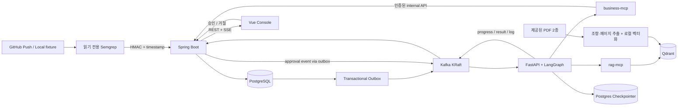

# CSI — Cyber Security Inspector

Vue 3 보안 콘솔과 Spring Boot → Kafka → LangGraph → business-mcp / rag-mcp → PostgreSQL 파이프라인을 구현한 Capstone 프로젝트입니다. **Local Demo가 기본**이며, 정적 분석 결과와 합성 시연 데이터의 출처를 `LOCAL_DEMO`로 표시합니다. 탐지 없는 검사는 전체 시스템의 안전 보증이 아닙니다.

## Lichu 연결

`../Lichu/`는 `ymj9608/Lichu`의 회원가입 검사 대상 앱입니다. 기존 Java 규칙에 Python/FastAPI 규칙을 추가했습니다. `.py` 파일도 읽기 전용 스냅샷, 문자열·주석 마스킹, HMAC 접수, 같은 Kafka/MCP/RAG 경로를 사용합니다. 예시 수정 코드도 파일 언어에 맞춰 제공합니다. Python 규칙 역시 이름·구문 기반이며 전체 데이터 흐름을 증명하지 않습니다.

로컬 실습 실행 및 GitHub Actions의 실제 설정은 `../Lichu/docs/csi/GITHUB_ACTIONS_SETUP.md`에 있습니다. 사내 문서의 기준을 Python 코드에 적용하지만 문서 원문 자체를 Python 지침으로 바꿔 인용하지 않습니다.

```sh
.venv/bin/python scripts/scan_repository.py ../Lichu --repository ymj9608/Lichu
```

이 명령은 현재 Java/Python 파일 내용의 합성 SHA와 `LOCAL_DEMO`를 사용합니다. GitHub Push 검증으로 표시하지 않습니다. `CSI_REPOSITORY_ALLOWLIST`에 `ymj9608/Lichu`를 먼저 추가하고 백엔드를 재생성해야 합니다.

`csi` 저장소 자체의 스캔 워크플로는 `CSI_SCAN_THIS_REPOSITORY=true`일 때만 실행됩니다. 웹사이트의 자동 검사는 `Lichu/.github/workflows/csi-security-scan.yml`이 담당합니다. `CSI_SCANNER_REF`는 이 Python 지원 변경이 포함된, GitHub에 Push한 CSI 커밋의 전체 SHA로 지정하세요.

## 실행

Docker Desktop / Docker Compose, Python 3.11+를 사용합니다.

```sh
python3 scripts/init_env.py
docker compose up -d --build
```

- 웹: http://127.0.0.1:5173
- 계정: `.env`의 `CSI_ADMIN_USERNAME`, `CSI_ADMIN_PASSWORD`. 비밀번호는 설치 시 무작위 생성되며 DB에는 bcrypt 해시만 저장합니다.
- 확인: `docker compose ps`, `docker compose logs --tail=60 backend agent`
- 종료: `docker compose down` (저장 데이터 유지)
- 데이터 삭제 명령은 기본 실행 절차에 포함하지 않습니다.
- 모든 공개 포트는 loopback에 바인딩됩니다. business-mcp, rag-mcp, Agent는 Compose 내부에서만 접근합니다.
- 최초 `rag-index`가 PDF의 실제 청크 47개를 Qdrant에 넣고 종료하면 정상입니다.

## Local Demo

프로젝트별 `.venv`, `.scanner-venv`를 사용합니다. uv가 없다면 Python venv와 pip로 같은 requirements를 설치할 수 있습니다.

```sh
uv venv --python 3.11 .venv
uv pip install --python .venv/bin/python -r agent/requirements.lock.txt
uv venv --python 3.11 .scanner-venv
uv pip install --python .scanner-venv/bin/python -r rules/requirements.txt
.venv/bin/python scripts/demo.py vulnerable
.venv/bin/python scripts/demo.py fixed
```

`demo.py`는 Java 샘플을 실행하지 않습니다. 실제 Semgrep 분석 → 문자열/주석 마스킹 → HMAC 서명 → API 접수 → Kafka → Agent → MCP → 결과 저장을 실행합니다. 같은 Payload를 두 번 전송하여 멱등성을 함께 확인합니다. 취약 샘플은 8건, 수정 샘플은 0건이 예상됩니다. SHA-256 파일 체크섬은 비밀번호 해시 규칙에서 제외됩니다. Commit SHA는 로컬 합성 소스의 SHA-1 식별자이며 실제 GitHub commit이라는 의미가 아닙니다.

격리된 scanner를 별도로 실행할 수도 있습니다.

```sh
mkdir -p .runtime
docker compose --profile tools run --build --rm scanner
```

읽기 전용 코드 마운트, 네트워크 차단, 비루트 사용자, capability 제거, CPU/메모리/PID 제한으로 실행합니다. 결과는 `.runtime/findings.json`에 기록합니다. `CSI_SCAN_TARGET`과 `CSI_SCAN_OUTPUT` 환경변수로 위치를 지정합니다. 대상의 Maven/Gradle/셸 스크립트는 실행하지 않습니다.

## 고정된 네 가지 진단 범위

| 유형 | 검사 규칙 | 사내 정책 | 검사하는 방어 설계 |
|---|---|---|---|
| T1 오프라인 비밀번호 추측 | SEC-01, SEC-02, SEC-04 | POL-04 | 평문 저장 후보, 빠른 해시, bcrypt 비용 12 미만 |
| T2 사전 계산 결과 재사용 | SEC-03 | POL-04 | 하드코딩 Salt 후보 |
| T3 로그를 통한 비밀정보 유출 | SEC-05 | POL-05 | 비밀번호·토큰·이메일 등 로그 인자 |
| T4 미승인 개인정보 처리 | POL-01 | POL-02, POL-03 | 미승인 개인정보 필드 후보와 승인 목록 비교 |

T4는 개별 공격 기법이 아니라 개인정보 처리 정책 이탈 위험입니다. 모든 규칙은 패턴 기반이며 실제 저장·전송 경로 전체를 증명하지 않습니다. 기본 증거 판정은 SUSPECTED, 개인정보 필드 단독 증거는 INSUFFICIENT_EVIDENCE입니다. 검토 상태 OPEN/REVIEWING/RESOLVED는 별도로 관리합니다. 공격·크래킹·침투·자동 코드 수정·운영 배포는 실행하지 않습니다.

## 시스템 구조



`scan.request`, `scan.progress`, `scan.result`, `scan.log`, `scan.dlq`와 Backend DLT를 사용합니다. Backend는 접수 트랜잭션에 검사와 Outbox를 함께 저장한 뒤 202를 반환합니다. Broker 전송은 최대 3회, Agent 실행은 최대 2회, 단일 실행 180초, graph recursion 25, MCP 호출당 15초, 동일 도구·인자 호출 3회 제한입니다. 10분 이상 미완료 작업은 FAILED 처리됩니다. Kafka 실패나 분석 실패를 완료로 바꾸지 않습니다.

`repository + workflowRunId + runAttempt`, `scanId + fingerprint`, Kafka eventId, scan별 approval, approval별 issue에 고유 제약을 둡니다. 메시지는 at-least-once이며 결과 저장 트랜잭션이 완료되기 전에 Kafka offset을 성공 처리하지 않습니다. 다중 Backend/Worker 확장은 MVP 범위 밖입니다.

## LangGraph와 승인

validate_scan에서 business-mcp로 커밋·Repository·영속 상태를 검증하며 이미 FAILED인 검사에 늦게 도착한 요청은 분석 없이 종료합니다.

validate_scan → load_findings → select_analysis_tools → retrieve_internal_policy에서 분기합니다. finding이 없으면 보고서 생성으로 이동합니다. finding이 있으면 규칙별 사내·외부 검색 → Red → Blue → 보고서 저장으로 진행합니다. 개인정보 필드 규칙이 있을 때만 추가 이력을 조회합니다.

분석 보고서는 승인 전에 저장합니다. 후속 조치가 필요하면 승인 카드를 만들고 `interrupt()`로 중단합니다. PostgreSQL Checkpointer의 동일 `thread_id = scanId`에서 `Command(resume=...)`로 재개합니다. Backend가 APPROVED를 확인한 경우에만 business-mcp가 CSI 내부 보안 검토 이슈를 만들 수 있습니다. 거절하면 쓰기 도구를 호출하지 않습니다. 외부 GitHub 이슈 전송 기능은 없으며 UI에도 내부 이슈로 표시합니다.

업무 테이블 `agent_checkpoints`는 승인 단계 요약입니다. LangGraph의 실제 상태는 별도 `checkpoints`, `checkpoint_blobs`, `checkpoint_writes` 테이블에 저장됩니다. business-mcp는 업무 DB에 직접 접근하지 않고 `/internal/**` API만 사용합니다.

## RAG와 사내 문서

`rag/documents/`의 제공 PDF 2종만 주 색인 대상입니다.

- `PG-POL-2026-01`: 가상 사내 개인정보 처리·개발 보안 규정
- `PG-REF-2026-01`: 외부 법령·기술 가이드 참조집. 법령 원문 자체와 구분합니다.

원문에서 bcrypt 최소 비용 **12**, 수집 인벤토리, 민감 로그 제한과 승인 규정을 확인했습니다. 사내 12를 법정 최소값으로 표현하지 않습니다. `account_id`, `email`, `password_hash`와 Java 명명 변형이 저장 승인 목록이며 raw password는 일시 처리만 허용합니다. 전화번호 등은 별도 검토 대상입니다.

```sh
.venv/bin/python scripts/prepare_policy.py
.venv/bin/python -m mcp_servers.index
```

문서 버전·문서 유형·조항 ID/제목·실제 페이지·원본 파일명·원문·chunkId를 보존합니다. 기본 임베딩은 1024차원 문자 n-gram hashing 벡터입니다. 외부 API 없이 재현되는 **어휘 유사도 검색**이며 의미론적 신경망 임베딩으로 주장하지 않습니다. Qdrant cosine 검색을 조항/문서 유형으로 제한합니다. 정책 또는 외부 근거 검색이 누락되면 분석을 실패 처리하고 출처를 지어내지 않습니다. `security://guidelines/{rule_id}` MCP Resource도 제공합니다.

추가 제공된 개인정보 보호법 PDF와 Capstone 자료는 검토·텍스트 추출했지만 주 RAG 색인에는 넣지 않았습니다. 원본 로고 `logo.png`, `csi.png`는 변형 없이 사용합니다.

## LLM 설정과 한계

기본 `LLM_MODE=disabled`는 실제 LangGraph와 MCP를 실행하고 결과를 **RULE_BASED**로 표시합니다. LLM을 호출한 것처럼 표시하지 않습니다. 호환되는 chat-completions API를 연결할 경우 `.env`에 다음을 지정하고 Agent를 재시작합니다.

```dotenv
LLM_MODE=enabled
LLM_BASE_URL=https://your-authorized-provider.example/v1
LLM_API_KEY=replace-locally
LLM_MODEL=your-model
```

외부 LLM에는 코드 원문, 파일 경로, 비밀값, 개인정보 값, PDF 전체 원문을 전송하지 않습니다. 지원된 필드·클래스 이름, 구조화된 정적 사실, 실제 증거 수준, 관련 정책 조항 발췌를 전달합니다. 이 전송 범위를 승인한 환경에서만 LLM을 활성화하세요. 출력은 Pydantic으로 검증하고 기존 Finding ID, 사실 ID, 검색된 문서 ID와 필수 인용을 검증합니다. timeout·키 누락·잘못된 출력·허위 인용 시 규칙 기반 내용으로 돌아가며 **LLM_FALLBACK**을 표시합니다. 단위 테스트와 Lichu LOCAL_DEMO에서 실제 OpenAI 호출을 검증했습니다. 자연어 서술 전체의 사실성을 자동 증명하지는 않습니다. 구현 범위와 검증 방법은 [근거 기반 정책 리뷰](docs/REVIEW_QUALITY.md)를 참고하세요.

## GitHub Push Integration Mode

아직 실제 Repository 및 HTTPS 주소가 지정되지 않았으므로 GitHub Push 연동 완료 상태가 아닙니다.

1. 이 `csi/` 디렉터리를 승인된 CSI 도구 Repository의 루트로 Push합니다. 비밀 파일 `.env`, `.runtime`, 가상환경은 제외합니다.
2. 검사 대상 Repository에 `.github/workflows/csi-security-scan.yml`을 복사합니다.
3. Repository Variables에 `CSI_SCANNER_REPOSITORY=owner/csi-tools`, `CSI_SCANNER_REF=검토된 40자리 commit SHA`를 설정합니다. 도구 Repo는 Runner가 읽을 수 있어야 합니다.
4. Secrets에 `CSI_BACKEND_URL=https://실제접근가능주소`, `CSI_INTEGRATION_SECRET`을 등록합니다. 워크플로는 대상 Repo의 스크립트가 아닌 승인된 CSI 도구 SHA만 실행합니다.
5. Backend `CSI_REPOSITORY_ALLOWLIST`에 대상 `owner/repo`를 넣고 UI에서 프로젝트를 등록합니다.
6. TLS reverse proxy를 통해 `/api/integrations/github/scan-results`를 공개합니다. 일반 UI와 `/internal/**`, Kafka, DB, MCP 포트는 외부 공개하지 않습니다. 공개 환경은 `COOKIE_SECURE=true`와 조직별 인증/권한 정책이 추가로 필요합니다.
7. develop 또는 main Push 후 GitHub Run URL과 CSI Commit SHA가 일치하는지 검증합니다.

Hosted Runner는 PC의 localhost에 접속할 수 없습니다. Fork PR, `pull_request_target`, 대상 빌드 실행은 사용하지 않습니다. Payload는 1MB / 300 findings 한도, HMAC-SHA256과 5분 timestamp 창으로 검증합니다. 성공 여부는 HTTP 202 및 실제 완료 상태로 확인합니다.

## 테스트

```sh
cd backend && mvn test && cd ..
.venv/bin/python -m pytest -q
CSI_TEST_COMPOSE=1 .venv/bin/python scripts/verify_integration.py
 .venv/bin/python scripts/verify_events.py
# 로컬 Kafka를 잠시 중지하고 복원하는 장애 시험 (다른 검사 실행 중에는 피하세요)
.venv/bin/python scripts/verify_failure.py
cd frontend && npm ci && npm run build && npx playwright test
```

Playwright는 로컬 Chrome과 실행 중인 5173 포트를 사용합니다. 테스트는 합성 프로젝트/검사/승인 이력을 생성합니다. `docs/verification.json`에 이 작업에서 실제 확인한 결과를 기록합니다. 실패 시험 이력도 숨기거나 삭제하지 않습니다.

## Harness 8요소

| 요소 | 구현 위치 |
|---|---|
| Instructions | `agent/csi_agent/analysis.py`: 증거 기반 출력, 불확실성, 법률 위반 미확정 |
| Tools | `mcp_servers/business.py`, `rag.py`: 최소 도구와 인증, Resource |
| Context | 검사 당시 정책 snapshot, 마스킹 evidence, 실제 RAG metadata |
| State & Memory | `AsyncPostgresSaver`, scan별 thread, 업무 상태 테이블 분리 |
| Agent Loop | `graph.py` 조건 분기, 규칙별 도구 선택, 개인정보 규칙의 이력 조회 |
| Guardrails | HMAC, CSRF, allowlist, 출력 schema, ID/인용 검증, read-only scanner |
| Recovery | Outbox, 멱등 키, 횟수 제한, DLQ, timeout, LLM fallback |
| Observability | 네 Kafka topic, 구조화된 scan_logs, tool name/latency, SSE |

## 현재 범위

단일 조직의 SECURITY_REVIEWER 계정이 허용 Repository를 관리하는 MVP입니다. 조직별 멀티테넌시·DEVELOPER 프로젝트 ACL·CPO 정책 변경 승인은 아직 구현 범위 밖이며 관련 기능을 제공하지 않습니다. 규칙은 이름/구문 기반으로 명시된 Java 패턴만 지원하며, 전체 프로그램 데이터 흐름·동적 설정·리플렉션·실제 DB 암호화·모든 개인정보 필드를 검증하지 않습니다. 목록은 최근 최대 1,000건을 가져와 클라이언트 필터·페이지 나누기를 적용합니다. 결과 비교는 같은 프로젝트·브랜치의 이전 완료 검사 기준입니다.

UI 구조는 [GitHub Code Scanning](https://docs.github.com/en/code-security/concepts/code-scanning/code-scanning-alerts), [Semgrep finding triage](https://docs.semgrep.dev/for-developers/resolve-findings-through-app), [SonarQube Security Hotspots](https://docs.sonarsource.com/sonarqube-cloud/managing-your-projects/issues/reviewing-security-hotspots), [Snyk Reports](https://docs.snyk.io/manage-risk/reporting/getting-started-with-snyk-reports)의 공식 문서 기능을 참고했습니다. 각 제품 실제 UI를 직접 조작하거나 복제하지 않았습니다.
