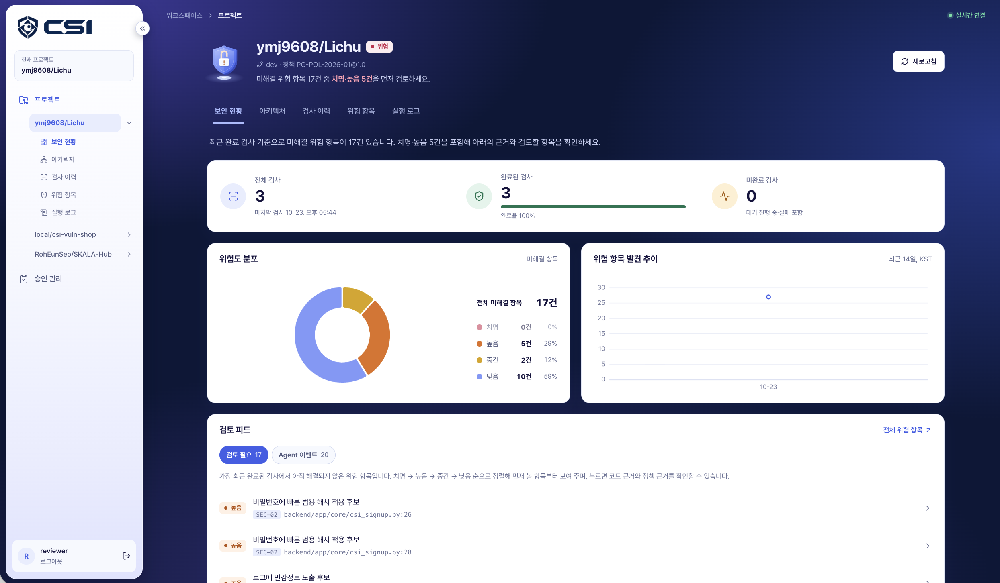
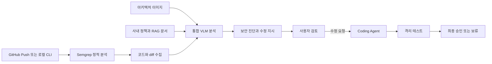

# CSI — Context-aware Security Inspector

> **CSI는 코드 변경을 아키텍처와 사내 정책의 맥락에서 분석해, 근거가 연결된 보안 진단과 실행 가능한 수정 지시를 제공하는 로컬 보안 리뷰 플랫폼입니다.**

<div align="center">

[](https://vuejs.org/)
[](https://www.typescriptlang.org/)
[](https://vitejs.dev/)
[](https://tailwindcss.com/)
[](https://pinia.vuejs.org/)
[](https://spring.io/projects/spring-boot)
[](https://openjdk.org/)
[](https://www.python.org/)
[](https://fastapi.tiangolo.com/)
[](https://www.langchain.com/langgraph)
[](https://ollama.com/)
[](https://semgrep.dev/)
[](https://www.docker.com/)
[](https://kafka.apache.org/)
[](https://www.postgresql.org/)
[](https://qdrant.tech/)

</div>



## 👥 팀원 소개

| PM | AI | AI | Infra | Frontend | Backend |
|:----------:|:----------:|:----------:|:----------:|:----------:|:----------:|
| [](https://github.com/ziihun)<br/><div align="center">박지훈</div> | [](https://github.com/ymj9608)<br/><div align="center">윤명진</div> | [](https://github.com/RohEunSeo)<br/><div align="center">노은서</div> | [](https://github.com/jason663475)<br/><div align="center">최현우</div> | [](https://github.com/Jang-haeun12)<br/><div align="center">장하은</div> | [](https://github.com/mju60213037)<br/><div align="center">이기현</div> |

## 🤔 왜 만들었나요?

- 기존 정적 분석 도구는 위험한 코드 패턴을 빠르게 찾을 수 있지만, 해당 코드가 시스템에서 어떤 역할을 하는지, 조직의 개인정보 처리 정책에 어긋나는지까지 판단하기는 어렵습니다. 코드, 아키텍처, 정책 문서가 서로 분리되어 있어 보안 담당자가 탐지 결과를 다시 해석하고 수정 방향을 정해야 하는 부담도 있습니다.

- CSI는 정적 분석 결과와 코드 변경 내역, 아키텍처 이미지, 사내 정책 및 보안 문서를 한 문맥에서 검토합니다. 분석 결과에는 판단 근거와 자연어 수정 지시가 함께 제공되며, 수정 후보의 생성과 채택은 테스트와 사람의 승인을 거치도록 설계했습니다.


## ✨ 핵심 기능

| 기능 | 설명 |
|---|---|
| 코드 보안 검사 | Semgrep으로 Java·Python 코드의 보안 및 개인정보 처리 후보를 탐지합니다. |
| 맥락 기반 분석 | 코드·diff·아키텍처 이미지·정책 문서 근거를 결합해 VLM이 단계별로 분석합니다. |
| 근거 있는 결과 | 파일과 라인, 정적 사실, 정책 조항 및 문서 인용을 결과에 연결합니다. |
| 변경 리뷰 | 두 Git 커밋의 차이와 새로 발생하거나 유지된 위험 후보를 함께 보여 줍니다. |
| 수정과 검증 | 선택적 Coding Agent가 저장된 지시로 수정안을 만들고 격리된 테스트를 수행합니다. |
| 사람의 통제 | 진단 검토와 코드 반영에 별도의 승인 단계를 두며 처리 이력을 보존합니다. |
| 웹 콘솔 | 프로젝트, 검사 이력, 위험 항목, 정책 근거, 실행 로그와 승인 상태를 조회합니다. |

## ⚙️ 동작 방식



VLM 분석은 다음 세 단계로 수행됩니다.

1. 아키텍처와 데이터 흐름 파악
2. 정적 탐지 결과와 정책 근거를 이용한 보안 판단
3. Coding Agent가 사용할 자연어 수정 지시 생성

검사 결과는 검토 후보입니다. CSI는 취약점 악용 가능성, 법률 위반 여부 또는 시스템 전체의 안전을 자동으로 확정하지 않습니다.

## 🚀 빠른 시작

### 준비 사항

- Docker Desktop 또는 Docker Engine과 Compose v2
- [Ollama](https://ollama.com/)와 로컬 VLM 실행이 가능한 환경
- 샘플 검사를 실행할 경우 Python 3.11

### 1. 저장소와 환경 설정

```sh
git clone --branch dev https://github.com/ymj9608/csi.git
cd csi
python3 scripts/init_env.py
```

`init_env.py`는 `.env`가 없을 때 로컬 비밀번호와 서비스 비밀값을 생성합니다. 기존 `.env`는 변경하지 않습니다. 전체 설정은 [.env.example](.env.example)을 참고하세요.

### 2. 로컬 모델 준비

```sh
ollama pull qwen3-vl:8b-instruct-q4_K_M
```

기본 Agent는 호스트의 Ollama에 연결합니다. 모델이나 주소를 바꾸려면 `.env`의 `CSI_REVIEW_VLM_MODEL`과 `CSI_REVIEW_OLLAMA_DOCKER_URL`을 수정하세요.

### 3. 서비스 실행

```sh
docker compose --project-directory . --env-file .env \
  -f compose.yml up -d --build

docker compose --project-directory . --env-file .env \
  -f compose.yml ps -a

curl -fsS http://127.0.0.1:8080/api/health
```

웹 콘솔은 <http://127.0.0.1:5174>에서 열립니다. `.env`의 `CSI_ADMIN_USERNAME`과 `CSI_ADMIN_PASSWORD`로 로그인한 뒤, 검사할 저장소와 브랜치 및 아키텍처 이미지를 프로젝트에 등록하세요. 프로젝트 등록만으로 검사가 시작되지는 않습니다.

서비스를 종료해도 PostgreSQL, Kafka, Qdrant의 named volume 데이터는 유지됩니다.

```sh
docker compose --project-directory . --env-file .env \
  -f compose.yml down
```

### 4. 샘플 검사

먼저 콘솔에서 `local/csi-demo` / `develop` 프로젝트와 아키텍처 이미지를 등록합니다. 그다음 스캐너 환경을 준비하고 취약·수정 샘플을 실행합니다.

```sh
python3.11 -m venv .venv
.venv/bin/python -m pip install -r agent/requirements.lock.txt

python3.11 -m venv .scanner-venv
.scanner-venv/bin/python -m pip install -r rules/requirements.txt

mkdir -p .runtime
.venv/bin/python scripts/demo.py vulnerable
.venv/bin/python scripts/demo.py fixed
```

검사는 `Semgrep → 서명 접수 → Kafka → Agent → MCP → 결과 저장`의 실제 경로를 사용합니다. 결과와 진행 로그는 웹 콘솔의 검사 상세 화면에서 확인할 수 있습니다.

## 🧩 시스템 구성

| 영역 | 기술과 역할 |
|---|---|
| Frontend | Vue 3, TypeScript, Vite, Pinia, Tailwind CSS, ECharts |
| Backend | Java 21, Spring Boot, Spring Security, Flyway |
| AI·Agent | Python 3.11, FastAPI, LangGraph, Ollama VLM |
| 정적 분석 | Semgrep Java·Python 규칙, 마스킹된 코드 및 diff 수집 |
| 근거 조회 | FastMCP, Qdrant, 사내 정책 및 보안 참조 문서 |
| 비동기 처리 | Kafka, Outbox, PostgreSQL checkpoint, SSE |
| 코드 수정 | 프로젝트별 검증 프로필을 사용하는 선택적 Coding Agent |

주요 디렉터리는 다음과 같습니다.

```text
csi/
├── frontend/        웹 콘솔
├── backend/         API, 인증, 검사·승인 데이터 관리
├── agent/           근거 수집과 통합 VLM 분석
├── coding_agent/    수정안 생성과 프로젝트별 검증
├── mcp_servers/     업무 데이터와 정책 문서 조회
├── rules/           Java·Python Semgrep 규칙
├── rag/             정책 원본과 검색 카탈로그
├── scripts/         환경 설정, 검사, 제출 및 검증 도구
├── tests/           Python 테스트
└── docs/            상세 설계와 검증 기록
```

## 🧪 개발 및 테스트

```sh
.venv/bin/python -m pytest tests -q
mvn -f backend/pom.xml test
npm --prefix frontend ci
npm --prefix frontend run build
```

프론트엔드만 개발 모드로 실행하려면 Backend를 먼저 실행한 뒤 다음 명령을 사용합니다.

```sh
npm --prefix frontend ci
npm --prefix frontend run dev -- --port 5175
```

GitHub Actions 연동에는 공개적으로 접근 가능한 HTTPS Backend 주소와 HMAC 비밀값이 필요합니다. 시작점은 [워크플로 템플릿](.github/workflows/csi-security-scan.yml)을 참고하세요. 데이터베이스, Kafka, MCP 및 내부 API는 외부에 공개하지 않아야 합니다.

## ⚠️ 현재 범위와 한계

- Java·Python의 명시된 구문과 이름 패턴을 중심으로 탐지하며 전체 데이터 흐름을 증명하지 않습니다.
- 아키텍처 이미지와 정책 근거가 없는 신규 통합 검사는 성공 결과로 대체하지 않고 실패 처리합니다.
- 현재는 단일 조직·단일 Worker용 로컬 MVP이며 다중 조직 권한과 고가용성을 지원하지 않습니다.
- 자동 병합, 운영 배포, 외부 GitHub 이슈 생성 및 등록되지 않은 저장소의 범용 자동 수정은 지원하지 않습니다.
- Coding Agent는 등록된 프로젝트별 허용 범위와 고정 테스트 안에서만 동작합니다.
- 분석 결과는 보안 전문가의 검토를 보조하기 위한 것으로 법률 자문이나 안전성 보증이 아닙니다.

## 📚 상세 문서

| 문서 | 내용 |
|---|---|
| [시스템 아키텍처](docs/ARCHITECTURE.md) | 서비스 경계, 승인 흐름, 장애 처리와 품질 설계 |
| [통합 VLM 리뷰](docs/UNIFIED_VLM_REVIEW.md) | 3단계 분석 구조, 입력·출력 계약과 검증 방식 |
| [리뷰 품질](docs/REVIEW_QUALITY.md) | 정적 사실, 정책 대조, 인용과 불확실성 처리 |
| [코드 변경 리뷰](docs/CHANGE_REVIEWS.md) | 커밋 diff와 변경 근거의 생성 및 표시 방식 |
| [Coding Agent](docs/CODING_AGENT.md) | 수정안 생성, 격리 검증과 승인 절차 |
| [Agent Harness](docs/AGENT_HARNESS.md) | 도구 경계, 상태 관리와 복구 설계 |
| [Slack 승인 연동](docs/SLACK_APPROVALS.md) | 선택적 알림과 승인 버튼 설정 |
| [검증 기록](docs/verification.json) | 날짜와 환경이 명시된 기존 실행 검증 결과 |