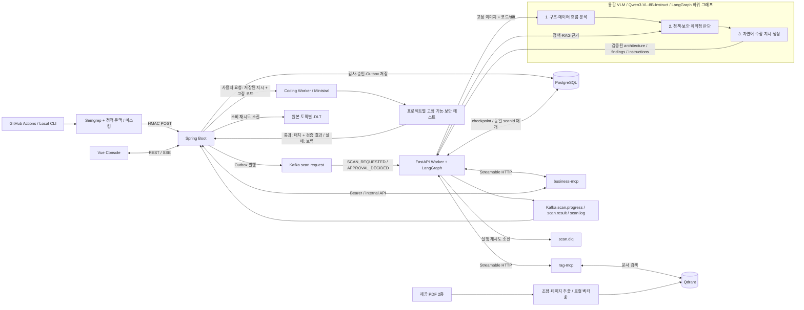
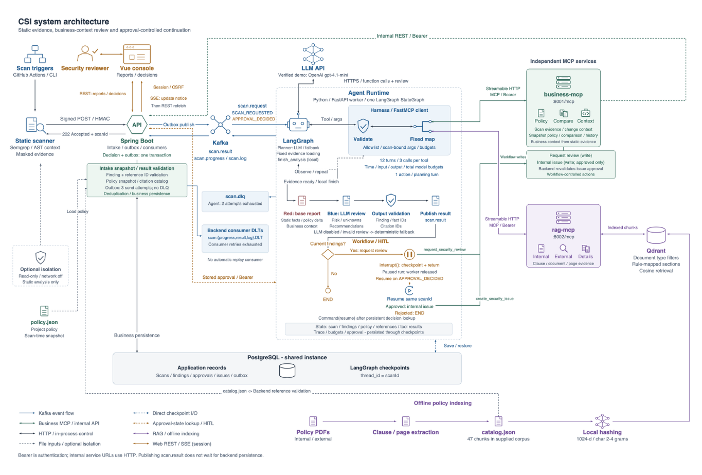
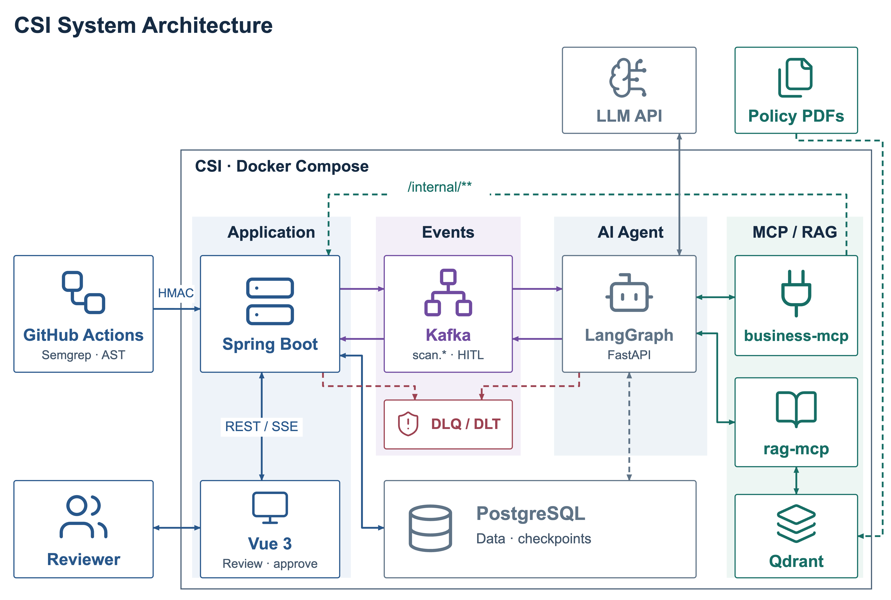
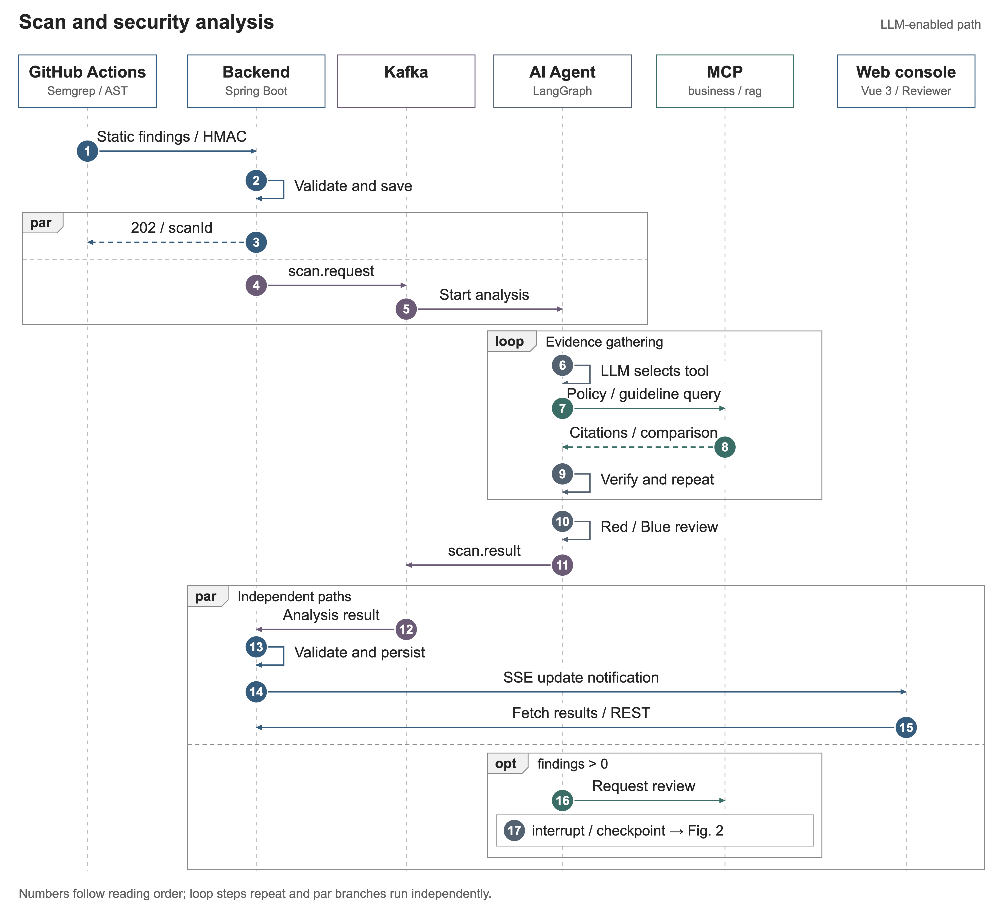
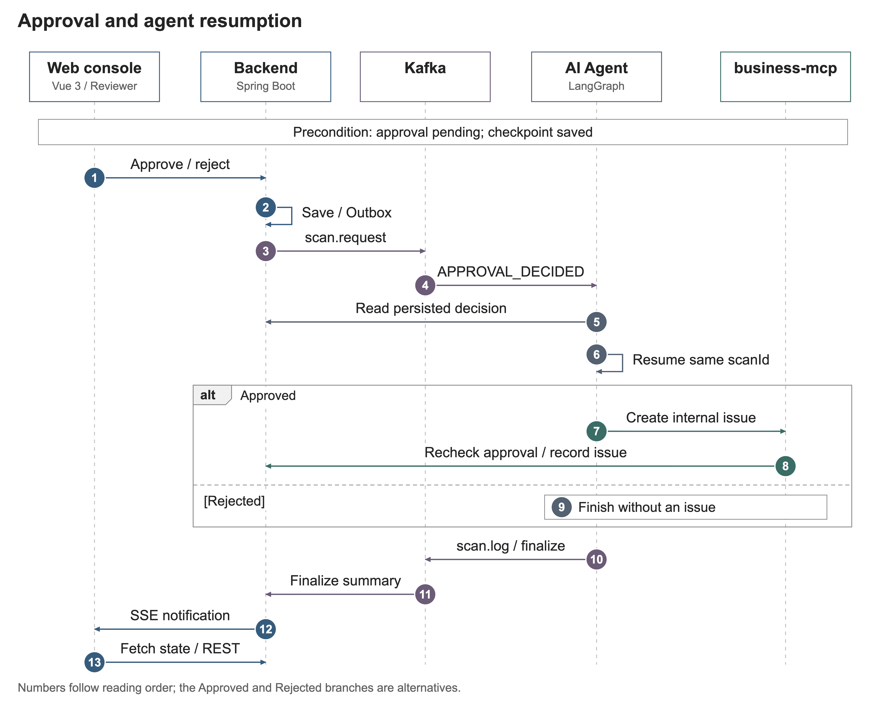

# CSI — Cyber Security Inspector

**코드 변경을 사내 개인정보 처리 정책과 대조하고, 근거가 있는 보안 리뷰를 제공하는 B2B 보안 진단 Capstone 프로젝트입니다.**

GitHub Actions 또는 로컬 스캐너가 Java/Python 코드를 정적으로 검사하면, CSI는 검사 시점의 아키텍처 이미지를 고정하고 MCP로 코드·diff·정책·문서 근거를 수집합니다. **별도 보안 리뷰 LLM 없이 같은 로컬 VLM이 LangGraph의 구조 분석 → 보안 판단 → 자연어 지시 생성 3단계로 화면용 아키텍처 JSON, 근거 기반 진단, Coding Agent용 자연어 수정 지시를 생성**합니다. 사용자가 수정안을 요청하면 Coding Worker는 저장된 지시를 재사용해 코드 생성·격리 검증을 수행합니다.

현재 구현은 **단일 조직·단일 Worker의 로컬 실습 MVP**입니다. 탐지 결과는 검토 후보이며, 취약점 악용 가능성·법률 위반·전체 시스템의 안전을 확정하지 않습니다. 신규 통합 분석은 `VLM`으로 표시하며, 과거의 `LLM`·`RULE_BASED`·`LLM_FALLBACK` 기록은 그대로 조회합니다.

[빠른 실행](#빠른-실행) · [로컬 검사](#로컬-검사와-결과-확인) · [GitHub Actions](#github-actions-연동) · [아키텍처](#시스템-아키텍처) · [Agent·MCP](#agent와-mcp) · [검증](#테스트와-검증) · [한계](#한계와-향후-과제)

## 주요 기능

| 기능 | 현재 구현 |
|---|---|
| 자동 검사 접수 | Actions/CLI의 HMAC 서명 요청, Repository allowlist, 중복 접수 방지, `202 Accepted` |
| 보안·정책 후보 탐지 | Semgrep Java/Python 규칙, 마스킹된 코드 근거, 파일·라인·규칙·증거 수준 |
| 근거 기반 리뷰 | 검사 당시 정책 snapshot, 사내 규정·외부 참조집 검색, 사실·문서 인용 검증, 개선 권고 |
| 코드 변경 리뷰 | 두 Git 커밋의 마스킹된 좌우 diff, 지원하는 Python 선언의 추가·삭제 요약, 연결된 보안 후보 |
| 로컬 코딩 Agent (선택) | 공통 엔진과 프로젝트별 검증 프로필, 고정 커밋의 수정안·근거 생성, 격리 전후 테스트, 별도 관리자 승인. Lichu 바인딩을 예제로 제공합니다. [실행 안내](docs/CODING_AGENT.md) |
| 아키텍처 참고·Slack 알림 (선택) | 저장된 프로젝트 분석의 관련 컴포넌트 후보 조회, 수정안 승인 DM, Socket Mode/HTTP 보안 검토 버튼. [설정과 검증 범위](docs/SLACK_APPROVALS.md) |
| 아키텍처 등록·비전 맥락 | **새 프로젝트 등록에는 이미지 첨부가 필수**입니다. 다음 코드 검사에서 이미지·코드·RAG를 통합 분석하고 JSON을 화면에 표시합니다. 신규 검사는 별도 이미지 Worker나 코딩 이미지 재연결이 필요하지 않습니다. |
| 콘솔 | 프로젝트별 현황, 검사 이력, 위험 항목 상세, 정책 조회, 실행 로그, 검토 상태 변경 |
| 사람의 검토와 실행 통제 | 승인 대기, PostgreSQL checkpoint, 동일 검사 재개, 승인 후 CSI 내부 검토 이슈 생성 |
| 비동기 처리·관측 | Outbox, Kafka, 제한된 재시도, DLQ/DLT, 모델 도구 선택 trace·예산, SSE 갱신 |

주요 기술은 Vue 3·TypeScript·Vite·Pinia·Tailwind CSS·ECharts, Java 21·Spring Boot·Spring Security·Flyway, Python 3.11·FastAPI·LangGraph·FastMCP, Kafka KRaft, PostgreSQL, Qdrant, Semgrep입니다.

## 빠른 실행

### 1. 작업 위치와 환경 설정

처음 설치한다면 아래 명령으로 저장소를 내려받습니다. 이미 내려받았다면 기존 **`csi` 저장소 루트**로 이동하세요. 이후 명령은 별도 안내가 없으면 이 위치를 기준으로 합니다.

```sh
git clone --branch dev https://github.com/ymj9608/csi.git
cd csi
git rev-parse HEAD
```

개발·평가 기준 브랜치는 `dev`입니다. 팀원끼리 재현할 때는 전체 커밋 SHA를 기록하세요. 통합 VLM 3단계 변경은 `feat/unified-vlm-review` 브랜치에 있으며, `dev` 병합 전에는 아래 명령으로 해당 브랜치를 사용합니다. 병합 후에는 위의 `dev` 실행 절차를 사용하면 됩니다.

```sh
git fetch origin
git switch --track origin/feat/unified-vlm-review
git rev-parse HEAD
```

```sh
python3 scripts/init_env.py
```

`init_env.py`는 `.env`가 없을 때 비밀번호와 서비스용 비밀값을 생성합니다. **기존 `.env`는 보존**하며, 빈 값이 있는 기존 파일을 자동 보완하지는 않습니다. 설정 항목은 [.env.example](.env.example)을 참고하세요.

| 환경변수 | 용도 |
|---|---|
| `DATABASE_PASSWORD` | PostgreSQL 비밀번호 |
| `CSI_ADMIN_USERNAME`, `CSI_ADMIN_PASSWORD` | 최초 콘솔 계정 생성. 비밀번호는 DB에 bcrypt 해시로 저장 |
| `CSI_INTEGRATION_SECRET` | 스캐너 요청의 HMAC 서명 검증. 대상 Repository의 Actions Secret과 동일하게 설정 |
| `CSI_INTERNAL_TOKEN` | Agent·MCP·Backend 내부 API 인증 |
| `CSI_REPOSITORY_ALLOWLIST` | 허용할 `owner/repository` 목록. 쉼표로 구분 |
| `CSI_REVIEW_OLLAMA_URL` | 네이티브 Agent의 Ollama 주소. 기본 `http://127.0.0.1:11434` |
| `CSI_REVIEW_OLLAMA_DOCKER_URL` | Compose Agent의 호스트 Ollama 주소. 기본 `http://host.docker.internal:11434` |
| `CSI_REVIEW_VLM_MODEL`, `CSI_REVIEW_VLM_TIMEOUT_SECONDS` | 통합 VLM 모델과 단계별 응답 제한. 기본 `qwen3-vl:8b-instruct-q4_K_M`, 600초 |

로컬 샘플과 Lichu를 함께 검사하려면 `.env`의 해당 항목을 다음과 같이 설정합니다.

```dotenv
CSI_REPOSITORY_ALLOWLIST=local/csi-demo,ymj9608/Lichu
```

`.env`는 Git 추적 대상에서 제외됩니다. 기존 DB에 생성된 계정의 비밀번호는 `.env` 수정만으로 변경되지 않습니다.

### 2. Docker Compose로 전체 서비스 실행

Docker Desktop 또는 Docker Engine과 Compose v2가 필요합니다. **Compose 파일과 빌드·마운트 기준 경로는 저장소 루트**입니다.

```sh
docker compose --project-directory . --env-file .env \
  -f compose.yml up -d --build

docker compose --project-directory . --env-file .env \
  -f compose.yml ps -a

curl -fsS http://127.0.0.1:8080/api/health
```

| 서비스 | 로컬 주소 / 접근 범위 |
|---|---|
| CSI 웹 콘솔 | http://127.0.0.1:5174 |
| Spring Boot API | http://127.0.0.1:8080 |
| PostgreSQL / Kafka / Qdrant | `127.0.0.1:5432` / `127.0.0.1:9092` / `127.0.0.1:6333` |
| Agent / business-mcp / rag-mcp | Compose 내부 전용. 호스트 포트를 공개하지 않음 |

`.env`의 관리자 계정으로 로그인한 뒤 **프로젝트 등록**에서 allowlist에 있는 저장소 이름과 검사할 브랜치, 아키텍처 이미지를 입력합니다. 예제 검사는 `local/csi-demo` / `develop`, Lichu는 실제 Push할 브랜치를 사용합니다. 새 프로젝트·정책·이미지를 함께 저장하며, 첫 이미지는 분석 대기 상태가 됩니다. 등록만으로 보안 스캔이 실행되지는 않습니다. `rag-index`는 카탈로그를 Qdrant에 색인하고 **종료 코드 0으로 종료**하는 일회성 작업입니다.

등록 이미지는 PNG/JPEG 원본 또는 PDF 첫 페이지·WebP/GIF를 변환한 PNG를 분석에 사용합니다. 서버에 전송되는 이미지는 최대 5 MiB·16 MP·한 변 8192 px입니다. 갤러리의 파일 보관과 실제 서버 분석은 별도이므로 분석 상태도 확인하세요.

Compose는 호스트 Ollama와 Coding Worker를 실행하지 않습니다. 먼저 아래 모델 설정과 [Coding Worker 설정](docs/CODING_AGENT.md)을 완료하세요. 신규 통합 검사에서는 `architecture_agent`를 별도로 실행하거나 이미지를 코딩 Agent에 다시 연결하지 않습니다. `local_automation`은 기본적으로 검증 프로필 연결만 관리하며, `--standalone-architecture`는 구형 이미지 전용 경로를 명시적으로 사용할 때만 지정합니다.

```sh
# 오류·진행 상태 확인
docker compose --project-directory . --env-file .env \
  -f compose.yml logs --tail=80 backend rag-index business-mcp rag-mcp agent

# 코드 변경 반영: 이미지 재빌드 및 컨테이너 갱신
docker compose --project-directory . --env-file .env \
  -f compose.yml up -d --build

# 종료: named volume의 검사 이력·DB 데이터 유지
docker compose --project-directory . --env-file .env \
  -f compose.yml down
```

`restart`만으로 이미지에 포함된 코드나 변경된 환경변수가 반영되지는 않습니다. 기존 완료 보고서도 소급 변경되지 않으므로 분석 변경을 확인하려면 새 검사를 실행하세요.

### 3. 프론트엔드만 개발 모드로 실행

Backend와 나머지 서비스는 위 Compose로 실행한 상태에서, Node.js 22와 npm을 사용합니다.

```sh
cd frontend
npm ci
npm run dev -- --port 5175
```

개발 화면은 http://127.0.0.1:5175 입니다. `/api` 요청은 Vite가 `127.0.0.1:8080`으로 전달합니다. 기본 Vite 포트는 5174이므로 Docker 콘솔이나 Lichu가 사용 중이면 다른 포트를 지정해야 합니다.

| 증상 | 확인할 내용 |
|---|---|
| `couldn't find env file` | 현재 위치가 `csi` 루트인지 확인하고 위 Compose 명령 사용 |
| `vite: command not found` / Pretendard import 오류 | `csi/frontend`에서 `npm ci` 실행 |
| `Port 5174 is already in use` | 기존 서버 주소로 접속하거나 개발 서버에 `--port 5175` 지정 |
| 로그인 실패 | 초기 계정의 DB 비밀번호와 현재 입력값 확인. `.env` 변경은 계정 재설정이 아님 |
| 검사 실패 | 같은 scanId의 로그에서 이미지·RAG 누락, Ollama 연결·시간 초과, 출력 검증 실패 확인 |
| 아키텍처 ‘대기 중’ | 등록만으로 검사가 실행되지는 않음. 이미지 등록 후 GitHub Push/CLI로 새 검사 접수 |
| 아키텍처 ‘분석 실패’ | 원인 해결 → **분석 다시 시도**로 대기 상태 준비 → 새 코드 검사 실행. 실패한 검사는 소급 재작성하지 않음 |

아키텍처 모델의 응답 제한은 `CSI_ARCHITECTURE_TIMEOUT_SECONDS`(기본 900초)입니다. 추론·결과 전송 오류는 안전한 오류 코드로 서버에 보고합니다. Worker 강제 종료나 통신 단절로 보고가 누락되면 Backend가 `CSI_ARCHITECTURE_JOB_TIMEOUT_SECONDS`(기본 2100초, 60~7200초 범위)를 넘긴 진행 작업을 실패로 전환합니다. 30초 주기의 점검과 상태 조회 시 확인하며, `QUEUED`는 Worker 실행 전 대기 상태이므로 이 만료 대상이 아닙니다. 재시도는 새 작업 ID를 사용하여 이전 Worker의 늦은 결과를 차단합니다.

## 로컬 검사와 결과 확인

### 스캐너 준비

로컬 CLI와 Python 테스트에는 Python 3.11을 사용합니다. Agent 의존성과 Semgrep 의존성은 별도 가상환경에 설치합니다. 다음 명령도 `csi` 루트 기준입니다.

아래 셸 명령은 macOS/Linux 기준입니다. Windows PowerShell에서는 Python 경로를 `.venv\Scripts\python.exe`로 바꾸고 `$env:PYTHONUTF8='1'`을 설정하세요. 여러 줄 명령의 `\`는 PowerShell 줄 연결 기호가 아니므로 한 줄로 입력합니다. Semgrep 실행 환경은 별도로 준비해야 하며, Python 단위 테스트 통과가 실제 스캐너 실행 성공을 대신하지 않습니다.

```sh
python3.11 -m venv .venv
.venv/bin/python -m pip install -r agent/requirements.lock.txt
python3.11 -m venv .scanner-venv
.scanner-venv/bin/python -m pip install -r rules/requirements.txt
mkdir -p .runtime
```

### 제공 샘플 검사

콘솔에서 **`local/csi-demo` 프로젝트와 해당 샘플의 아키텍처 이미지를 먼저 등록**하세요. CLI는 미등록 프로젝트를 자동 생성하지 않습니다.

```sh
.venv/bin/python scripts/demo.py vulnerable
.venv/bin/python scripts/demo.py fixed
```

합성 Java 샘플을 **실제 Semgrep → 서명 접수 → Kafka → Agent → MCP → 저장** 경로로 검사합니다. 대상 애플리케이션은 실행하지 않습니다. 현재 fixture의 예상 후보는 취약 샘플 8건, 수정 샘플 0건이며 같은 요청의 중복 전송도 확인합니다.

결과는 `LOCAL_DEMO`입니다. 샘플의 합성 SHA는 실제 GitHub commit SHA가 아닙니다.

### Lichu 검사와 커밋 비교

Lichu는 별도 검사 대상 저장소입니다. `csi`와 같은 상위 폴더에 있다고 가정합니다. allowlist 반영 후 Backend를 갱신하고, 콘솔에서 `ymj9608/Lichu`와 아키텍처 이미지를 먼저 등록하세요. 아래 `TARGET_BRANCH`는 실제 검사·Push할 브랜치 이름으로 바꿉니다.

```sh
# 현재 작업 디렉터리의 Java/Python 소스 검사
.venv/bin/python scripts/scan_repository.py ../Lichu \
  --repository ymj9608/Lichu --branch TARGET_BRANCH

# 실제 두 커밋 비교: 두 값을 해당 저장소에 존재하는 40자리 SHA로 교체
.venv/bin/python scripts/scan_repository.py ../Lichu \
  --repository ymj9608/Lichu --branch TARGET_BRANCH \
  --base-sha BASE_FULL_SHA --head-sha HEAD_FULL_SHA
```

첫 명령은 현재 소스 내용의 합성 식별자를 사용합니다. 두 번째는 지정한 Git 커밋의 소스를 읽습니다. **둘 다 로컬 실행이므로 `LOCAL_DEMO`**로 기록합니다.

코드 변경 리뷰는 마스킹된 diff와 정적 선언 사실을 보여 줍니다. Python의 지원 클래스 필드·함수 선언 추가/삭제를 요약하며, Java는 diff와 연결된 탐지 결과를 제공합니다. 임의의 기능 설명을 생성하지 않습니다. 기준 커밋 부재, 잘림, 변경 근거가 없는 과거 검사는 별도 상태로 표시합니다.

화면에서 다음을 확인하세요.

1. **프로젝트 → 검사 이력 → 검사 상세**: scanId, Repository, 브랜치, SHA, 실행 출처, `COMPLETED` / `FAILED`.
2. **코드 변경 리뷰**: 기준·현재 SHA, 파일별 좌우 diff, 선언 변화, 신규·유지·미탐지 후보.
3. **위험 항목 → AI 분석 / 보안 근거**: 정책 대조, 정적 사실, Red/Blue 리뷰, 실제 인용, 도구 선택 주체와 호출 trace.
4. **실행 로그**: 근거 수집, `visual_architecture` → `visual_security` → `visual_instruction`, 결과 저장·실패·재시도 상태. `model_decision`·`context_budget`은 구형 실행 기록에서 확인합니다.
5. **승인 관리**: 승인·거절 결과와 후속 내부 이슈 처리 상태.

다른 팀원이 재현할 때는 검사 결과에 **문서명·조항/페이지·인용 ID**가 붙는지 확인하세요. 코드 파일·라인은 스캐너 근거이고 문서 인용과 구분합니다. 신규 통합 경로는 필수 이미지·문서 근거를 확보하지 못하면 실패 처리하며, 규칙 기반 성공으로 대체하지 않습니다.

같은 브랜치의 이전 완료 검사와 비교하는 기능과, 명시한 두 Git 커밋을 비교하는 기능은 기준이 다릅니다. **이번 검사에서 미탐지된 항목을 자동으로 수정 완료(`RESOLVED`)로 판단하지 않습니다.**

## 로컬 통합 VLM 설정

호스트에 Ollama를 설치하고 모델을 준비합니다. Windows·Mac 모두 같은 HTTP API를 사용합니다. GPU/메모리 여유와 모델 처리 시간을 확인하고 시간 제한은 세 조건을 비교할 때 동일하게 유지하세요.

```sh
ollama pull qwen3-vl:8b-instruct-q4_K_M
ollama pull ministral-3:8b-instruct-2512-q4_K_M
```

```dotenv
CSI_REVIEW_VLM_MODEL=qwen3-vl:8b-instruct-q4_K_M
CSI_REVIEW_OLLAMA_URL=http://127.0.0.1:11434
CSI_REVIEW_OLLAMA_DOCKER_URL=http://host.docker.internal:11434
CSI_REVIEW_VLM_TIMEOUT_SECONDS=600
CSI_SCAN_TIMEOUT_SECONDS=2100
```

```sh
# .env 수정 후 Agent에 반영
docker compose --project-directory . --env-file .env \
  -f compose.yml up -d --no-deps --force-recreate agent
```

VLM 입력은 검사에 고정된 이미지, 마스킹된 코드 근거·제공된 diff, 정책 snapshot, 사내·외부 문서 발췌입니다. 저장소 전체나 PDF 전체가 자동으로 입력되는 것은 아닙니다. 응답은 아키텍처 JSON과 진단·자연어 지시로 검증하여 저장합니다. `LLM_MODE`와 OpenAI 설정은 신규 통합 경로에서 사용하지 않습니다.

JSON은 결과의 저장·전달 형식입니다. Coding Agent가 실행할 수정 지시는 `instructions[].text`에 들어 있는 자연어 문장이며, 호스트가 이 문장과 근거 ID를 꺼내 코드·정책 맥락과 함께 전달합니다. 아키텍처 구성 요소 JSON을 수정 지시 대신 그대로 넘기는 방식은 아닙니다.

이미지 최대 5MiB, Finding 최대 20개, 직렬화 입력 80,000 UTF-8 바이트를 초과하면 조용히 잘라내지 않고 차단합니다. 모델 오류·시간 초과·잘못된 ID/인용도 실패 처리합니다. Agent 실행은 재시도를 포함해 총 1800초·최대 2회 시도이며, 정상 분석을 코딩 요청 때 다시 실행하지 않습니다. 분석 모델 사용 표시는 정확도 보증이 아닙니다.

반복 생성 방어는 스트리밍 중 긴 구절의 연속 3회 반복 감지, Qwen Instruct 권장 샘플링(`temperature=0.7`, `top_p=0.8`, `top_k=20`, `repeat_penalty=1.0`, `presence_penalty=1.5`)·`repeat_last_n=256`, 프롬프트에 명시한 단계별 schema·필드 의미·완결 조건과 인용 검증을 함께 사용합니다. 구조 분석은 출력 2000토큰, 보안·지시 단계는 Finding 수에 따라 2000~6000토큰이며 잘린 응답은 실패로 처리합니다. 자연어 지시 필드의 기존 3000자 한도는 유지합니다. 단계별 토큰·시간은 기존 `analysis.orchestration.trace`에 저장하며 별도 보안 리뷰 Agent는 없습니다. 실패 출력은 Coding Agent에 전달하지 않습니다.

기존 29회 반복은 단일 호출 생성 도중 발생했습니다. 입력 중복을 약 13% 제거해도 반복되었고, 동일 입력에 반복 억제 파라미터를 적용한 한 번의 재시도는 완료되었습니다. 따라서 입력 길이나 리뷰 Agent 제거만을 원인으로 확정하지 않습니다. 단계 분리와 샘플링 조정만으로도 반복이 재현됐습니다. 같은 코드·분석 근거와 생성 옵션에서 출력 schema·필드 의미·종료 조건을 프롬프트에 명시한 재생은 114.98초에 정상 완료됐습니다. 단계 분리는 실패 범위를 줄이는 개선이며, 반복·품질 문제의 완전한 해결을 보장하지 않습니다. [구현 및 검증 기록](docs/UNIFIED_VLM_REVIEW.md)을 참고하세요.

### 기존 설치를 통합 경로로 갱신

구형 분석·코딩 작업이 종료된 뒤 이 변경이 포함된 브랜치를 받아 전체 서비스를 재빌드합니다. Backend 시작 시 **Flyway V13**이 검사별 이미지·분석 저장 테이블을 추가합니다. 기존 DB를 초기화할 필요는 없습니다.

```sh
docker compose --project-directory . --env-file .env \
  -f compose.yml up -d --build
```

호스트에서 실행하는 Coding Worker도 같은 소스로 갱신해 재시작합니다([실행법](docs/CODING_AGENT.md)). 신규 경로 확인은 **새 검사**로 진행하세요. 기존 완료 검사·수정안에는 당시의 분석과 지시를 유지하며, 소스 갱신만으로 과거 결과를 재작성하지 않습니다. 신규 검사에는 별도 아키텍처 Worker가 필요하지 않습니다.

## GitHub Actions 연동

CSI 도구 저장소는 `ymj9608/csi`, 검사 대상 앱은 `ymj9608/Lichu`입니다. GitHub Hosted Runner에서 접근할 **HTTPS 수신 주소와 실행 중인 CSI Backend·Kafka·Agent**가 필요합니다. Actions가 CSI 서버를 대신 실행하거나 배포해 주지는 않습니다.

1. Backend의 `CSI_REPOSITORY_ALLOWLIST`에 대상 저장소를 추가하고 컨테이너를 갱신합니다.
2. CSI 콘솔의 **프로젝트**에서 동일한 `owner/repository`와 기본 브랜치를 등록합니다.
3. 대상 저장소의 **Settings → Secrets and variables → Actions**에서 다음을 설정합니다.

| 구분 | 이름 | 값 |
|---|---|---|
| Variable | `CSI_SCANNER_REPOSITORY` | `ymj9608/csi` |
| Variable | `CSI_SCANNER_REF` | 검토 후 Push한 CSI 스캐너의 **40자리 commit SHA** |
| Variable | `CSI_SCAN_THIS_REPOSITORY` | 이 저장소의 워크플로 템플릿을 그대로 사용할 때 `true` |
| Secret | `CSI_BACKEND_URL` | 접근 가능한 HTTPS 기본 주소. 예: `https://csi-intake.example.com` |
| Secret | `CSI_INTEGRATION_SECRET` | Backend `.env`의 동명 값과 동일한 HMAC 키 |
| Secret | `CSI_SCANNER_READ_TOKEN` | CSI 도구 저장소가 비공개일 때 필요한 읽기 전용 자격 증명 |

`CSI_BACKEND_URL`에는 `/api/integrations/github/scan-results`를 붙이지 않습니다. 전송 스크립트가 이 경로를 추가합니다. 이 값은 대상 저장소의 Actions Secret이며, Compose 내부 서비스용 `http://backend:8080`과 구분합니다.

4. [워크플로 템플릿](.github/workflows/csi-security-scan.yml)을 대상 저장소의 `.github/workflows/csi-security-scan.yml`에 적용합니다. 기존 워크플로가 있다면 다음 항목을 확인합니다.
   - 트리거: 현재 템플릿은 `main`, `develop`, `dev`의 Push와 `workflow_dispatch`.
   - CSI 자체의 불필요한 실행을 막는 opt-in 조건: 그대로 복사했다면 위 `CSI_SCAN_THIS_REPOSITORY=true` 필요.
   - 변경 비교: 대상 checkout의 `fetch-depth: 0`, `CSI_BASE_SHA: ${{ github.event.before }}`, `scan_changes.py`, `CSI_SCAN_FILE: scan.json`.
   - 구버전 `scan.py` + `CSI_FINDINGS_FILE` 방식은 현재 소스 검사만 제공하며 전후 diff를 보내지 않음.
5. HTTPS reverse proxy 또는 실습용 터널을 준비합니다. 공개 수신 경로는 검사 접수 엔드포인트로 제한하고, `/internal/**`, DB, Kafka, MCP를 공개하지 않습니다. 별도 intake proxy를 사용할 경우 그 주소를 연결합니다.
6. 대상 브랜치에 Push한 뒤 Actions의 `Accepted scan`과 scanId를 확인하고, CSI 검사 상세의 Commit SHA·Run URL·최종 상태를 확인합니다.

Hosted Runner는 개발 PC의 `localhost`에 접속할 수 없습니다. 터널 주소가 바뀌면 Secret도 갱신해야 합니다. **Actions의 성공과 HTTP 202는 접수 성공**이며, AI 분석 완료나 보안 통과를 의미하지 않습니다.

워크플로는 승인된 CSI SHA의 스캐너만 실행합니다. 대상 저장소의 빌드·테스트·앱 코드를 실행하지 않으며 Fork PR 및 `pull_request_target`을 사용하지 않습니다. 수신 요청은 HMAC-SHA256, 5분 timestamp 창, allowlist, 1MB payload / 최대 300개 Finding 제한으로 검증합니다.

## 시스템 아키텍처

### 현재 실행 구조

**필수 이미지 등록 → Push/CLI 보안 검사 → 같은 VLM의 3단계 분석 → 결과 저장 → 사용자 요청 → Coding Agent 수정·검증 → 사람 승인** 흐름입니다. 등록만으로 코드 검사를 실행하지 않으며, 코딩 요청 때 이미지를 다시 추론하지 않습니다. 별도 보안 리뷰 모델은 호출하지 않습니다.



세 단계는 각각 필요한 문맥만 받아 실행합니다. 이미지는 1단계에, 정책·문서 발췌는 2단계에, 검증된 분석 결론·수정 범위는 3단계에 전달합니다. 각 단계에 코드 근거를 남겨 앞선 추론을 재검토하며, 실패한 단계만 체크포인트에서 재개합니다.

| 결과 | 저장·사용 방식 |
|---|---|
| 아키텍처 구성 요소 JSON | 기존 `summary`·`components` 형식으로 아키텍처 화면에 표시 |
| 보안 진단·근거 | Finding·사실 ID·문서 인용을 검증한 뒤 위험 항목 화면에 표시 |
| 자연어 수정 지시 | `instructions[].text`를 저장하고 Coding Agent에 그대로 재사용 |
| 수정 코드·검증 기록 | Worker가 프로젝트별 고정 테스트를 실행. 필수 검증 통과 후보만 승인 가능 |

이미지와 분석 결과는 검사별 `scan_visual_reviews`에 고정합니다. 구성 요소 화면용 JSON 저장과 Coding Agent의 자연어 명령 전달은 함께 유지됩니다. [구현 계약과 소스 설명](docs/UNIFIED_VLM_REVIEW.md)을 참고하세요.

<details>
<summary>이전 구현의 상세 그림·요약 구조도</summary>

아래 그림의 별도 LLM 리뷰·모델 도구 선택 루프는 구형 실행 경로입니다. 현재 동작은 위 3단계 흐름을 기준으로 합니다.





</details>

Backend는 검사와 Outbox를 한 트랜잭션에 저장한 뒤 202를 반환합니다. Agent 결과는 Kafka를 통해 Backend가 검증·저장합니다. Vue는 SSE `update` 알림을 받으면 REST API를 다시 조회합니다.

승인 결정도 DB·Outbox에 함께 저장하고 **기존 `scan.request` 토픽**으로 전달합니다. Agent는 Backend의 영속 승인 상태를 직접 재조회한 뒤 동일 `thread_id=scanId`의 checkpoint를 `Command(resume=...)`로 재개합니다.

업무 데이터와 checkpoint는 같은 PostgreSQL 인스턴스에 있지만 책임이 다릅니다. business-mcp는 `/internal/**`만 호출하고 업무 DB에 직접 접근하지 않습니다. Agent의 Checkpointer는 `checkpoints`, `checkpoint_blobs`, `checkpoint_writes`를 직접 사용하며, `agent_checkpoints`는 업무용 단계 요약입니다.

콘솔 API는 Spring Security 세션 쿠키와 CSRF 검증을 사용하며 현재 역할은 `SECURITY_REVIEWER`입니다. 내부 API는 Bearer 인증, 스캐너 접수는 HMAC 인증으로 구분합니다. 로컬 HTTP 실행의 쿠키 설정과 별개로 HTTPS 운영 환경에서는 `COOKIE_SECURE=true`를 설정해야 합니다.

### 품질 기준을 반영한 설계

ISO/IEC 25010:2023의 9개 제품 품질 특성을 **요구사항 → 설계·코드 → 테스트·실행 기록 → 남은 검증**으로 연결했습니다. 이는 품질을 고려한 아키텍처 설계이며, ISO 인증이나 모든 품질 목표의 달성 선언은 아닙니다.

| 품질 관점 | CSI의 설계 선택 | 검증 범위 |
|---|---|---|
| 기능 적합성·보안성 | 실제 Finding·문서 인용 검증, 인증 경계·마스킹·읽기 도구 allowlist | 샘플·경계 테스트 및 과거 인증 통합 검증. 탐지 정확도·종합 공격 대응 평가는 남음 |
| 성능 효율성·신뢰성 | 비동기 접수, Outbox·멱등성, 호출 예산·유한 재시도·checkpoint | 예산 테스트와 과거 승인/장애 검증. p95 지연·비용·프로세스 강제 종료 후 복구는 미측정 |
| 호환성·상호작용 능력 | 검증된 API/MCP 계약, 구버전 검사 조회, SSE·근거·불확실성 표시 | 계약 테스트와 과거 화면 E2E. 클라이언트 호환 행렬·접근성 평가는 부족 |
| 유지보수성·유연성 | 규칙·프롬프트·서비스 분리, 회귀 테스트, Compose·환경 변수 | 로컬 테스트·배포 기록. 다중 Worker·고가용성·환경별 재현은 별도 검증 필요 |
| 안전성 | 기존 리뷰 승인은 내부 이슈 생성. 선택적 코딩 Worker는 격리 테스트·별도 승인·커밋 검증 후 새 worktree 준비 | 승인/거절 및 제한된 Lichu 검증. 정식 위해 분석이나 안전성 보증은 아님 |

[품질 요구사항과 설계 검증](docs/ARCHITECTURE.md#품질-요구사항과-설계-검증)에 QA-01–09의 코드·검증 근거, 판별 기준과 다음 측정 계획을 정리했습니다. 2011판과 2023판의 용어 차이, 테스트 대역과 실제 서비스 검증의 구분도 포함합니다.

### 기존 실행 시퀀스 참고

원 안의 번호는 그림을 읽는 순서입니다. `loop` 단계는 반복하며 `par` 영역의 경로는 독립적으로 진행하므로, 번호가 모든 이벤트의 엄격한 실행 순서를 의미하지는 않습니다.

<details>
<summary>1. 검사 접수와 보안 분석</summary>

구형 LLM 경로의 도구 선택·MCP 근거 수집을 포함한 그림입니다. 신규 경로는 위의 고정 근거 수집·VLM 3단계로 대체됐으며, 결과 발행·Backend 저장·SSE 재조회와 Finding 승인 대기 경로는 유지됩니다.



[검사·분석 시퀀스 원본 PNG](docs/diagrams/csi-sequence-scan-analysis.en.color.png)

</details>

<details>
<summary>2. 승인 결정과 Agent 재개</summary>

저장된 승인 결정을 같은 `scan.request` 토픽으로 전달한 뒤, Agent가 결정을 재조회하고 동일 scanId에서 재개합니다. 승인 시 Backend의 재검증을 거쳐 내부 이슈를 만들고, 거절 시 이슈 생성 없이 종료합니다.



[승인·재개 시퀀스 원본 PNG](docs/diagrams/csi-sequence-approval-resume.en.color.png)

</details>

## Agent와 MCP

### Agent 실행 구조

**LangGraph는 작업 상태·근거 수집·승인을 관리하며, 별도 보안 리뷰 LLM은 호출하지 않습니다.** 동일한 VLM이 필요한 문맥을 단계별로 받아 통합 판단하고, Coding Worker는 검증된 자연어 지시를 재사용합니다.

| 단계 | 수행 내용 |
|---|---|
| 검사 검증·초기 근거 로드 | Repository·SHA·상태 검증, Finding 조회, 변경 근거가 있으면 `get_scan_changes` 호출 |
| 고정 근거 수집 | 호스트가 정책·코드 변경·검사 이미지·규칙별 RAG를 MCP로 조회. 모델의 추가 도구 선택 루프 없음 |
| 입력 조건 검증 | 이미지·정책·규칙별 사내 및 외부 문서 근거가 필수. 누락/한도 초과 시 실패 |
| VLM 통합 판단 | 구조·데이터 흐름 → 정책·취약점 → 자연어 지시. 각 응답을 검증한 뒤 기존 JSON 계약으로 합성 |
| 결과 발행 | `scan.result`의 `visualReview`를 Backend가 커밋·이미지 해시·인용과 대조하고 저장 |
| 수정안 생성 | 사용자 요청 후 저장된 지시를 Coding Worker에 전달. 테스트 실패 피드백으로 최대 2회 생성 |
| HITL | 현재 Finding이 있으면 검토 요청 후 `interrupt()`. 승인 시 내부 이슈 생성, 거절 시 이슈 생성 없이 종료 |

초기 근거 조회와 승인 요청은 호스트가 수행합니다. VLM 응답으로 도구 실행·권한 변경·승인을 수행하지 않습니다. 테스트 결과는 모델의 자기 보고가 아니라 검증 Worker의 실제 실행 결과입니다.

보고서 생성과 후속 승인 상태는 별개입니다. 검사 결과를 발행한 후 승인을 기다리므로 **검사 완료와 승인 대기가 동시에 표시될 수 있습니다.** 기존 LangGraph 승인 대상은 **CSI 내부 보안 검토 이슈 생성**입니다. 선택적 [코딩 Agent](docs/CODING_AGENT.md)는 위험 항목의 분석 확인 후 수정안 생성·근거 확인·승인/거절로 이어지며, 승인만으로 코드가 병합되거나 배포되지는 않습니다.

신규 검사의 지시는 검사 시점의 이미지와 커밋에 고정됩니다. 이후 이미지를 바꾸어도 기존 수정안에 새 분석이 섞이지 않습니다. 기존 검사만 이전 `vlm-orchestrator-v1` 경로를 유지하며, 신규 `unified-vlm-review-v1`은 이미지 재추론 없이 저장된 지시를 표시합니다.

### MCP 서버

| 서버 | 도구 / 리소스 | 데이터 경로 |
|---|---|---|
| `business-mcp` | `get_scan_context`, `get_scan_findings`, `get_scan_changes`, `get_scan_visual_input`, `get_privacy_policy`, `get_scan_history`, `compare_policy_with_findings`, `request_security_review`, `create_security_issue` | Backend의 내부 API. 이미지 snapshot 조회, 이슈 생성 시 승인 상태 재검증 |
| `rag-mcp` | `search_internal_privacy_policy`, `search_security_guidelines`, `get_guideline_details`; Resource `security://guidelines/{rule_id}` | Qdrant에서 문서 유형·규칙별 조항 필터와 유사도 검색 |

두 서버는 FastMCP 기반의 독립 서비스이며 Compose에서는 `http://business-mcp:8001/mcp`, `http://rag-mcp:8002/mcp`로 연결합니다. Bearer는 인증 방식이며 내부 통신을 HTTPS로 암호화한다는 의미는 아닙니다.

도구 선택 → Harness 검증 → FastMCP 라우팅과 승인 후 쓰기 경로는 [MCP 라우팅 상세도 v5 (PDF)](docs/diagrams/CSI_MCP_Routing_Visual_v5.pdf)에서 확인할 수 있습니다.

### Harness와 복구

| 요소 | 구현 |
|---|---|
| Instructions | [visual_stages.py](agent/csi_agent/visual_stages.py)의 단계별 프롬프트와 [visual_review.py](agent/csi_agent/visual_review.py)의 기존 결과 계약 |
| Tools | 명시적 도구 목록, 인자 검증, scanId 주입, 읽기/변경 annotation |
| Context | 정책 snapshot·정적 사실·검색 근거, 공유 인용 사전, 배치 및 요청·누적 예산 |
| State & Memory | PostgreSQL Checkpointer, scan별 상태·도구 trace·예산 저장 |
| Agent Loop | 고정 근거 조회 → 구조 분석 → 보안 판단 → 자연어 지시 → 검증·저장 → 사용자 요청 시 코딩·테스트 최대 2회 |
| Guardrails | 출력 schema, Finding·사실·문서 ID 검증, 승인 재검증, 마스킹·읽기 전용 분석 |
| Recovery | Outbox, 멱등 처리, 유한 재시도, timeout, 명시적 실패, DLQ/DLT |
| Observability | Kafka 이벤트, 도구 선택 주체·호출 결과·예산 로그, 보고서 trace, SSE |

신규 경로에는 모델 도구 선택 12턴 루프가 없습니다. VLM 단계별 응답 제한은 기본 600초(30~900초 설정), 전체 Agent 실행은 재시도 포함 1800초·최대 2회입니다. 체크포인트에서 실패한 단계만 다시 실행합니다. 예전 planner/reviewer와 관련 테스트는 과거 계약 회귀 검증용으로 남아 있으며 신규 `graph.py`는 호출하지 않습니다. [기존 Agent Harness](docs/AGENT_HARNESS.md)의 180초·fallback 설명은 구형 경로 기준입니다.

Outbox 전송은 최대 3회 시도하며, Kafka 메시지는 중복될 수 있다는 전제로 eventId·검사·Finding·승인·이슈에 멱등 처리를 적용합니다. `scan.dlq`와 Backend의 `scan.progress.DLT`, `scan.result.DLT`, `scan.log.DLT`는 자동 재처리하지 않습니다. 장기 미완료 검사와 승인 재개 실패는 별도로 다룹니다.

## 진단 범위와 정책 근거

| 위험 유형 | 규칙 | 정적 검사 대상 |
|---|---|---|
| T1 비밀번호 추측 위험 | `SEC-01`, `SEC-02`, `SEC-04` | 평문 저장 후보, 비밀번호에 빠른 해시 사용, 사내 기준 미만 bcrypt 설정 |
| T2 사전 계산 결과 재사용 위험 | `SEC-03` | 고정 Salt 후보 |
| T3 로그를 통한 정보 유출 | `SEC-05` | 비밀번호·인증 토큰·일부 개인정보를 로그 인자로 전달하는 패턴 |
| T4 개인정보 처리 정책 이탈 | `POL-01` | 개인정보 필드 후보와 승인·제한·일시 처리 목록 비교 |

T4는 개별 공격 기법이 아니라 정책 이탈 위험입니다. SHA 계열 사용 자체를 취약점으로 확정하지 않습니다. bcrypt 최소 비용 **12는 제공된 사내 실습 정책의 기준**입니다.

보안 규칙의 기본 증거 판정은 `SUSPECTED`, 개인정보 필드 후보는 `INSUFFICIENT_EVIDENCE`입니다. `MEDIUM` 신뢰 수준은 정적 규칙의 기본값이며 확률이나 LLM 점수가 아닙니다. `OPEN`·`REVIEWING`·`RESOLVED`는 별도의 검토·조치 상태입니다.

RAG의 주 색인은 [rag/documents](rag/documents)의 **PrivacyGuard PDF 2종, 현재 카탈로그 47개 청크**입니다.

- `PG-POL-2026-01`: 가상의 사내 개인정보 처리·개발 보안 규정.
- `PG-REF-2026-01`: 외부 법령·보안 기술 가이드 참조집. 법령 원문이나 OWASP 원문 corpus와 구분합니다.

문서 유형·버전·조항·실제 페이지·원문·chunkId를 보존합니다. 벡터는 1024차원 문자 2–4 gram hashing이며, Qdrant cosine 검색을 사용합니다. 외부 임베딩 API나 신경망 기반 의미 검색은 사용하지 않습니다.

```sh
# PDF 변경 시: 카탈로그 추출과 벡터 색인은 별개
.venv/bin/python scripts/prepare_policy.py
.venv/bin/python -m mcp_servers.index
```

위 색인 명령은 실행 중인 로컬 Qdrant를 사용합니다. 컨테이너의 카탈로그도 갱신하려면 이미지 재빌드 후 `rag-index`를 다시 실행해야 합니다. 문서를 바꿀 때는 [rag/policy.json](rag/policy.json), 추출 스크립트의 구조화 정책, 스캐너 규칙도 함께 검토해야 하며 PDF 교체만으로 새 정책을 자동 해석하지 않습니다.

추가 법률 PDF·Capstone 자료는 주 색인 대상이 아닙니다. 원문·검색 결과에 없는 출처를 만들어 인용하지 않으며 사내 정책을 법령과 동일한 권위로 취급하지 않습니다.

## 테스트와 검증

`csi` 루트에서 실행합니다. Python 테스트는 위 가상환경과 Semgrep 설치가 필요하고, Backend 테스트는 JDK 21·Maven 3.9, Frontend 빌드는 Node.js 22를 사용합니다.

```sh
mkdir -p .runtime
.venv/bin/python -m pip install -r coding_agent/requirements.txt -r slack_bot/requirements.txt
.venv/bin/python -m pytest tests -q
mvn -f backend/pom.xml test
npm --prefix frontend ci
npm --prefix frontend run build
```

Python 테스트는 마스킹·실제 Semgrep 규칙·정책 근거·모델 출력 검증·도구 선택 반복과 한도·승인 재개·변경 비교를, Spring 테스트는 접수와 구조화 근거 검증을 다룹니다. 로컬 샘플 검사는 실제 서비스 간 연결을 확인하는 별도 절차입니다.

브라우저 E2E는 [Playwright 설정](frontend/playwright.config.ts)에 따라 **CSI가 5174에서 실행 중**이고 로컬 Chrome이 설치되어 있어야 합니다.

```sh
cd frontend
npm run test:e2e
```

전체 E2E에는 실제 DB 데이터가 필요한 테스트와 API를 모의 처리하는 테스트가 함께 있습니다. 콘솔 테스트에는 프로젝트·여러 위험 항목·LLM 도구 선택이 기록된 완료 검사가 필요합니다. 변경 리뷰 테스트는 Lichu 전화번호 추가/수정 시나리오와 변경 근거가 없는 과거 검사에 의존하며, `CSI_CHANGE_ADDED_SCAN`, `CSI_CHANGE_FIXED_SCAN`에 해당 scanId를 지정하지 않으면 건너뜁니다. 상세 데이터 조건은 [테스트 코드](frontend/e2e)와 [변경 리뷰 문서](docs/CHANGE_REVIEWS.md)를 참고하세요.

### 통합 VLM 3단계 재검증 (2026-10-25)

로컬의 미푸시 통합 분석 코드를 기준으로 **구조·데이터 흐름 → 보안 판단 → 자연어 수정 지시**를 기존 LangGraph의 하위 그래프로 분리했습니다. 외부 흐름은 VLM → Coding Agent이며 모델, 화면용 JSON, 자연어 지시, Coder 수정·검증 로직과 8개 평가 항목은 유지했습니다. 단계별 schema를 프롬프트에도 명시하고, 출력 상한·스트리밍 반복 감지·인용 검증·체크포인트 재개를 적용했습니다.

**반복 원인을 입력 토큰 수 하나로 확정하지 않았습니다.** 중복 입력 제거, 단계 분리, 샘플링 조정만 적용한 예비 실행에서도 반복이 재현됐습니다. 출력 필드의 의미·종료 조건을 명시한 동일 입력 재생은 정상 종료했고, 최종 3조건 실행의 VLM **9단계 호출 모두 반복 없이 정상 종료**했습니다. 기존 반복 원문을 새 검출기로 재생했을 때도 같은 문단의 3회 연속 반복에서 감지했습니다. 이는 조건별 1회 관찰이며 반복이 영구히 제거됐다는 보증은 아닙니다.

| 입력 조건 | 최고 후보 | 최종 후보 | 전체 시간 | 8개 필수 항목 충족 |
|---|---:|---|---:|---|
| 전체 코드 | 5/8 | 테스트 로딩 오류 | 873.4초 | 미충족 |
| 코드 + 구조화 텍스트 | 6/8 | 테스트 로딩 오류 | 809.0초 | 미충족 |
| 코드 + 이미지 | 6/8 | 6/8 | 1,137.3초 | 미충족 |

소스·설정·문서·이미지·고정 테스트 및 Coder 설정의 동일성을 해시로 확인했습니다. 원본 5/8, 정답 대조군 8/8이며 모델에는 정답·테스트 소스를 제공하지 않았습니다. 시간 제한 없이 실행하되 출력·반복·재시도 한도는 유지했습니다. 모듈 로딩 오류는 0/8이 아닌 **검증 미실행**으로 구분합니다.

**안정성 개선을 수정 정확도 개선으로 해석하지 않습니다.** 세 조건 모두 정상 경로와 직접 호출의 유출 차단에 실패했습니다. VLM이 실패 경로만 수정하도록 잘못 지시한 사례와 Coder가 존재하지 않는 모듈을 가져온 오류가 함께 있어, 실패를 Coding Agent 하나의 원인으로 돌릴 수 없습니다. 이미지와 구조화 텍스트는 동일한 6/8이므로 이 실행에서 이미지 고유의 우위를 확인하지 못했습니다. 이전 16조건의 8/8 사례는 아래의 역사적 결과이며 이번 통합 경로의 성능으로 재사용하지 않습니다.

[실제 지시·8개 항목·단계별 토큰/시간](docs/benchmarks/unified-vlm-fanout-20261025-staged-v3/RESULTS_KO.md) · [계약 보존 확인](docs/benchmarks/unified-vlm-fanout-20261025-staged-v3/contract-preservation.json) · [원인 검토·구현·재현 방법](docs/UNIFIED_VLM_REVIEW.md)

최신 코드의 기능 회귀는 **Python 504 통과·3 건너뜀·2 제외**, Backend **80 통과**, 독립 PostgreSQL 연동 **4 통과**, Playwright **29 통과**, Frontend 빌드 성공이다. Python 전체는 최종 프롬프트 적용 후 재실행했다. Backend·화면 검사는 해당 코드 변경 후 실행했으며 이후 VLM 내부 프롬프트만 보완했다. 실제 Semgrep 별도 마커와 선택 Docker 통합 검사는 이번 실행 범위에서 제외했다. [검증 기록](docs/testing/unified-vlm-staged-validation.json)을 참고한다.

### 통합 전 구현 점검 (2026-10-25)

| 검증 범위 | 결과 | 확인한 내용 |
|---|---|---|
| Backend 일반 테스트 | 79개 통과 | 등록·출력 검증·권한 경계·실패 보고·늦은 결과 차단 |
| Python 테스트 (실제 스캐너 제외) | 457개 통과·3개 건너뜀 | Agent·근거·권한·수정 범위·검증·실패 처리. 모델 요청은 모의 처리 |
| Worker 결과 파일 보안 추가 테스트 | 2개 통과 | 한글 UTF-8 저장, 사용자 전용 권한, 권한 설정 실패 시 기존 기록 보존 |
| 등록·이미지 연결·실패 재시도 화면 테스트 | 9개 통과 | PNG/PDF 업로드·코딩 연결, 실패 후 폴링 종료·재시도. API 모의 처리 |
| 실제 PostgreSQL 통합 테스트 | 3개 통과 | 임시 DB에서 V1~V12 적용, 분석 만료·작업 ID 교체·늦은 응답 차단 및 버전형 이미지 연결 |
| Frontend 빌드 | 통과 | TypeScript 검사·프로덕션 번들 생성. 번들 크기 경고는 남음 |

[교재 기준 점검·실행 명령·검증 범위](docs/testing/course-implementation-validation.json)를 함께 보세요. Windows에서 실행했으며 Mac 실장비와 실제 모델 추론, 전체 서비스의 새 clone→출처 포함 응답 및 영상 재현은 이번 점검에 포함하지 않았습니다. Python 본 검사에서 실제 Semgrep 테스트 2개는 제외했고, Windows 심볼릭 링크 권한이 필요한 2개와 명시적 Docker 통합 테스트 1개는 건너뛰었습니다. 추가 파일 보안 테스트 2개는 본 검사 후 별도 실행했습니다. 이 결과는 모델 성능 점수나 전체 종단 간 성공률이 아닙니다.

아키텍처 실패 처리 변경을 적용하려면 Backend를 재빌드·재시작하여 **Flyway V12**를 적용한 뒤 Frontend·아키텍처 Worker도 갱신하세요. 기존 DB를 초기화할 필요는 없습니다. API와 시간 제한은 [아키텍처 API](docs/ARCHITECTURE_API.md#업로드-이미지-분석의-실패재시도)에 설명되어 있습니다.

제출 전에는 로그인 정보 없는 브라우저에서 [저장소](https://github.com/ymj9608/csi)가 열리는지, `git ls-files -- .env`가 비어 있는지도 확인하세요. 2026-10-25에는 공개 접근과 `main`·`dev`의 `.env` 미포함을 확인했습니다. `init_env.py`가 **clone 후 로컬에 생성하는 `.env`**는 정상이며 업로드 대상이 아닙니다. `.env`와 비밀값이 보이는 터미널·화면은 제출 영상에 포함하지 않습니다.

### 구현 검증 범위와 제출 전 확인

아래 표는 최신 구현의 검증 근거와 실제 실행에서 추가로 확인할 범위입니다. 위의 통합 VLM 회귀·실모델 기록을 우선 적용합니다.

| 기준 | 코드·검증 근거 | 남은 확인 |
|---|---|---|
| C1 핵심 시나리오 | 등록·이미지 연결 UI, 통합 VLM 단계·지시 재사용, 수정·검증·승인 상태 전이 테스트 | 실제 모델을 포함한 서비스 전체 실행 및 다른 팀원의 빈 폴더 재현 |
| C2 출력 규격·출처 | [근거·인용 검증](tests/test_review_quality.py), [추출 스키마](architecture_agent/schema.py), Backend 결과 검증 | 실제 화면의 문서명·페이지·인용 ID와 원문 대조 |
| C3 예외 처리·보류 | [근거 부족](tests/test_agent_missing_evidence.py), [Worker 실패](tests/test_architecture_worker_routing.py), [권한 경계](backend/src/test/java/com/csi/ArchitectureDiagramSecurityTest.java) | 실제 모델 장애·중단 복구 및 실패 시연 영상 |
| C4 실행·출처·보안 | 실행 명령, RAG 원본·카탈로그, 이미지 내용 검사, 세션·CSRF·내부 Bearer, Windows/POSIX 결과 파일 권한 | 공개 제출 커밋, `.env` 미추적, 제출 영상의 비밀값 미노출 최종 점검 |

- **평가셋:** 교재는 10문항 이상(권장 20문항)을 요구합니다. 아래 대표 실험의 8개 테스트만으로 이 기준을 충족했다고 주장하지 않습니다. 입력 방식 4종이나 반복 실행을 서로 다른 평가 문항으로 세지 않습니다. 부족한 문항은 같은 고정 평가셋으로 전후 실행하고 실패 사례까지 기록해야 합니다.
- **역할·기여:** README의 실명 역할표와 각 팀원의 병합 PR 근거가 필요합니다(교재 11쪽). 담당자와 PR을 확인하기 전 임의로 배정하지 않습니다.
- **재현·산출물:** 작성자가 아닌 팀원의 clone→실행→출처 포함 답변 확인, 3분 이내 핵심·실패 영상, 동일 평가셋 수치의 검증서·발표자료 일치 확인은 별도로 남아 있습니다.

### 검증 결과서 기준 실험 결과

2026-10-24에 수행한 `windows-vlm-20261024-v3` 중 **동시 전송 소규모 사례(`fanout-small`, 소스·설정 파일 5개)**의 결과입니다. VLM은 `Qwen3-VL-8B-Instruct`, Coding Agent는 `Ministral-3-8B-Instruct-2512`를 사용했습니다. 두 모델 모두 Ollama의 Q4_K_M 양자화로 실행했으며, 프롬프트에는 별도 버전 번호를 기록하지 않았습니다. [실험 조건](docs/benchmarks/windows-vlm-20261024-v3/README.txt)과 [모델·실행 범위](docs/benchmarks/windows-vlm-20261024-v3/MODEL_CONTEXT.txt)를 참고하세요.

**동일 평가셋의 개선 전·후 비교:** 취약 원본과 코드+이미지 조건의 2차 수정안에 동일한 기능·보안 테스트 8개를 적용했습니다. 전후 `test_contract.py`의 SHA-256이 같으며, 테스트 항목을 줄여 얻은 결과가 아닙니다.

| 구분 | 평가 대상 | 통과 수 | 충족률 |
|---|---|---|---|
| 개선 전 | 취약 원본 코드 | **5/8** | **62.5%** |
| 개선 후 | 코드+이미지 조건의 2차 수정안 | **8/8** | **100%** |

결과: **개선 전 5/8 → 개선 후 8/8 (충족률 62.5% → 100%, 평가셋 v3)**. 외부로 전화번호가 전달되는 정상 경로·실패 경로·직접 호출의 3개 실패 항목을 해결하고, 나머지 5개 항목의 통과를 유지했습니다. 근거는 [수정 전 검증 기록](docs/benchmarks/windows-vlm-20261024-v3/controls/fanout-small/original/validation.json), [수정 후 검증 기록](docs/benchmarks/windows-vlm-20261024-v3/pilot/fanout-small/image_search/candidate-2/validation.json), [고정 테스트](docs/benchmarks/windows-vlm-20261024-v3/controls/fanout-small/original/test_contract.py)입니다.

**입력 방식별 비교:** 아래는 같은 사례에서 각 입력 방식이 생성한 두 수정안 중 **더 많은 테스트를 통과한 후보**의 결과입니다. 위의 개선 전 5/8은 취약 원본 점수이며, 아래 코드 검색의 5/8과는 평가 대상이 다릅니다.

| 검증 항목 | 전체 코드 | 코드 검색 | 코드 + 구조화 텍스트 | 코드 + 이미지 |
|---|---|---|---|---|
| 내부 SMS | 오류 | 오류 | 통과 | 통과 |
| 정상 경로 유출 차단 | 통과 | 통과 | 통과 | 통과 |
| 실패 경로 유출 차단 | 통과 | 통과 | 실패 | 통과 |
| 회원 정보 보존 | 통과 | 통과 | 통과 | 통과 |
| 복구 기록 보존 | 통과 | 통과 | 통과 | 통과 |
| 정상 전송 유지 | 통과 | 통과 | 실패 | 통과 |
| 장애 진단 유지 | 통과 | 실패 | 통과 | 통과 |
| 직접 호출·원본 보존 | 통과 | 실패 | 통과 | 통과 |
| **통과 수** | **7/8** | **5/8** | **6/8** | **8/8** |

선택된 후보는 전체 코드·구조화 텍스트·이미지 조건의 2차 후보와 코드 검색 조건의 1차 후보입니다. 코드 검색의 최종 2차 후보는 0/8이므로, 최종 후보를 기록한 [comparison.csv](docs/benchmarks/windows-vlm-20261024-v3/comparison.csv)와 최고 후보 기준 표를 구분해야 합니다. [후보별 원시 기록](docs/benchmarks/windows-vlm-20261024-v3/pilot/fanout-small)에서 확인할 수 있습니다.

전체 실험은 16조건이며, 위 표는 그중 선택한 소규모 사례의 4가지 입력 조건입니다. 각 조건은 1회 실행했으므로 이 결과만으로 Vision의 일반적인 우수성이나 독립적인 효과를 확정하지 않습니다. 또한 별도 실험 실행기의 결과이며, CSI 서비스 전체의 종단 간 성공률은 아닙니다.

검증 결과서의 기능 테스트(TC-01~05)는 모의 응답으로 허용 범위, 검증 실패 시 코드 제공·승인 차단, 시간 초과 처리 등을 확인한 것으로, 위 실제 모델 실험과 구분합니다. 개인정보 외부 유출에 집중한 **4개 항목의 MVP 검증**도 별도 범위입니다. 8개 항목 평가와 평가셋이 달라, 통과 여부를 직접 비교해 성능 향상이나 통과 비중 증가로 해석하지 않습니다.

기존 검증 기록은 다음 문서에서 **수행 날짜와 환경을 함께** 확인할 수 있습니다.

- [verification.json](docs/verification.json): 2026-10-19 Local Demo 빌드·통합·이벤트·장애 검증 기록.
- [CHANGE_REVIEWS.md](docs/CHANGE_REVIEWS.md): 2026-10-20 변경 비교 검증, 당시 Python 40개·Spring 8개·Chrome E2E 2개 통과 및 Vue 빌드 기록.
- [REVIEW_QUALITY.md](docs/REVIEW_QUALITY.md), [AGENT_HARNESS.md](docs/AGENT_HARNESS.md): 인용 검증, 실제 LLM 호출·도구 trace·fallback 검증 범위.

이는 기록된 시점의 결과이며 현재 환경의 자동 재검증 결과나 실제 GitHub Push 검증을 대신하지 않습니다. 실행 경로는 이 README의 `compose.yml` 기준 명령을 사용하세요.

## 한계와 향후 과제

| 한계 | 다음 과제 |
|---|---|
| Java/Python의 명시된 이름·구문 패턴 중심. 일부 Pydantic·SQLAlchemy 저장 호출만 문맥 추출 | 언어·프레임워크·규칙 확장, 함수 간 데이터 흐름 분석, 우회·오탐 사례 평가 |
| 업무 맥락은 정책 대조·필드 역할·정적 저장 호출·실습 조건·코드 변경 사실까지 | 수집 목적·보유 기간·실제 승인 기록·운영 설정과의 검증 가능한 연계 |
| `match_business_context` 도구와 런타임 업무 로그 자동 수집은 없음 | 별도 업무 맥락 데이터 모델·출처 검증·MCP 도구 설계 |
| 제한된 공격 패턴과 어휘 기반 문서 검색 | 변화하는 공격에 대응한 규칙 갱신, 출처가 명확한 자료 확장, 검색 품질 평가 |
| 테스트 통과와 별개로 오탐·미탐, 처리 지연·비용, 대규모 부하·장애의 정량 평가 부족 | 기준 데이터셋과 평가 지표, 비용·지연 측정, 부하·복구 시험 |
| 단일 조직·단일 Worker MVP, 목록은 최근 최대 1,000건 조회 후 화면에서 필터·페이지 처리 | 조직·프로젝트별 권한, 서버 페이지 처리, 다중 Worker·백엔드 확장, DLQ 운영 절차 |

현재 자동 병합·운영 배포·외부 GitHub 이슈 생성·임의 파일 업로드·공격 실행·비밀번호 크래킹은 지원하지 않습니다. 선택적 코딩 Worker는 활성 프로젝트 검증 프로필에 정의된 수정 허용 범위와 고정 테스트를 사용합니다. Lichu 프로필을 예제로 제공하며, 다른 저장소는 별도 프로필·바인딩·검증 환경을 준비해야 합니다. 승인 후 명시적 CLI로 새 worktree를 준비하는 범위이며, 범용 저장소 자동 수정은 지원하지 않습니다.

선택적 격리 스캐너는 읽기 전용 마운트·네트워크 차단·비루트 사용자·자원 제한으로 **정적 분석 도구만 실행**합니다. 코딩 Worker의 테스트 검증 컨테이너는 이 스캐너와 별도입니다. 범위·실행법·검증 한계는 [코딩 Agent 문서](docs/CODING_AGENT.md)를 참고하세요.

```sh
mkdir -p .runtime
docker compose --project-directory . --env-file .env \
  -f compose.yml --profile tools run --build --rm scanner
```

기본 대상은 `fixtures/vulnerable`, 출력은 `.runtime/findings.json`입니다. `CSI_SCAN_TARGET`, `CSI_SCAN_OUTPUT`으로 경로를 지정할 수 있으며 이 명령 자체는 결과를 Backend에 접수하지 않습니다. Linux bind mount에서는 출력 디렉터리에 컨테이너 사용자 UID/GID `65532:65532`의 쓰기 권한이 필요합니다.

## 저장소와 상세 문서

```text
csi/
├── frontend/             Vue 콘솔, Nginx, compose.yml
├── backend/              Spring Boot API, Kafka 처리, DB migration
├── agent/                FastAPI Worker, 통합 VLM 3단계, LangGraph checkpoint
├── architecture_agent/   기존 이미지 전용 분석·화면 JSON 계약
├── coding_agent/         공통 수정 엔진, 프로젝트별 프로필, 격리 검증
├── slack_bot/            선택적 승인 알림·Socket Mode/HTTP 버튼 처리
├── mcp_servers/          business-mcp, rag-mcp, Qdrant 색인·검색
├── rules/                Java/Python Semgrep 규칙, 격리 스캐너
├── rag/                  PDF 2종, 정책 snapshot 원본, 추출 카탈로그
├── scripts/              환경 생성, 검사·변경 비교·서명 전송·검증
├── tests/                Python 테스트
├── fixtures/             합성 취약·수정 샘플
└── docs/                 구현 범위, 검증 기록, 참고 문서와 diagrams/
```

주요 코드의 책임은 다음과 같습니다.

| 코드 | 책임 |
|---|---|
| [graph.py](agent/csi_agent/graph.py) | 검사 검증·MCP 근거 수집·통합 VLM 연결·결과 발행·기존 사람 승인 |
| [visual_stages.py](agent/csi_agent/visual_stages.py) | 같은 VLM의 구조·보안·지시 3단계, 스트리밍 반복 감지, 단계 검증·재개 |
| [visual_review.py](agent/csi_agent/visual_review.py) | 화면용 아키텍처 JSON·Finding·자연어 지시의 공통 계약과 인용 검증 |
| [UnifiedReview.java](backend/src/main/java/com/csi/UnifiedReview.java) | 검사 이미지 고정, 커밋·이미지 해시 확인, 결과 저장·실패 반영 |
| [project_engine.py](coding_agent/project_engine.py) | 저장된 자연어 지시 재사용, 허용 코드 수정·검증 최대 2회 |
| [project_verification.py](coding_agent/project_verification.py), [프로필 예제](coding_agent/project_profiles) | 프로젝트별 수정 범위·고정 테스트·실행 계획 검증. 공통 엔진과 분리 |
| [business.py](mcp_servers/business.py), [rag.py](mcp_servers/rag.py) | Backend 근거 조회와 정책 문서 검색·인용 데이터 제공 |

| 문서 | 내용 |
|---|---|
| [UNIFIED_VLM_REVIEW.md](docs/UNIFIED_VLM_REVIEW.md) | 현재 3단계 분석·JSON/자연어 계약·반복 방어·실측·운영 전환 |
| [최종 3조건 실험 결과](docs/benchmarks/unified-vlm-fanout-20261025-staged-v3/RESULTS_KO.md) | 5/8·6/8·6/8, 실제 지시문, 단계별 토큰/시간, 실패 원인 |
| [ARCHITECTURE.md](docs/ARCHITECTURE.md) | 서비스 경계·승인·실패 경로, ISO/IEC 25010 품질 요구사항과 설계·검증 대응 |
| [AGENT_HARNESS.md](docs/AGENT_HARNESS.md) | 구형 모델 도구 선택·Harness 기록. 현재 단계 실행은 통합 VLM 문서 참고 |
| [REVIEW_QUALITY.md](docs/REVIEW_QUALITY.md) | 정적 사실과 정책 대조, 인용·불확실성·모델 출력 검증 |
| [CHANGE_REVIEWS.md](docs/CHANGE_REVIEWS.md) | 좌우 diff, 변경 요약·연결 리뷰, 한도와 검증 시나리오 |
| [verification.json](docs/verification.json) | 날짜·환경이 명시된 기존 실행 검증 기록 |
| [평가표 기반 발표자료 PPTX](docs/presentations/CSI_Evaluation_Design.pptx) · [PDF](docs/presentations/CSI_Evaluation_Design.pdf) · [전체 미리보기](docs/presentations/CSI_Evaluation_Design_preview.png) | 아키텍처·Agent 설계/구현·MCP 담당 영역 60점의 설계와 검증 근거. 본편 10장 + 부록 3장, 발표자 노트 포함 |
| [상세 아키텍처 PNG](docs/diagrams/CSI.png) · [요약 구조도 PNG](docs/diagrams/csi-system-architecture-paper.en.png) | 이전 모델 실행 경로를 포함한 서비스 경계 참고 그림 |
| [검사·분석 시퀀스 PNG](docs/diagrams/csi-sequence-scan-analysis.en.color.png) · [승인·재개 시퀀스 PNG](docs/diagrams/csi-sequence-approval-resume.en.color.png) | 번호로 표시한 검사 처리 및 HITL 재개 흐름 |
| [MCP 라우팅 상세도 v5 PDF](docs/diagrams/CSI_MCP_Routing_Visual_v5.pdf) | 모델 선택, 도구 검증·라우팅, MCP 서비스와 승인 후 내부 이슈 생성 |

발표자료의 텍스트·설명 도식은 PowerPoint에서 편집할 수 있으며 Keynote에서 13장 가져오기와 PDF 내보내기를 확인했습니다. 재생성 소스는 [build_evaluation_deck.py](scripts/build_evaluation_deck.py)입니다. 발표자료용 `python-pptx`, `Pillow`는 서비스 런타임 의존성과 분리해 사용합니다.

새 프로젝트 등록 시 아키텍처 이미지는 필수입니다. 프로젝트·정책·분석용 이미지를 한 트랜잭션으로 저장하며, 신규 통합 분석은 **다음 Push/CLI 코드 검사 접수 후 Agent가 실행 중일 때** 진행됩니다. 별도 이미지 Worker는 구형 이미지 전용 경로에서만 사용합니다. 기존 프로젝트와 과거 코드 전용 실험 결과는 유지합니다. 제공자 선택과 데이터셋 설명은 [Perception & Reasoning](docs/PERCEPTION_REASONING.md)을 확인하세요.
