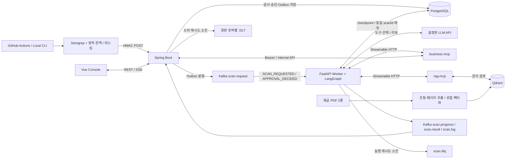

# CSI — Cyber Security Inspector

**코드 변경을 사내 개인정보 처리 정책과 대조하고, 근거가 있는 보안 리뷰를 제공하는 B2B 보안 진단 Capstone 프로젝트입니다.**

GitHub Actions 또는 로컬 스캐너가 Java/Python 코드를 정적으로 검사하면, CSI는 Kafka로 작업을 전달하고 LangGraph Agent가 MCP를 통해 정책·문서 근거를 수집합니다. Vue 콘솔에서 코드 위치, 정책 대조, Red/Blue 리뷰, 변경 전후 diff, 실행 로그와 후속 조치 승인을 확인할 수 있습니다.

현재 구현은 **단일 조직·단일 Worker의 로컬 실습 MVP**입니다. 탐지 결과는 검토 후보이며, 취약점 악용 가능성·법률 위반·전체 시스템의 안전을 확정하지 않습니다. `LOCAL_DEMO`, 실제 GitHub 실행, `LLM`·`RULE_BASED`·`LLM_FALLBACK`을 구분해 표시합니다.

[빠른 실행](#빠른-실행) · [로컬 검사](#로컬-검사와-결과-확인) · [GitHub Actions](#github-actions-연동) · [아키텍처](#시스템-아키텍처) · [Agent·MCP](#agent와-mcp) · [검증](#테스트와-검증) · [한계](#한계와-향후-과제)

## 주요 기능

| 기능 | 현재 구현 |
|---|---|
| 자동 검사 접수 | Actions/CLI의 HMAC 서명 요청, Repository allowlist, 중복 접수 방지, `202 Accepted` |
| 보안·정책 후보 탐지 | Semgrep Java/Python 규칙, 마스킹된 코드 근거, 파일·라인·규칙·증거 수준 |
| 근거 기반 리뷰 | 검사 당시 정책 snapshot, 사내 규정·외부 참조집 검색, 사실·문서 인용 검증, 개선 권고 |
| 코드 변경 리뷰 | 두 Git 커밋의 마스킹된 좌우 diff, 지원하는 Python 선언의 추가·삭제 요약, 연결된 보안 후보 |
| 로컬 코딩 Agent (선택) | Lichu 회원가입 보완 코드·근거 생성, 격리 전후 테스트, 별도 관리자 승인과 새 worktree 준비. [실행 안내](docs/CODING_AGENT.md) |
| 콘솔 | 프로젝트별 현황, 검사 이력, 위험 항목 상세, 정책 조회, 실행 로그, 검토 상태 변경 |
| 사람의 검토와 실행 통제 | 승인 대기, PostgreSQL checkpoint, 동일 검사 재개, 승인 후 CSI 내부 검토 이슈 생성 |
| 비동기 처리·관측 | Outbox, Kafka, 제한된 재시도, DLQ/DLT, 모델 도구 선택 trace·예산, SSE 갱신 |

주요 기술은 Vue 3·TypeScript·Vite·Pinia·Tailwind CSS·ECharts, Java 21·Spring Boot·Spring Security·Flyway, Python 3.11·FastAPI·LangGraph·FastMCP, Kafka KRaft, PostgreSQL, Qdrant, Semgrep입니다.

## 빠른 실행

### 1. 작업 위치와 환경 설정

처음 설치한다면 아래 명령으로 저장소를 내려받습니다. 이미 내려받았다면 기존 **`csi` 저장소 루트**로 이동하세요. 이후 명령은 별도 안내가 없으면 이 위치를 기준으로 합니다.

```sh
git clone https://github.com/ymj9608/csi.git
cd csi
```

```sh
python3 scripts/init_env.py
```

`init_env.py`는 `.env`가 없을 때 비밀번호와 서비스용 비밀값을 생성합니다. **기존 `.env`는 보존**하며, 빈 값이 있는 기존 파일을 자동 보완하지는 않습니다. 설정 항목은 [.env.example](.env.example)을 참고하세요.

| 환경변수 | 용도 |
|---|---|
| `DATABASE_PASSWORD` | PostgreSQL 비밀번호 |
| `CSI_ADMIN_USERNAME`, `CSI_ADMIN_PASSWORD` | 최초 콘솔 계정 생성. 비밀번호는 DB에 bcrypt 해시로 저장 |
| `CSI_INTEGRATION_SECRET` | 스캐너 요청의 HMAC 서명 검증. 대상 Repository의 Actions Secret과 동일하게 설정 |
| `CSI_INTERNAL_TOKEN` | Agent·MCP·Backend 내부 API 인증 |
| `CSI_REPOSITORY_ALLOWLIST` | 허용할 `owner/repository` 목록. 쉼표로 구분 |
| `LLM_MODE`, `LLM_BASE_URL`, `LLM_API_KEY`, `LLM_MODEL` | 선택 사항. 기본값은 LLM 비활성화 |

로컬 샘플과 Lichu를 함께 검사하려면 `.env`의 해당 항목을 다음과 같이 설정합니다.

```dotenv
CSI_REPOSITORY_ALLOWLIST=local/csi-demo,ymj9608/Lichu
```

`.env`는 Git 추적 대상에서 제외됩니다. 기존 DB에 생성된 계정의 비밀번호는 `.env` 수정만으로 변경되지 않습니다.

### 2. Docker Compose로 전체 서비스 실행

Docker Desktop 또는 Docker Engine과 Compose v2가 필요합니다. **Compose 파일은 `frontend/compose.yml`에 있지만, 빌드·마운트 기준 경로는 저장소 루트**입니다.

```sh
docker compose --project-directory . --env-file .env \
  -f frontend/compose.yml up -d --build

docker compose --project-directory . --env-file .env \
  -f frontend/compose.yml ps -a

curl -fsS http://127.0.0.1:8080/api/health
```

| 서비스 | 로컬 주소 / 접근 범위 |
|---|---|
| CSI 웹 콘솔 | http://127.0.0.1:5174 |
| Spring Boot API | http://127.0.0.1:8080 |
| PostgreSQL / Kafka / Qdrant | `127.0.0.1:5432` / `127.0.0.1:9092` / `127.0.0.1:6333` |
| Agent / business-mcp / rag-mcp | Compose 내부 전용. 호스트 포트를 공개하지 않음 |

`.env`의 관리자 계정으로 로그인한 뒤 **프로젝트**를 선택합니다. 데이터가 없으면 빈 상태로 표시됩니다. `rag-index`는 카탈로그를 Qdrant에 색인하고 **종료 코드 0으로 종료**하는 일회성 작업입니다.

```sh
# 오류·진행 상태 확인
docker compose --project-directory . --env-file .env \
  -f frontend/compose.yml logs --tail=80 backend rag-index business-mcp rag-mcp agent

# 코드 변경 반영: 이미지 재빌드 및 컨테이너 갱신
docker compose --project-directory . --env-file .env \
  -f frontend/compose.yml up -d --build

# 종료: named volume의 검사 이력·DB 데이터 유지
docker compose --project-directory . --env-file .env \
  -f frontend/compose.yml down
```

`restart`만으로 이미지에 포함된 코드나 변경된 환경변수가 반영되지는 않습니다. 기존 완료 보고서도 소급 변경되지 않으므로 분석 변경을 확인하려면 새 검사를 실행하세요.

### 3. 프론트엔드만 개발 모드로 실행

Backend와 나머지 서비스는 위 Compose로 실행한 상태에서, Node.js 22와 npm을 사용합니다.

```sh
cd frontend
npm ci
npm run dev -- --port 5175
```

개발 화면은 http://127.0.0.1:5175 입니다. `/api` 요청은 Vite가 `127.0.0.1:8080`으로 전달합니다. 기본 Vite 포트는 5174이므로 Docker 콘솔이나 Lichu가 사용 중이면 다른 포트를 지정해야 합니다.

| 증상 | 확인할 내용 |
|---|---|
| `couldn't find env file` | 현재 위치가 `csi` 루트인지 확인하고 위 Compose 명령 사용 |
| `vite: command not found` / Pretendard import 오류 | `csi/frontend`에서 `npm ci` 실행 |
| `Port 5174 is already in use` | 기존 서버 주소로 접속하거나 개발 서버에 `--port 5175` 지정 |
| 로그인 실패 | 초기 계정의 DB 비밀번호와 현재 입력값 확인. `.env` 변경은 계정 재설정이 아님 |
| 검사 실패 / LLM fallback | 같은 scanId의 실행 로그와 Agent 로그에서 실제 실패 단계 확인 |

## 로컬 검사와 결과 확인

### 스캐너 준비

로컬 CLI와 Python 테스트에는 Python 3.11을 사용합니다. Agent 의존성과 Semgrep 의존성은 별도 가상환경에 설치합니다. 다음 명령도 `csi` 루트 기준입니다.

```sh
python3.11 -m venv .venv
.venv/bin/python -m pip install -r agent/requirements.lock.txt
python3.11 -m venv .scanner-venv
.scanner-venv/bin/python -m pip install -r rules/requirements.txt
mkdir -p .runtime
```

### 제공 샘플 검사

```sh
.venv/bin/python scripts/demo.py vulnerable
.venv/bin/python scripts/demo.py fixed
```

합성 Java 샘플을 **실제 Semgrep → 서명 접수 → Kafka → Agent → MCP → 저장** 경로로 검사합니다. 대상 애플리케이션은 실행하지 않습니다. 현재 fixture의 예상 후보는 취약 샘플 8건, 수정 샘플 0건이며 같은 요청의 중복 전송도 확인합니다.

결과는 `LOCAL_DEMO`입니다. 샘플의 합성 SHA는 실제 GitHub commit SHA가 아닙니다.

### Lichu 검사와 커밋 비교

Lichu는 별도 검사 대상 저장소입니다. `csi`와 같은 상위 폴더에 있다고 가정합니다. allowlist 반영 후 Backend를 갱신해야 하며, 로컬 CLI는 미등록 프로젝트를 생성합니다.

```sh
# 현재 작업 디렉터리의 Java/Python 소스 검사
.venv/bin/python scripts/scan_repository.py ../Lichu \
  --repository ymj9608/Lichu --branch dev

# 실제 두 커밋 비교: 두 값을 해당 저장소에 존재하는 40자리 SHA로 교체
.venv/bin/python scripts/scan_repository.py ../Lichu \
  --repository ymj9608/Lichu --branch dev \
  --base-sha BASE_FULL_SHA --head-sha HEAD_FULL_SHA
```

첫 명령은 현재 소스 내용의 합성 식별자를 사용합니다. 두 번째는 지정한 Git 커밋의 소스를 읽습니다. **둘 다 로컬 실행이므로 `LOCAL_DEMO`**로 기록합니다.

코드 변경 리뷰는 마스킹된 diff와 정적 선언 사실을 보여 줍니다. Python의 지원 클래스 필드·함수 선언 추가/삭제를 요약하며, Java는 diff와 연결된 탐지 결과를 제공합니다. 임의의 기능 설명을 생성하지 않습니다. 기준 커밋 부재, 잘림, 변경 근거가 없는 과거 검사는 별도 상태로 표시합니다.

화면에서 다음을 확인하세요.

1. **프로젝트 → 검사 이력 → 검사 상세**: scanId, Repository, 브랜치, SHA, 실행 출처, `COMPLETED` / `FAILED`.
2. **코드 변경 리뷰**: 기준·현재 SHA, 파일별 좌우 diff, 선언 변화, 신규·유지·미탐지 후보.
3. **위험 항목 → AI 분석 / 보안 근거**: 정책 대조, 정적 사실, Red/Blue 리뷰, 실제 인용, 도구 선택 주체와 호출 trace.
4. **실행 로그**: `mcp_start`, `mcp_complete`, `model_decision`, `context_budget`, `REPORT_SAVED` 등.
5. **승인 관리**: 승인·거절 결과와 후속 내부 이슈 처리 상태.

같은 브랜치의 이전 완료 검사와 비교하는 기능과, 명시한 두 Git 커밋을 비교하는 기능은 기준이 다릅니다. **이번 검사에서 미탐지된 항목을 자동으로 수정 완료(`RESOLVED`)로 판단하지 않습니다.**

## LLM 설정

기본 `LLM_MODE=disabled`에서도 LangGraph·MCP·RAG는 동작하며 결과는 `RULE_BASED`로 표시됩니다. LLM을 사용하려면 함수 호출과 JSON 응답을 지원하는 Chat Completions 호환 API를 설정합니다.

아래는 프로젝트의 기존 OpenAI 실검증에서 사용한 설정 예시입니다. 모델은 코드에 고정되어 있지 않습니다.

```dotenv
LLM_MODE=enabled
LLM_BASE_URL=https://api.openai.com/v1
LLM_API_KEY=YOUR_OPENAI_API_KEY
LLM_MODEL=gpt-4.1-mini
```

```sh
# .env 수정 후 Agent에 반영
docker compose --project-directory . --env-file .env \
  -f frontend/compose.yml up -d --no-deps --force-recreate agent
```

모델에는 허용된 필드·클래스 이름, 구조화된 정적 사실, 정책 대조 결과와 관련 조항 발췌를 전달합니다. 코드 원문·전체 diff·파일 경로·개인정보 값·비밀값·PDF 전체를 분석 입력으로 보내지 않습니다.

모델 선택과 응답을 검증하며, 설정 누락·API 오류·시간/예산 초과·잘못된 ID/인용 등은 `LLM_FALLBACK`으로 표시합니다. 필수 문서 근거를 끝내 확보하지 못하면 검사가 실패할 수 있습니다. `LLM` 표시는 해당 실행에서 모델을 사용했다는 뜻이며 분석 정확도 인증이 아닙니다.

## GitHub Actions 연동

CSI 도구 저장소는 `ymj9608/csi`, 검사 대상 앱은 `ymj9608/Lichu`입니다. GitHub Hosted Runner에서 접근할 **HTTPS 수신 주소와 실행 중인 CSI Backend·Kafka·Agent**가 필요합니다. Actions가 CSI 서버를 대신 실행하거나 배포해 주지는 않습니다.

1. Backend의 `CSI_REPOSITORY_ALLOWLIST`에 대상 저장소를 추가하고 컨테이너를 갱신합니다.
2. CSI 콘솔의 **프로젝트**에서 동일한 `owner/repository`와 기본 브랜치를 등록합니다.
3. 대상 저장소의 **Settings → Secrets and variables → Actions**에서 다음을 설정합니다.

| 구분 | 이름 | 값 |
|---|---|---|
| Variable | `CSI_SCANNER_REPOSITORY` | `ymj9608/csi` |
| Variable | `CSI_SCANNER_REF` | 검토 후 Push한 CSI 스캐너의 **40자리 commit SHA** |
| Variable | `CSI_SCAN_THIS_REPOSITORY` | 이 저장소의 워크플로 템플릿을 그대로 사용할 때 `true` |
| Secret | `CSI_BACKEND_URL` | 접근 가능한 HTTPS 기본 주소. 예: `https://csi-intake.example.com` |
| Secret | `CSI_INTEGRATION_SECRET` | Backend `.env`의 동명 값과 동일한 HMAC 키 |
| Secret | `CSI_SCANNER_READ_TOKEN` | CSI 도구 저장소가 비공개일 때 필요한 읽기 전용 자격 증명 |

`CSI_BACKEND_URL`에는 `/api/integrations/github/scan-results`를 붙이지 않습니다. 전송 스크립트가 이 경로를 추가합니다. 이 값은 대상 저장소의 Actions Secret이며, Compose 내부 서비스용 `http://backend:8080`과 구분합니다.

4. [워크플로 템플릿](.github/workflows/csi-security-scan.yml)을 대상 저장소의 `.github/workflows/csi-security-scan.yml`에 적용합니다. 기존 워크플로가 있다면 다음 항목을 확인합니다.
   - 트리거: 현재 템플릿은 `main`, `develop`, `dev`의 Push와 `workflow_dispatch`.
   - CSI 자체의 불필요한 실행을 막는 opt-in 조건: 그대로 복사했다면 위 `CSI_SCAN_THIS_REPOSITORY=true` 필요.
   - 변경 비교: 대상 checkout의 `fetch-depth: 0`, `CSI_BASE_SHA: ${{ github.event.before }}`, `scan_changes.py`, `CSI_SCAN_FILE: scan.json`.
   - 구버전 `scan.py` + `CSI_FINDINGS_FILE` 방식은 현재 소스 검사만 제공하며 전후 diff를 보내지 않음.
5. HTTPS reverse proxy 또는 실습용 터널을 준비합니다. 공개 수신 경로는 검사 접수 엔드포인트로 제한하고, `/internal/**`, DB, Kafka, MCP를 공개하지 않습니다. 별도 intake proxy를 사용할 경우 그 주소를 연결합니다.
6. 대상 브랜치에 Push한 뒤 Actions의 `Accepted scan`과 scanId를 확인하고, CSI 검사 상세의 Commit SHA·Run URL·최종 상태를 확인합니다.

Hosted Runner는 개발 PC의 `localhost`에 접속할 수 없습니다. 터널 주소가 바뀌면 Secret도 갱신해야 합니다. **Actions의 성공과 HTTP 202는 접수 성공**이며, AI 분석 완료나 보안 통과를 의미하지 않습니다.

워크플로는 승인된 CSI SHA의 스캐너만 실행합니다. 대상 저장소의 빌드·테스트·앱 코드를 실행하지 않으며 Fork PR 및 `pull_request_target`을 사용하지 않습니다. 수신 요청은 HMAC-SHA256, 5분 timestamp 창, allowlist, 1MB payload / 최대 300개 Finding 제한으로 검증합니다.

## 시스템 아키텍처

### 상세 구조

검사 접수부터 Agent의 근거 수집·결과 발행, MCP 호출 경계, 정책 색인과 승인 재개까지 나타낸 상세 아키텍처입니다. 작은 글씨는 [원본 PNG](docs/diagrams/CSI.png)를 열어 확대할 수 있습니다.


<details>
<summary>핵심 서비스만 보는 요약 구조도</summary>


[요약 구조도 원본 PNG](docs/diagrams/csi-system-architecture-paper.en.png)

</details>

<details>
<summary>텍스트 다이어그램으로 보는 데이터 흐름</summary>



</details>

Backend는 검사와 Outbox를 한 트랜잭션에 저장한 뒤 202를 반환합니다. Agent 결과는 Kafka를 통해 Backend가 검증·저장합니다. Vue는 SSE `update` 알림을 받으면 REST API를 다시 조회합니다.

승인 결정도 DB·Outbox에 함께 저장하고 **기존 `scan.request` 토픽**으로 전달합니다. Agent는 Backend의 영속 승인 상태를 직접 재조회한 뒤 동일 `thread_id=scanId`의 checkpoint를 `Command(resume=...)`로 재개합니다.

업무 데이터와 checkpoint는 같은 PostgreSQL 인스턴스에 있지만 책임이 다릅니다. business-mcp는 `/internal/**`만 호출하고 업무 DB에 직접 접근하지 않습니다. Agent의 Checkpointer는 `checkpoints`, `checkpoint_blobs`, `checkpoint_writes`를 직접 사용하며, `agent_checkpoints`는 업무용 단계 요약입니다.

콘솔 API는 Spring Security 세션 쿠키와 CSRF 검증을 사용하며 현재 역할은 `SECURITY_REVIEWER`입니다. 내부 API는 Bearer 인증, 스캐너 접수는 HMAC 인증으로 구분합니다. 로컬 HTTP 실행의 쿠키 설정과 별개로 HTTPS 운영 환경에서는 `COOKIE_SECURE=true`를 설정해야 합니다.

### 품질 기준을 반영한 설계

ISO/IEC 25010:2023의 9개 제품 품질 특성을 **요구사항 → 설계·코드 → 테스트·실행 기록 → 남은 검증**으로 연결했습니다. 이는 품질을 고려한 아키텍처 설계이며, ISO 인증이나 모든 품질 목표의 달성 선언은 아닙니다.

| 품질 관점 | CSI의 설계 선택 | 검증 범위 |
|---|---|---|
| 기능 적합성·보안성 | 실제 Finding·문서 인용 검증, 인증 경계·마스킹·읽기 도구 allowlist | 샘플·경계 테스트 및 과거 인증 통합 검증. 탐지 정확도·종합 공격 대응 평가는 남음 |
| 성능 효율성·신뢰성 | 비동기 접수, Outbox·멱등성, 호출 예산·유한 재시도·checkpoint | 예산 테스트와 과거 승인/장애 검증. p95 지연·비용·프로세스 강제 종료 후 복구는 미측정 |
| 호환성·상호작용 능력 | 검증된 API/MCP 계약, 구버전 검사 조회, SSE·근거·불확실성 표시 | 계약 테스트와 과거 화면 E2E. 클라이언트 호환 행렬·접근성 평가는 부족 |
| 유지보수성·유연성 | 규칙·프롬프트·서비스 분리, 회귀 테스트, Compose·환경 변수 | 로컬 테스트·배포 기록. 다중 Worker·고가용성·환경별 재현은 별도 검증 필요 |
| 안전성 | 기존 리뷰 승인은 내부 이슈 생성. 선택적 코딩 Worker는 격리 테스트·별도 승인·커밋 검증 후 새 worktree 준비 | 승인/거절 및 제한된 Lichu 검증. 정식 위해 분석이나 안전성 보증은 아님 |

[품질 요구사항과 설계 검증](docs/ARCHITECTURE.md#품질-요구사항과-설계-검증)에 QA-01–09의 코드·검증 근거, 판별 기준과 다음 측정 계획을 정리했습니다. 2011판과 2023판의 용어 차이, 테스트 대역과 실제 서비스 검증의 구분도 포함합니다.

### 주요 실행 시퀀스

원 안의 번호는 그림을 읽는 순서입니다. `loop` 단계는 반복하며 `par` 영역의 경로는 독립적으로 진행하므로, 번호가 모든 이벤트의 엄격한 실행 순서를 의미하지는 않습니다.

<details>
<summary>1. 검사 접수와 보안 분석</summary>

LLM을 활성화한 경우의 도구 선택·MCP 근거 수집, 결과 발행과 Backend 저장, SSE 알림 후 REST 재조회를 보여 줍니다. 현재 Finding이 있으면 승인 요청과 checkpoint 저장으로 이어집니다.


[검사·분석 시퀀스 원본 PNG](docs/diagrams/csi-sequence-scan-analysis.en.color.png)

</details>

<details>
<summary>2. 승인 결정과 Agent 재개</summary>

저장된 승인 결정을 같은 `scan.request` 토픽으로 전달한 뒤, Agent가 결정을 재조회하고 동일 scanId에서 재개합니다. 승인 시 Backend의 재검증을 거쳐 내부 이슈를 만들고, 거절 시 이슈 생성 없이 종료합니다.


[승인·재개 시퀀스 원본 PNG](docs/diagrams/csi-sequence-approval-resume.en.color.png)

</details>

## Agent와 MCP

### Agent 실행 구조

**하나의 LangGraph Agent** 안에 Red·Blue 분석 단계가 있습니다. 별도 자율 Agent 두 개를 실행하는 구조는 아닙니다.

| 단계 | 수행 내용 |
|---|---|
| 검사 검증·초기 근거 로드 | Repository·SHA·상태 검증, Finding 조회, 변경 근거가 있으면 `get_scan_changes` 호출 |
| 도구 선택 반복 | 모델이 허용된 읽기 도구를 선택 → Harness가 인자 검증·실행 → 관측 결과를 다음 선택에 반영 |
| 종료 조건 검증 | 정책, 필요한 필드 비교, 규칙별 사내·외부 근거가 확보되어야 `finish_analysis` 수락 |
| Red / Blue 리뷰 | 정적 사실과 인용을 구성하고 위험·오탐 가능성·불확실성·개선 권고 작성 및 출력 검증 |
| 결과 발행 | `scan.result`를 발행하고 Backend가 보고서 저장 |
| HITL | 현재 Finding이 있으면 검토 요청 후 `interrupt()`. 승인 시 내부 이슈 생성, 거절 시 이슈 생성 없이 종료 |

초기 근거 조회와 승인 요청은 Harness가 수행합니다. 모델에 제공하는 선택지는 정책·비교·이력·RAG 읽기 도구 6개와 로컬 종료 동작 `finish_analysis`입니다. 쓰기 도구는 모델의 자유 선택 목록에 포함하지 않습니다.

보고서 생성과 후속 승인 상태는 별개입니다. 검사 결과를 발행한 후 승인을 기다리므로 **검사 완료와 승인 대기가 동시에 표시될 수 있습니다.** 기존 LangGraph 승인 대상은 **CSI 내부 보안 검토 이슈 생성**입니다. 선택적 [코딩 Agent](docs/CODING_AGENT.md)는 위험 항목의 분석 확인 후 수정안 생성·근거 확인·승인/거절로 이어지며, 승인만으로 코드가 병합되거나 배포되지는 않습니다.

### MCP 서버

| 서버 | 도구 / 리소스 | 데이터 경로 |
|---|---|---|
| `business-mcp` | `get_scan_context`, `get_scan_findings`, `get_scan_changes`, `get_privacy_policy`, `get_scan_history`, `compare_policy_with_findings`, `request_security_review`, `create_security_issue` | Backend의 내부 API. 이슈 생성 시 Backend가 승인 상태를 다시 검증 |
| `rag-mcp` | `search_internal_privacy_policy`, `search_security_guidelines`, `get_guideline_details`; Resource `security://guidelines/{rule_id}` | Qdrant에서 문서 유형·규칙별 조항 필터와 유사도 검색 |

두 서버는 FastMCP 기반의 독립 서비스이며 Compose에서는 `http://business-mcp:8001/mcp`, `http://rag-mcp:8002/mcp`로 연결합니다. Bearer는 인증 방식이며 내부 통신을 HTTPS로 암호화한다는 의미는 아닙니다.

도구 선택 → Harness 검증 → FastMCP 라우팅과 승인 후 쓰기 경로는 [MCP 라우팅 상세도 v5 (PDF)](docs/diagrams/CSI_MCP_Routing_Visual_v5.pdf)에서 확인할 수 있습니다.

### Harness와 복구

| 요소 | 구현 |
|---|---|
| Instructions | [planner.md](agent/prompts/planner.md), [reviewer.md](agent/prompts/reviewer.md)로 지시문 분리 |
| Tools | 명시적 도구 목록, 인자 검증, scanId 주입, 읽기/변경 annotation |
| Context | 정책 snapshot·정적 사실·검색 근거, 공유 인용 사전, 배치 및 요청·누적 예산 |
| State & Memory | PostgreSQL Checkpointer, scan별 상태·도구 trace·예산 저장 |
| Agent Loop | 모델 선택 → 도구 실행 → 관측 → 재선택, 근거 충족 후 종료 |
| Guardrails | 출력 schema, Finding·사실·문서 ID 검증, 승인 재검증, 마스킹·읽기 전용 분석 |
| Recovery | Outbox, 멱등 처리, 유한 재시도, timeout, fallback, DLQ/DLT |
| Observability | Kafka 이벤트, 도구 선택 주체·호출 결과·예산 로그, 보고서 trace, SSE |

현재 도구 선택은 **최대 12턴**, 같은 도구 이름은 최대 3회, MCP 호출당 15초입니다. Worker는 실행당 180초·최대 2회 시도이며, 모델 작업 시간은 150초·호출 최대 32회입니다. 입력 상한 24,000은 UTF-8 바이트를 이용한 보수적 계수이며 정확한 청구 토큰 수가 아닙니다. 예산·배치·fallback의 상세 기준은 [Agent Harness](docs/AGENT_HARNESS.md)에 있습니다.

Outbox 전송은 최대 3회 시도하며, Kafka 메시지는 중복될 수 있다는 전제로 eventId·검사·Finding·승인·이슈에 멱등 처리를 적용합니다. `scan.dlq`와 Backend의 `scan.progress.DLT`, `scan.result.DLT`, `scan.log.DLT`는 자동 재처리하지 않습니다. 장기 미완료 검사와 승인 재개 실패는 별도로 다룹니다.

## 진단 범위와 정책 근거

| 위험 유형 | 규칙 | 정적 검사 대상 |
|---|---|---|
| T1 비밀번호 추측 위험 | `SEC-01`, `SEC-02`, `SEC-04` | 평문 저장 후보, 비밀번호에 빠른 해시 사용, 사내 기준 미만 bcrypt 설정 |
| T2 사전 계산 결과 재사용 위험 | `SEC-03` | 고정 Salt 후보 |
| T3 로그를 통한 정보 유출 | `SEC-05` | 비밀번호·인증 토큰·일부 개인정보를 로그 인자로 전달하는 패턴 |
| T4 개인정보 처리 정책 이탈 | `POL-01` | 개인정보 필드 후보와 승인·제한·일시 처리 목록 비교 |

T4는 개별 공격 기법이 아니라 정책 이탈 위험입니다. SHA 계열 사용 자체를 취약점으로 확정하지 않습니다. bcrypt 최소 비용 **12는 제공된 사내 실습 정책의 기준**입니다.

보안 규칙의 기본 증거 판정은 `SUSPECTED`, 개인정보 필드 후보는 `INSUFFICIENT_EVIDENCE`입니다. `MEDIUM` 신뢰 수준은 정적 규칙의 기본값이며 확률이나 LLM 점수가 아닙니다. `OPEN`·`REVIEWING`·`RESOLVED`는 별도의 검토·조치 상태입니다.

RAG의 주 색인은 [rag/documents](rag/documents)의 **PrivacyGuard PDF 2종, 현재 카탈로그 47개 청크**입니다.

- `PG-POL-2026-01`: 가상의 사내 개인정보 처리·개발 보안 규정.
- `PG-REF-2026-01`: 외부 법령·보안 기술 가이드 참조집. 법령 원문이나 OWASP 원문 corpus와 구분합니다.

문서 유형·버전·조항·실제 페이지·원문·chunkId를 보존합니다. 벡터는 1024차원 문자 2–4 gram hashing이며, Qdrant cosine 검색을 사용합니다. 외부 임베딩 API나 신경망 기반 의미 검색은 사용하지 않습니다.

```sh
# PDF 변경 시: 카탈로그 추출과 벡터 색인은 별개
.venv/bin/python scripts/prepare_policy.py
.venv/bin/python -m mcp_servers.index
```

위 색인 명령은 실행 중인 로컬 Qdrant를 사용합니다. 컨테이너의 카탈로그도 갱신하려면 이미지 재빌드 후 `rag-index`를 다시 실행해야 합니다. 문서를 바꿀 때는 [rag/policy.json](rag/policy.json), 추출 스크립트의 구조화 정책, 스캐너 규칙도 함께 검토해야 하며 PDF 교체만으로 새 정책을 자동 해석하지 않습니다.

추가 법률 PDF·Capstone 자료는 주 색인 대상이 아닙니다. 원문·검색 결과에 없는 출처를 만들어 인용하지 않으며 사내 정책을 법령과 동일한 권위로 취급하지 않습니다.

## 테스트와 검증

`csi` 루트에서 실행합니다. Python 테스트는 위 가상환경과 Semgrep 설치가 필요하고, Backend 테스트는 JDK 21·Maven 3.9, Frontend 빌드는 Node.js 22를 사용합니다.

```sh
mkdir -p .runtime
.venv/bin/python -m pytest tests -q
mvn -f backend/pom.xml test
npm --prefix frontend ci
npm --prefix frontend run build
```

Python 테스트는 마스킹·실제 Semgrep 규칙·정책 근거·모델 출력 검증·도구 선택 반복과 한도·승인 재개·변경 비교를, Spring 테스트는 접수와 구조화 근거 검증을 다룹니다. 로컬 샘플 검사는 실제 서비스 간 연결을 확인하는 별도 절차입니다.

브라우저 E2E는 [Playwright 설정](frontend/playwright.config.ts)에 따라 **CSI가 5174에서 실행 중**이고 로컬 Chrome이 설치되어 있어야 합니다.

```sh
cd frontend
npm run test:e2e
```

E2E는 빈 DB용 테스트가 아닙니다. 콘솔 테스트에는 프로젝트·여러 위험 항목·LLM 도구 선택이 기록된 완료 검사가 필요합니다. 변경 리뷰 테스트는 Lichu 전화번호 추가/수정 시나리오와 변경 근거가 없는 과거 검사에 의존하며, `CSI_CHANGE_ADDED_SCAN`, `CSI_CHANGE_FIXED_SCAN`에 해당 scanId를 지정하지 않으면 건너뜁니다. 상세 데이터 조건은 [테스트 코드](frontend/e2e)와 [변경 리뷰 문서](docs/CHANGE_REVIEWS.md)를 참고하세요.

기존 검증 기록은 다음 문서에서 **수행 날짜와 환경을 함께** 확인할 수 있습니다.

- [verification.json](docs/verification.json): 2026-10-19 Local Demo 빌드·통합·이벤트·장애 검증 기록.
- [CHANGE_REVIEWS.md](docs/CHANGE_REVIEWS.md): 2026-10-20 변경 비교 검증, 당시 Python 40개·Spring 8개·Chrome E2E 2개 통과 및 Vue 빌드 기록.
- [REVIEW_QUALITY.md](docs/REVIEW_QUALITY.md), [AGENT_HARNESS.md](docs/AGENT_HARNESS.md): 인용 검증, 실제 LLM 호출·도구 trace·fallback 검증 범위.

이는 기록된 시점의 결과이며 현재 환경의 자동 재검증 결과나 실제 GitHub Push 검증을 대신하지 않습니다. 실행 경로는 이 README의 `frontend/compose.yml` 기준 명령을 사용하세요.

## 한계와 향후 과제

| 한계 | 다음 과제 |
|---|---|
| Java/Python의 명시된 이름·구문 패턴 중심. 일부 Pydantic·SQLAlchemy 저장 호출만 문맥 추출 | 언어·프레임워크·규칙 확장, 함수 간 데이터 흐름 분석, 우회·오탐 사례 평가 |
| 업무 맥락은 정책 대조·필드 역할·정적 저장 호출·실습 조건·코드 변경 사실까지 | 수집 목적·보유 기간·실제 승인 기록·운영 설정과의 검증 가능한 연계 |
| `match_business_context` 도구와 런타임 업무 로그 자동 수집은 없음 | 별도 업무 맥락 데이터 모델·출처 검증·MCP 도구 설계 |
| 제한된 공격 패턴과 어휘 기반 문서 검색 | 변화하는 공격에 대응한 규칙 갱신, 출처가 명확한 자료 확장, 검색 품질 평가 |
| 테스트 통과와 별개로 오탐·미탐, 처리 지연·비용, 대규모 부하·장애의 정량 평가 부족 | 기준 데이터셋과 평가 지표, 비용·지연 측정, 부하·복구 시험 |
| 단일 조직·단일 Worker MVP, 목록은 최근 최대 1,000건 조회 후 화면에서 필터·페이지 처리 | 조직·프로젝트별 권한, 서버 페이지 처리, 다중 Worker·백엔드 확장, DLQ 운영 절차 |

현재 자동 병합·운영 배포·외부 GitHub 이슈 생성·임의 파일 업로드·공격 실행·비밀번호 크래킹은 지원하지 않습니다. 선택적 코딩 Worker는 Lichu 실습 파일 하나의 추천 수정안을 생성하고 격리된 기능·보안 테스트를 실행합니다. 승인 후 명시적 CLI로 새 worktree를 준비하는 범위이며, 범용 저장소 자동 수정은 지원하지 않습니다.

선택적 격리 스캐너는 읽기 전용 마운트·네트워크 차단·비루트 사용자·자원 제한으로 **정적 분석 도구만 실행**합니다. 코딩 Worker의 테스트 검증 컨테이너는 이 스캐너와 별도입니다. 범위·실행법·검증 한계는 [코딩 Agent 문서](docs/CODING_AGENT.md)를 참고하세요.

```sh
mkdir -p .runtime
docker compose --project-directory . --env-file .env \
  -f frontend/compose.yml --profile tools run --build --rm scanner
```

기본 대상은 `fixtures/vulnerable`, 출력은 `.runtime/findings.json`입니다. `CSI_SCAN_TARGET`, `CSI_SCAN_OUTPUT`으로 경로를 지정할 수 있으며 이 명령 자체는 결과를 Backend에 접수하지 않습니다. Linux bind mount에서는 출력 디렉터리에 컨테이너 사용자 UID/GID `65532:65532`의 쓰기 권한이 필요합니다.

## 저장소와 상세 문서

```text
csi/
├── frontend/             Vue 콘솔, Nginx, compose.yml
├── backend/              Spring Boot API, Kafka 처리, DB migration
├── agent/                FastAPI Worker, LangGraph, Harness, prompts
├── mcp_servers/          business-mcp, rag-mcp, Qdrant 색인·검색
├── rules/                Java/Python Semgrep 규칙, 격리 스캐너
├── rag/                  PDF 2종, 정책 snapshot 원본, 추출 카탈로그
├── scripts/              환경 생성, 검사·변경 비교·서명 전송·검증
├── tests/                Python 테스트
├── fixtures/             합성 취약·수정 샘플
└── docs/                 구현 범위, 검증 기록, 참고 문서와 diagrams/
```

| 문서 | 내용 |
|---|---|
| [ARCHITECTURE.md](docs/ARCHITECTURE.md) | 서비스 경계·승인·실패 경로, ISO/IEC 25010 품질 요구사항과 설계·검증 대응 |
| [AGENT_HARNESS.md](docs/AGENT_HARNESS.md) | 모델 도구 선택, 상태·예산·복구, Harness 8요소 |
| [REVIEW_QUALITY.md](docs/REVIEW_QUALITY.md) | 정적 사실과 정책 대조, 인용·불확실성·모델 출력 검증 |
| [CHANGE_REVIEWS.md](docs/CHANGE_REVIEWS.md) | 좌우 diff, 변경 요약·연결 리뷰, 한도와 검증 시나리오 |
| [verification.json](docs/verification.json) | 날짜·환경이 명시된 기존 실행 검증 기록 |
| [평가표 기반 발표자료 PPTX](docs/presentations/CSI_Evaluation_Design.pptx) · [PDF](docs/presentations/CSI_Evaluation_Design.pdf) · [전체 미리보기](docs/presentations/CSI_Evaluation_Design_preview.png) | 아키텍처·Agent 설계/구현·MCP 담당 영역 60점의 설계와 검증 근거. 본편 10장 + 부록 3장, 발표자 노트 포함 |
| [상세 아키텍처 PNG](docs/diagrams/CSI.png) · [요약 구조도 PNG](docs/diagrams/csi-system-architecture-paper.en.png) | 전체 서비스 경계와 핵심 구성요소 |
| [검사·분석 시퀀스 PNG](docs/diagrams/csi-sequence-scan-analysis.en.color.png) · [승인·재개 시퀀스 PNG](docs/diagrams/csi-sequence-approval-resume.en.color.png) | 번호로 표시한 검사 처리 및 HITL 재개 흐름 |
| [MCP 라우팅 상세도 v5 PDF](docs/diagrams/CSI_MCP_Routing_Visual_v5.pdf) | 모델 선택, 도구 검증·라우팅, MCP 서비스와 승인 후 내부 이슈 생성 |

발표자료의 텍스트·설명 도식은 PowerPoint에서 편집할 수 있으며 Keynote에서 13장 가져오기와 PDF 내보내기를 확인했습니다. 재생성 소스는 [build_evaluation_deck.py](scripts/build_evaluation_deck.py)입니다. 발표자료용 `python-pptx`, `Pillow`는 서비스 런타임 의존성과 분리해 사용합니다.
