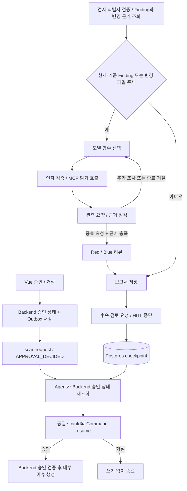

# Agent 도구 선택과 Harness

> 이 문서는 `legacy_graph.py`와 기존 도구 선택 루프의 설계·검증 기록입니다. 신규 검사는 [통합 VLM 경로](UNIFIED_VLM_REVIEW.md)를 사용합니다. 근거 수집 후 VLM이 구조 JSON·진단·자연어 지시를 함께 생성하고, Coding Worker가 저장된 지시를 재사용합니다. 아래의 별도 리뷰 모델·12턴 루프를 신규 경로로 해석하지 마세요.

기존 그래프는 규칙에 따른 고정 도구 순서였고 변경 도구 annotation, 별도 프롬프트 파일, 입력 예산이 부족했습니다. 이번 변경은 모델이 읽기 도구를 고르고 관측 결과에 따라 다음 행동을 선택하는 반복 경로를 추가합니다. 평가 점수나 분석 정확도를 보장하는 변경은 아닙니다.

## 실행 경로



Finding이 없는 경우 승인 요청 없이 종료합니다. 모델에는 `get_privacy_policy`, `compare_policy_with_findings`, `get_scan_history`, `get_guideline_details`, 두 종류의 검색과 `finish_analysis`만 제공합니다. 함수 스키마는 `planner.py`의 명시적인 MCP 어댑터에서 관리합니다. MCP 서버의 모든 도구를 동적으로 노출하지 않습니다.

`scan.request`는 신규 검사와 승인 재개가 공유하는 토픽입니다. 위 그림의 승인은 코드를 수정하는 승인이 아니라 **CSI 내부 보안 검토 이슈 생성 승인**입니다. 전체 진입점·실패 경로·미구현 기능은 [실제 구현 기준 아키텍처](ARCHITECTURE.md)를 참고하세요.

모델은 실제 함수 호출 응답을 내며, Harness가 이를 검사하고 FastMCP로 실행합니다. 최근 도구 관측·오류는 다음 요청의 `tool` 메시지로 전달하고 과거 호출은 요약합니다. 정책 snapshot, POL-01 필드 비교, 각 규칙의 사내/외부 근거가 없으면 종료를 거절합니다. 모델의 입력으로 전달된 코드 유래 정보와 문서 발췌는 명령이 아닌 데이터입니다.

LLM 비활성화는 RULE_BASED, 모델 선택 실패 후 결정적 경로로 복구하면 LLM_FALLBACK입니다. 리뷰 문장을 LLM이 작성했더라도 선택 단계가 fallback이면 검사 전체는 LLM_FALLBACK입니다. UI에서 선택 단계와 개별 리뷰 모드를 구분합니다. 근거 확보에 끝내 실패하면 작업이 실패하며 문서 인용을 만들지 않습니다.

함수 호출 형식은 [OpenAI 공식 function calling 문서](https://developers.openai.com/api/docs/guides/function-calling)를 참고했습니다.

## 예산과 복구

| 제한 | 값 / 적용 |
|---|---|
| 선택 루프 | 종료 요청 포함 최대 12턴 |
| MCP 반복 | 검사 상태에 저장된 도구 이름별 최대 3회, 인자가 달라도 합산 |
| MCP 시간 | 호출당 15초 |
| 모델 작업 시간 | 시작 이후 150초를 넘으면 추가 호출 금지, 남은 시간 내 HTTP timeout |
| Worker | 실행당 180초, 최대 2회 시도, graph recursion 60 |
| 요청 입력 예산 | UTF-8 바이트 기반 보수적 상한 24,000 |
| 응답 예산 | 리뷰 6,000 tokens, 선택 700 tokens |
| 검사별 모델 예산 | 예약 입력+최대 출력 합계 200,000, 호출 최대 32회 |
| 리뷰 배치 | 최대 4개 Finding, 큰 입력은 더 작게 분리 |
| 일시 오류 | HTTP 429/503 초기 요청 + 최대 2회 재시도, 매 시도 예산 차감 |

입력 계수는 메시지·함수 스키마를 직렬화한 UTF-8 바이트 수 + framing 여유분입니다. 정확한 모델 tokenizer 측정값이나 청구 금액이 아닙니다. 예약 예산은 실패한 요청에도 차감하고 API가 반환한 실제 usage는 별도로 저장합니다. 6개 규칙을 함께 조사할 수 있도록 권장 예시인 8턴보다 큰 12턴을 사용하되 무한 반복은 허용하지 않습니다.

배치 내 같은 인용 문서는 사전으로 공유하여 중복을 줄입니다. 기본 조항 발췌는 900자이며 단일 Finding도 크면 200자로 줄인 후 재검사합니다. 여전히 한도를 넘으면 전송하지 않습니다. 출력 잘림은 더 작은 배치로 분리하고, 단일 항목도 실패하면 해당 리뷰만 사유와 함께 LLM_FALLBACK으로 남깁니다. 성공한 다른 배치와 전체 정적 탐지 목록은 유지합니다. 많은 Finding을 모두 LLM으로 분석한다고 보장하지 않으며 총 예산 소진 후 남은 항목은 명시적인 fallback입니다.

## Harness 8요소

| 요소 | 구현 / 확인 |
|---|---|
| Instructions | `agent/prompts/planner.md`, `reviewer.md`를 별도 버전 관리 |
| Tools | 명시적 읽기 목록, 인자 schema, 검사 ID는 모델 대신 Harness가 주입 |
| Context | 근거 요약, 공유 인용 사전, 배치 및 요청/검사 예산 |
| State & Memory | PostgreSQL checkpointer에 선택 trace·관측·예산·도구 횟수 보존 |
| Agent Loop | 선택 → 실행 → 관측 → 재선택, 충분한 근거 확인 후 종료 |
| Guardrails | 출력 ID/인용 검증, mutation 도구 모델 목록 제외, Backend 승인 검증 |
| Recovery | 오류 ToolMessage, 유한 재시도, 배치별 fallback, 기존 Kafka 멱등 처리 |
| Observability | model_decision, tool_observation, assess_evidence, context_budget, 실행 trace |

읽기 도구는 `readOnlyHint=true`, `destructiveHint=false`입니다. 상태를 바꾸는 `request_security_review`, `create_security_issue`는 보수적으로 `readOnlyHint=false`, `destructiveHint=true`입니다. annotation 자체는 권한 통제가 아닙니다. 승인 요청 레코드는 Harness가 만들며, 실제 후속 이슈는 HITL 승인과 Backend 재검증 이후에만 만듭니다. 외부 GitHub 이슈 생성이나 코드 변경은 하지 않습니다.

## 검증 방법

```sh
SSL_CERT_FILE=/etc/ssl/cert.pem .venv/bin/python -m pytest tests -q
docker compose build backend rag-index frontend
docker compose up -d --no-deps backend business-mcp rag-mcp agent frontend
.venv/bin/python scripts/scan_repository.py ../Lichu --repository ymj9608/Lichu --branch dev --submit-base http://127.0.0.1:8091
```

별도 intake nginx가 Backend 주소를 캐시한 환경에서는 Backend 재생성 후 nginx reload가 필요합니다. 마지막 명령은 LOCAL_DEMO 검사이며 GitHub Push 검증으로 표시하지 않습니다. 기존 완료된 보고서는 소급 변경하지 않습니다.

새 검사 → 취약점 상세 → AI 분석에서 `Agent 도구 선택`의 LLM 여부·턴·도구·관측 상태를 확인합니다. Execution Logs에서 같은 scanId의 선택·MCP·예산 이벤트를 확인합니다. 단위 테스트는 조기 종료 거절, 도구 오류 후 다른 검색, 반복 제한, 잘못된 인자/쓰기 요청 거절, 승인 재개, 300개 입력 분할, 부분 실패 보존, 출력 잘림 재분할, 일시 오류 재시도를 검증합니다.

제공된 원본 PDF 4종은 사용자 요청에 따라 `docs/`로 옮겼습니다. `.pdf.txt` 추출본은 로컬 `.reference-materials/`에 보존합니다. Capstone PDF와 모든 추출본은 Git 추적에서 제외하며 이미 존재하는 Git 이력은 재작성하지 않습니다. 실제 RAG에 필요한 `rag/documents/`의 PrivacyGuard 사본·정책·카탈로그는 유지합니다.

## 실제 검증 기록

2026-10-19 로컬 적용 후 Lichu 검사 `3e963769-b666-4d74-be45-5dee03b54769`가 COMPLETED / LLM으로 완료되었습니다. gpt-4.1-mini가 정책 조회 → 필드 비교 → 사내 검색 → 외부 검색 → 종료를 5턴에 걸쳐 선택했습니다. POL-01 후보 5건 모두 LLM 리뷰이며 도구 선택 5회 + 리뷰 배치 2회, API usage 합계 11,338 tokens, 예약 예산 65,866, 최대 요청 입력 상한 13,173입니다. 실제 API에서 사실·문서 인용 ID와 이벤트 저장을 확인하고 Chrome에서 선택 trace·예산·인용 표시를 검증했습니다. 이 기록은 LOCAL_DEMO이며 새로운 GitHub Push 검증이 아닙니다.

Python 전체 테스트 31개 통과 후 6개 규칙이 12턴/도구별 3회 내에 처리되는 테스트를 추가해 Agent 테스트 12개가 통과했습니다. Spring 테스트 5개와 Vue 타입 검사·빌드도 통과했습니다. 원본 PDF 4개는 페이지를 읽을 수 있음을 확인했고 이동 전후 SHA-256이 동일합니다.

### dev 프론트엔드 병합 검증

2026-10-19 팀원 UI 변경 `dd8afee`를 병합했습니다. 취약점 상세 충돌은 새 verdict 디자인·한국어 탭을 보존하고 Agent 선택 trace·예산·fallback 표시를 추가하는 방식으로 해결했습니다. Python 전체 32개 테스트와 Vue 타입 검사·프로덕션 빌드가 통과했습니다. Chrome E2E는 실제 API의 주요 화면, SSE 연결 표시, 로그인/로그아웃, 모델 선택 trace·인용, 390px 모바일의 가로 넘침을 검증합니다. 테스트 전 LLM LOCAL_DEMO 보고서가 최소 1건 필요합니다.

병합된 로컬 서버에서 새 Lichu 검사 `844ec39c-fa38-4ee8-a059-f97ddc48bc42`가 COMPLETED / LLM(gpt-4.1-mini), 후보 5건으로 완료됐습니다. 실제 모델 선택 5턴과 MCP 호출·인용 ID를 확인했습니다. 이는 LOCAL_DEMO 검증이며 GitHub Actions Push 검증으로 기록하지 않습니다.

변경 비교가 포함된 검사는 `get_scan_changes`로 immutable 근거를 수집하고 C1 사실을 리뷰에 추가합니다. 현재 후보가 없어도 기준 후보의 문서는 조회하며, 현재 후보가 없으면 승인 요청 없이 종료합니다. diff 원문은 모델에 보내지 않습니다. [구현과 제한](CHANGE_REVIEWS.md)을 참고하세요.

도구 호출 한도를 소진한 함수는 다음 모델 선택 스키마에서 제외하고, 모델이 해당 함수를 반환해도 거절합니다. 변경 근거 C1이 있는 리뷰는 C1 인용이 누락되면 LLM 응답 검증 실패로 명시적인 fallback을 남깁니다.
