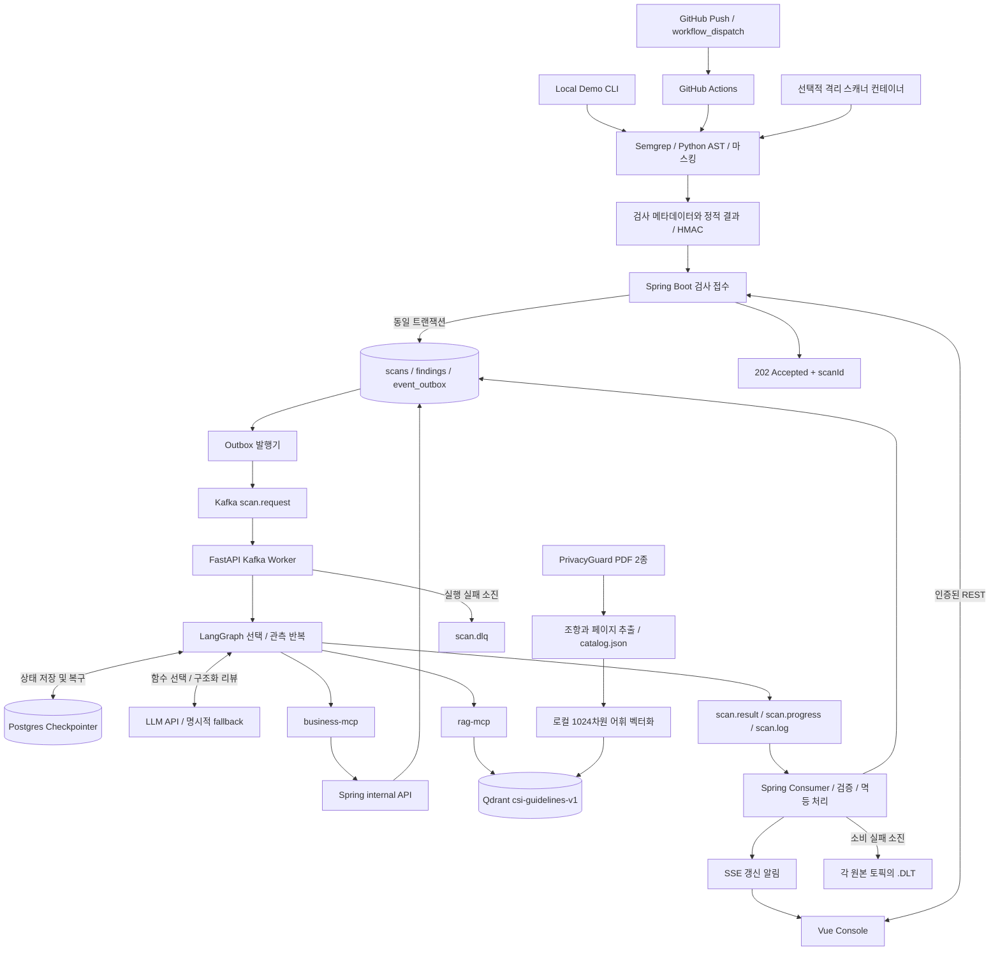
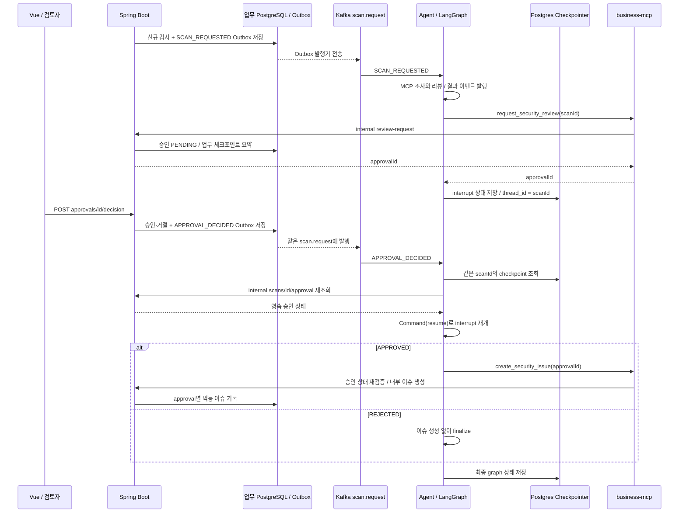

# CSI 실제 구현 기준 아키텍처

2026-10-19 기준 코드와 실행 중인 로컬 구성을 대조한 문서입니다. 초기 구상 그림의 기능을 구현 완료로 간주하지 않습니다. 원 구상 이미지의 편집 가능한 원본은 저장소에 없으므로 README와 이 문서의 Mermaid를 현재 구현을 설명하는 기준으로 사용합니다.

## 팀원 점검 결과와 정확한 표현

| 점검 항목 | 코드 확인 결과 | 발표·그림에 사용할 표현 |
|---|---|---|
| Sandbox | 대상 앱 빌드·테스트·공격 실행 없음. 선택적 Docker 정적 스캐너는 있음 | 네트워크 차단 정적 분석 컨테이너; 대상 코드 실행 Sandbox 미구현 |
| business-mcp 패치 도구 | 읽기 도구와 승인 요청·내부 이슈 생성만 있음 | 업무 조회 / 검토 요청 / 승인 후 내부 이슈 생성 |
| Vector DB OWASP | PG-POL 28개 + PG-REF 19개 = 47개 청크 | 제공된 사내 정책·외부 참조집 RAG |
| Vue 업로드 | 파일 업로드 화면/API 없음 | 조회 / 프로젝트 등록 / Finding 상태 변경 / 승인·거절 |
| 검사 진입점 | Actions와 로컬 CLI의 서명된 검사 결과 POST | GitHub Actions / Local Demo → HMAC 접수 |
| DLQ/DLT | Agent 실패 토픽 1개, Backend 소비 실패 토픽 3개 | scan.dlq + scan.progress.DLT / scan.result.DLT / scan.log.DLT |
| HITL | 신규 검사와 같은 scan.request를 통한 checkpoint 재개 | APPROVAL_DECIDED → 상태 재조회 → 동일 scanId의 Command(resume) |

대상 코드를 격리해서 테스트하는 것 자체가 비침투 원칙과 반드시 충돌하는 것은 아닙니다. 다만 현재 MVP는 검사 대상 Repository의 임의 코드를 실행하지 않는 범위로 설계했습니다. 도식과 구현을 맞추려고 대상 코드 실행, 자동 패치, 파일 업로드를 이번에 추가하지 않았습니다.

## 전체 데이터 흐름

Actions는 GitHub 이벤트를 받아 스캐너를 실행하고 JSON을 POST합니다. GitHub webhook 본문을 Backend가 직접 받는 구조가 아닙니다. Repository allowlist, HMAC·timestamp, payload 제한과 멱등 키를 검증합니다. 로컬 합성 소스 식별자는 실제 GitHub commit SHA와 구분합니다.

SSE는 화면 갱신 알림을 전달하고 Vue가 REST로 상태·결과를 다시 조회합니다. business-mcp가 업무 DB에 직접 쓰지 않으며 승인된 내부 API를 호출합니다. Agent checkpointer는 업무 테이블과 별도 책임으로 같은 PostgreSQL 인스턴스를 사용합니다.

## HITL 재개 시퀀스

보고서 결과 이벤트는 승인 대기 전에 발행됩니다. 따라서 검사 `COMPLETED`와 승인 `PENDING`이 함께 존재할 수 있습니다. 승인된 작업은 **CSI 내부 이슈 기록**이며 코드 패치, 외부 GitHub 이슈 작성, 운영 배포가 아닙니다. 별도 approval 토픽이나 새 scanId로 분석을 다시 시작하지 않습니다. 이미 완료한 graph는 중복 이벤트로 재실행하지 않습니다.

## 실패 경로

| 실패 위치 | 현재 동작 | 남은 한계 |
|---|---|---|
| Backend Outbox → Kafka | 최대 3회 발행 시도, 실패 로그. QUEUED 검사면 FAILED | 승인 재개 이벤트 발행 실패는 기존 완료 보고서를 FAILED로 바꾸지 않음 |
| Agent 검사/재개 실행 | 최대 2회 시도 후 scan.dlq 발행. 일반 검사 실패는 scan.result에 FAILED 전송 | 승인 재개 실패는 기존 보고서를 덮어쓰지 않음 |
| Backend progress/result/log 소비 | 초기 처리 + 2회 재시도 후 원본 토픽 이름에 .DLT를 붙여 보냄 | DLT에 갔다고 즉시 검사 상태가 FAILED가 되는 전용 소비자는 없음 |
| 오래된 검사 | QUEUED/RUNNING이 10분을 넘으면 FAILED | 이미 COMPLETED인 검사의 승인 재개 정체는 이 타이머 대상이 아님 |

DLQ/DLT 토픽은 존재하지만 전용 관리 화면·자동 재전송·소비자 기반 복구는 없습니다. 자동 복구까지 구현됐다고 설명하면 안 됩니다. 장애 테스트를 수행할 때는 정상 검사와 승인 작업에 영향을 주지 않도록 별도로 계획해야 합니다.

## Sandbox와 데이터 출처

`compose.yml`의 `scanner`는 tools profile로 실행합니다. `/target:ro`, `network_mode: none`, 읽기 전용 루트 파일시스템, 비루트 UID 65532, capability 제거, no-new-privileges, CPU·메모리·PID 제한을 적용합니다. 실행되는 것은 승인된 Semgrep/AST 분석기이며 대상 앱·Maven·Gradle·셸 스크립트는 실행하지 않습니다. 기본 로컬 CLI와 GitHub Hosted Runner가 이 Compose 컨테이너를 자동으로 사용하지도 않습니다.

RAG 데이터는 `rag/documents/`의 제공 PDF 두 개이며 `rag/catalog.json`에 PG-POL 28개, PG-REF 19개가 있습니다. Qdrant `csi-guidelines-v1`의 실제 point 수도 47개로 확인했습니다. 참조집 안의 OWASP/NIST 관련 설명을 인용할 수는 있으나, OWASP 공식 원문 사이트를 직접 수집·색인한 corpus로 표현하면 안 됩니다. `docs/`로 옮긴 개인정보 보호법 PDF와 Capstone 자료는 이 색인 대상이 아닙니다.

Lichu의 `BUSINESS_CONTEXT` 실행 로그 역시 현재 CSI에 자동 수집되지 않습니다. 저장 경로에 대한 정적 사실과 Lichu에서 직접 관찰한 런타임 로그는 다른 근거이며, 자동으로 합쳐졌다고 주장하지 않습니다.

## 구현 근거와 검증

| 경로 | 책임 |
|---|---|
| `.github/workflows/csi-security-scan.yml` | CSI 저장소용 opt-in Actions 예시; 실제 대상 Lichu는 자체 workflow 사용 |
| `scripts/scan.py`, `scan_repository.py`, `submit.py` | 정적 검사 / Local Demo / HMAC 전송 |
| `compose.yml`, `rules/Dockerfile` | 선택적 격리 정적 스캐너 |
| `backend/.../Intake.java`, `ApiController.java` | 검사 접수, 승인 결정, 같은 scan.request Outbox |
| `backend/.../KafkaConfig.java`, `KafkaPipeline.java` | 8개 업무 토픽, DLT와 Outbox/소비/timeout 처리 |
| `agent/csi_agent/app.py`, `graph.py` | 두 이벤트 유형 소비, DLQ, interrupt와 승인 재개 |
| `mcp_servers/business.py`, `rag.py`, `index.py` | 실제 도구, Resource, 색인 범위 |
| `frontend/src/views/Console.vue` | 조회·등록·검토·승인; 파일 업로드 없음 |

2026-10-19 확인: 로컬 Qdrant point 47개와 카탈로그의 chunkId·payload 일치, 위 8개 Kafka 업무 토픽 존재, Agent 회귀 테스트 12개 통과. README·Harness·이 문서의 Mermaid 4개를 Chrome에서 SVG로 렌더링해 문법도 확인했습니다. 토픽·데이터 확인은 읽기 전용으로 수행했으며 이번 문서 수정 때문에 장애를 주입하거나 새로운 승인/LLM 작업을 실행하지 않았습니다. 과거 실행 증거는 `AGENT_HARNESS.md`와 `verification.json`의 기록 시점을 함께 확인하세요.
