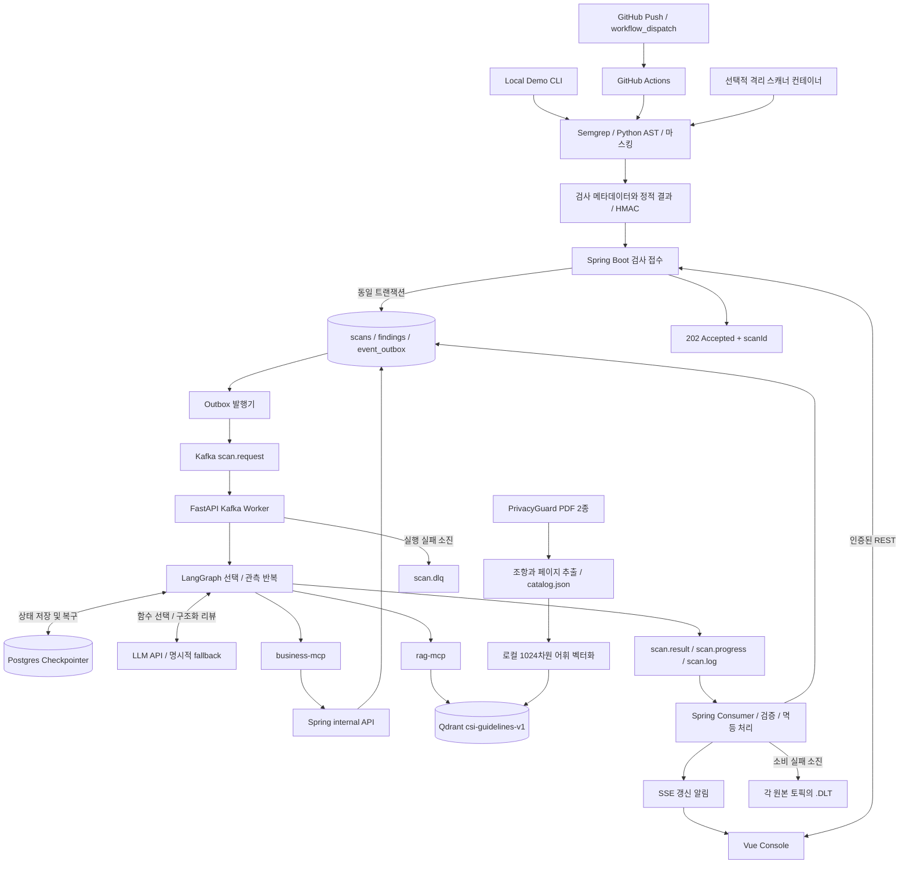
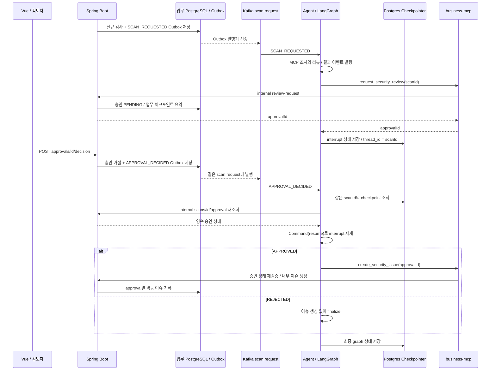

# CSI 실제 구현 기준 아키텍처

2026-10-21 기준 `e9a7048`의 코드를 바탕으로 서비스 경계와 품질 요구사항을 정리했습니다. [상세 구조도](diagrams/CSI.png)와 아래 데이터 흐름을 함께 보세요. 초기 구상 그림에 있는 기능을 구현 완료로 간주하지 않으며, 과거 실행 기록과 이번 코드·테스트 확인의 시점을 구분합니다.

2026-10-22 `ai/coding-agent`에서 선택적 Lichu 코딩 Worker를 추가했습니다. 기존 LangGraph 리뷰 경로와 별도이며, 로컬 모델의 수정안을 격리 테스트하고 관리자 승인 후 새 worktree에 준비합니다. 아래 품질 평가의 과거 결과와 이번 추가 구현을 구분하며, 상세 실행·검증 범위는 [CODING_AGENT.md](CODING_AGENT.md)를 참고하세요.

## 팀원 점검 결과와 정확한 표현

| 점검 항목 | 코드 확인 결과 | 발표·그림에 사용할 표현 |
|---|---|---|
| Sandbox | 정적 스캐너와 별도로 선택적 Lichu 코딩 Worker의 격리 Python 테스트 추가. 공격 실행 없음 | 네트워크 차단·읽기 전용 컨테이너에서 지정된 Lichu 기능·보안 테스트 |
| business-mcp 패치 도구 | 읽기 도구와 승인 요청·내부 이슈 생성만 있음 | 업무 조회 / 검토 요청 / 승인 후 내부 이슈 생성 |
| Vector DB OWASP | PG-POL 28개 + PG-REF 19개 = 47개 청크 | 제공된 사내 정책·외부 참조집 RAG |
| Vue 업로드 | 파일 업로드 화면/API 없음 | 조회 / 프로젝트 등록 / Finding 상태 변경 / 승인·거절 |
| 검사 진입점 | Actions와 로컬 CLI의 서명된 검사 결과 POST | GitHub Actions / Local Demo → HMAC 접수 |
| DLQ/DLT | Agent 실패 토픽 1개, Backend 소비 실패 토픽 3개 | scan.dlq + scan.progress.DLT / scan.result.DLT / scan.log.DLT |
| HITL | 신규 검사와 같은 scan.request를 통한 checkpoint 재개 | APPROVAL_DECIDED → 상태 재조회 → 동일 scanId의 Command(resume) |

기존 정적 분석·LangGraph 리뷰는 대상 코드를 실행하지 않습니다. 선택적 코딩 Worker는 별도 실행 경계에서 지정된 Lichu 프로필의 코드·테스트만 실행하고, 모델이 제시한 명령은 실행하지 않습니다. 추천 코드 생성·승인과 실제 병합·배포는 별도 단계입니다.

## 전체 데이터 흐름

Actions는 GitHub 이벤트를 받아 스캐너를 실행하고 JSON을 POST합니다. GitHub webhook 본문을 Backend가 직접 받는 구조가 아닙니다. Repository allowlist, HMAC·timestamp, payload 제한과 멱등 키를 검증합니다. 로컬 합성 소스 식별자는 실제 GitHub commit SHA와 구분합니다.

SSE는 화면 갱신 알림을 전달하고 Vue가 REST로 상태·결과를 다시 조회합니다. business-mcp가 업무 DB에 직접 쓰지 않으며 승인된 내부 API를 호출합니다. Agent checkpointer는 업무 테이블과 별도 책임으로 같은 PostgreSQL 인스턴스를 사용합니다.

## HITL 재개 시퀀스

보고서 결과 이벤트는 승인 대기 전에 발행됩니다. 따라서 검사 `COMPLETED`와 승인 `PENDING`이 함께 존재할 수 있습니다. 승인된 작업은 **CSI 내부 이슈 기록**이며 코드 패치, 외부 GitHub 이슈 작성, 운영 배포가 아닙니다. 별도 approval 토픽이나 새 scanId로 분석을 다시 시작하지 않습니다. 이미 완료한 graph는 중복 이벤트로 재실행하지 않습니다.

## 실패 경로

| 실패 위치 | 현재 동작 | 남은 한계 |
|---|---|---|
| Backend Outbox → Kafka | 최대 3회 발행 시도, 실패 로그. QUEUED 검사면 FAILED | 승인 재개 이벤트 발행 실패는 기존 완료 보고서를 FAILED로 바꾸지 않음 |
| Agent 검사/재개 실행 | 최대 2회 시도 후 scan.dlq 발행. 일반 검사 실패는 scan.result에 FAILED 전송 | 승인 재개 실패는 기존 보고서를 덮어쓰지 않음 |
| Backend progress/result/log 소비 | 초기 처리 + 2회 재시도 후 원본 토픽 이름에 .DLT를 붙여 보냄 | DLT에 갔다고 즉시 검사 상태가 FAILED가 되는 전용 소비자는 없음 |
| 오래된 검사 | QUEUED/RUNNING이 10분을 넘으면 FAILED | 이미 COMPLETED인 검사의 승인 재개 정체는 이 타이머 대상이 아님 |

DLQ/DLT 토픽은 존재하지만 전용 관리 화면·자동 재전송·소비자 기반 복구는 없습니다. 자동 복구까지 구현됐다고 설명하면 안 됩니다. 장애 테스트를 수행할 때는 정상 검사와 승인 작업에 영향을 주지 않도록 별도로 계획해야 합니다.

## Sandbox와 데이터 출처

[`frontend/compose.yml`](../frontend/compose.yml)의 `scanner`는 tools profile로 실행합니다. `/target:ro`, `network_mode: none`, 읽기 전용 루트 파일시스템, 비루트 UID 65532, capability 제거, no-new-privileges, CPU·메모리·PID 제한을 적용합니다. 실행되는 것은 승인된 Semgrep/AST 분석기이며 대상 앱·Maven·Gradle·셸 스크립트는 실행하지 않습니다. 기본 로컬 CLI와 GitHub Hosted Runner가 이 Compose 컨테이너를 자동으로 사용하지도 않습니다.

RAG 데이터는 `rag/documents/`의 제공 PDF 두 개이며 `rag/catalog.json`에 PG-POL 28개, PG-REF 19개가 있습니다. Qdrant `csi-guidelines-v1`의 point 47개와 카탈로그 일치는 2026-10-19 실행 기록입니다. 참조집 안의 OWASP/NIST 관련 설명을 인용할 수는 있으나, OWASP 공식 원문 사이트를 직접 수집·색인한 corpus로 표현하면 안 됩니다. `docs/`로 옮긴 개인정보 보호법 PDF와 Capstone 자료는 이 색인 대상이 아닙니다.

Lichu의 `BUSINESS_CONTEXT` 실행 로그 역시 현재 CSI에 자동 수집되지 않습니다. 저장 경로에 대한 정적 사실과 Lichu에서 직접 관찰한 런타임 로그는 다른 근거이며, 자동으로 합쳐졌다고 주장하지 않습니다.

## 품질 요구사항과 설계 검증

Capstone 평가표의 **“ISO/IEC 25010 품질평가를 고려한 아키텍처 설계”**에 대응하기 위해, 품질 요구사항을 설계 결정·구현 파일·검증 근거에 연결합니다. 이 문서는 품질을 고려한 설계의 추적표이며 ISO 인증이나 전체 적합성 평가 결과가 아닙니다.

기준은 **ISO/IEC 25010:2023의 제품 품질 특성 9개**입니다. 평가표는 판을 지정하지 않습니다. 2011판에 익숙한 독자를 위해 사용성(Usability)은 2023판의 상호작용 능력(Interaction capability), 이식성(Portability)은 유연성(Flexibility)으로 연결해 설명합니다. 안전성(Safety)은 2023판에서 추가된 특성이며 보안성(Security)과 구분합니다. 이는 명칭 변경만이 아니라 모델 개정이므로 두 판의 세부 특성이 모두 동일하다는 뜻은 아닙니다. 근거: [ISO 2023 개요](https://www.iso.org/standard/78176.html), [ISO 2011 개요](https://www.iso.org/standard/35733.html), [ISO 2023을 채택한 GSO의 공식 미리보기·개정 설명](https://gso-sims-preview-doc-aws.s3-eu-west-1.amazonaws.com/gso-iso-iec-25010-2025-en.html).

### 요구사항에서 검증까지의 대응표

`QA-*`는 CSI의 추적용 ID입니다. 아래 V1–V4의 날짜와 범위는 다음 절에 정의합니다. **부분 검증**은 해당 테스트·시나리오의 통과를 의미하며 품질 특성 전체 충족을 의미하지 않습니다.

| ID / 품질 특성 | CSI의 요구사항 | 설계 결정과 구현 근거 | 확인된 검증 / 남은 범위 |
|---|---|---|---|
| QA-01 기능 적합성 | 정적 탐지·정책·변경 근거를 연결하고 존재하지 않는 Finding이나 인용을 수락하지 않는다 | [출력 검증](../agent/csi_agent/analysis.py), [정책 대조](../mcp_servers/policy_review.py), [변경 결과 검증](../backend/src/main/java/com/csi/ChangeSet.java). 필드 존재·정적 저장 호출·실제 승인 여부를 구분 | V1·V2: 실제 Semgrep 샘플, 가짜 ID·인용·변경 연결 거부. V4: 전후 변경 리뷰. **부분 검증**; 대표 데이터셋의 오탐·미탐 및 리뷰 내용의 의미적 정확도 미측정 |
| QA-02 성능 효율성 | 접수는 장시간 분석과 분리하고 모델·도구 사용량에 상한을 둔다 | [Intake](../backend/src/main/java/com/csi/Intake.java)의 DB/Outbox 저장 후 202, [Harness](../agent/csi_agent/harness.py)의 12턴·모델 호출 32회·입력 예산 상한·작업 시간 제한 | V1: 반복·호출·문맥·마감 예산 테스트. **제한 동작 부분 검증**; p95 접수/분석 지연, 처리량, 실제 금액은 미측정. 예산 상한은 처리 시간·비용 달성 실적이 아님 |
| QA-03 호환성 | 서비스별 언어가 달라도 검증된 계약으로 연결하고 구버전 검사도 조회한다 | [FastMCP 업무 서버](../mcp_servers/business.py), [검색 서버](../mcp_servers/rag.py)의 Streamable HTTP, JSON 이벤트, Backend의 입력 검증. 변경 정보가 없는 검사는 `NOT_PROVIDED` | V2: 구버전 근거 payload와 잘못된 계약 검사. V3·V4: 실제 MCP/REST/Kafka 연결 및 구버전 화면. **부분 검증**; 여러 MCP 클라이언트·API 버전 조합의 계약 시험은 없음 |
| QA-04 상호작용 능력 | 사용자가 진행 상태·근거·불확실성·승인 대상 작업을 구별한다 | [Console](../frontend/src/views/Console.vue)의 상태 표시, SSE 알림 후 재조회, 근거·diff·모드 표시. 검사 완료와 승인 대기를 별도로 표현 | V3·V4: 주요 화면, SSE, 390px 모바일, 변경 비교 E2E 기록. **부분 검증**; 실제 사용자 과업 성공률, 키보드·스크린리더 접근성 시험은 부족 |
| QA-05 신뢰성 | 중복 전달·일시 장애에도 업무 기록이 중복되거나 실패가 성공으로 표시되지 않는다 | [KafkaPipeline](../backend/src/main/java/com/csi/KafkaPipeline.java)의 Outbox·멱등 소비·유한 재시도·stale 검사 종료, [Worker](../agent/csi_agent/app.py)의 PostgresSaver·동일 scanId 재개·DLQ | V1: 메모리 체크포인터 기반 재개/반복 시험. V3: DB checkpoint·승인/거절·중복 이벤트·Kafka 중단 기록. **부분 검증**; 프로세스 강제 종료·DB 복구·다중 Worker·DLQ 재처리 검증은 부족 |
| QA-06 보안성 | 사용자·외부 스캐너·내부 서비스의 권한 경계를 나누고 민감정보·임의 도구 호출을 제한한다 | [Security](../backend/src/main/java/com/csi/Security.java)의 세션/CSRF/역할, Intake의 HMAC·시간창·allowlist, [MCP 토큰 검증](../mcp_servers/common.py), [Planner](../agent/csi_agent/planner.py)의 읽기 도구 allowlist와 인자 검증 | V1·V2: 마스킹·서명 변조·경로·도구 검증. V3: 익명/잘못된 토큰/CSRF 거부. **부분 검증**; 단일 조직 권한이며 침투 시험·종합 프롬프트 인젝션 평가·내부 TLS는 없음 |
| QA-07 유지보수성 | 규칙·정책·프롬프트·업무 API를 분리해 변경 영향을 추적하고 회귀를 확인한다 | [버전 관리 프롬프트](../agent/prompts), [규칙](../rules), [DB 마이그레이션](../backend/src/main/resources/db/migration), [Python 테스트](../tests), [Java 테스트](../backend/src/test/java/com/csi) | V1·V2: Python 40개·Java 8개 통과. **부분 검증**; 테스트 수는 커버리지나 유지보수 비용을 뜻하지 않음. 변경 영향·리뷰 시간·전체 분기 커버리지 미측정 |
| QA-08 유연성 | 배포 환경과 설정을 바꿀 수 있게 구성하되 지원 범위를 명확히 한다 | [Compose](../frontend/compose.yml)의 서비스 분리·볼륨·환경 변수와 [설정 예시](../.env.example). LLM 주소·모델은 설정으로 주입 | V3: 로컬 Compose 빌드·기동 기록. **부분 검증**; 깨끗한 Linux/macOS에서의 재현, 임의 LLM 호환, 다중 Worker 확장·고가용성은 미검증 |
| QA-09 안전성 | 진단 시스템의 오판이나 자동 실행이 운영 변경으로 이어지는 위험을 줄인다 | [Graph](../agent/csi_agent/graph.py)의 검토 요청·interrupt, [내부 API](../backend/src/main/java/com/csi/ApiController.java)의 승인 재검증. 추가 코딩 Worker는 격리 테스트·별도 승인·새 worktree 준비로 제한하며 운영 배포 없음 | V1: 쓰기 도구를 모델 선택에서 제외, 증거 없는 확정 방지. V3: 기존 승인 시 내부 이슈 1건·거절 시 0건. 코딩 Worker 검증은 별도 문서 참조. **제한된 위험 통제 근거**; 정식 위해 분석이나 안전성 보증을 수행한 것은 아님 |

### 검증 근거와 유효 범위

| 근거 | 날짜 / 환경 | 실제로 확인한 내용 | 해석의 한계 |
|---|---|---|---|
| V1 | 2026-10-21 / 로컬 Python | `.venv/bin/python -m pytest tests -q`: **40 passed**. [보안](../tests/test_security.py), [도구 루프](../tests/test_agent_loop.py), [리뷰](../tests/test_review_quality.py), [변경](../tests/test_changes.py) 테스트 | Semgrep fixture 실행을 포함하지만 모델/일부 MCP는 대역을 사용함. 라이브 LLM·전체 서비스 재검증이 아님 |
| V2 | 2026-10-21 / 로컬 Maven | `mvn -o -f backend/pom.xml test -q`: **8 tests, 실패·오류 0**. Intake, EvidenceContext, ChangeSet 검사 | 입력·출력 경계의 단위 테스트이며 실제 DB 트랜잭션·Kafka 장애 시험이 아님 |
| V3 | 2026-10-19 / Local Demo | [verification.json](verification.json)의 인증, 실제 MCP Resource, PostgreSQL checkpoint, HITL 승인/거절, SSE, 중복 이벤트, Kafka 중단, RAG 47청크 기록 | **과거 통합 기록**. 해당 실행은 LLM/GitHub Push 검증을 포함하지 않음 |
| V4 | 2026-10-20 / Local Demo | [CHANGE_REVIEWS](CHANGE_REVIEWS.md)의 실제 Semgrep·Kafka·MCP·Qdrant·OpenAI 변경 리뷰, Chrome E2E 2개, Vue 빌드 기록 | **과거 통합 기록**. 합성/실습 시나리오의 통과이며 GitHub Hosted Runner나 운영 규모 성능의 증거가 아님 |

V1·V2는 문서 보완 직전 동일 코드에서 실행한 결과입니다. 이번 문서·발표자료 작성에서 서비스 중단, 새 LLM 호출, 운영 환경 검증을 수행한 것으로 확대 해석하지 않습니다. V3·V4의 테스트 수를 오늘의 테스트 수에 더해 총 커버리지처럼 제시하지 않습니다.

### 품질 요구사항이 만든 설계 선택

| 선택 | 선택 이유 / 관련 ID | 비용과 절충 |
|---|---|---|
| DB/Outbox 저장 후 202 + Kafka | 긴 분석과 접수를 분리하고 발행 의도를 영속화 (QA-02·05) | 최종 일관성. 202는 접수 성공이며 UI는 최종 상태를 재조회해야 함 |
| 모델의 읽기 선택 + 고정된 승인 후 쓰기 | 근거 조사에는 선택권을 주고 업무 변경에는 권한 검사를 적용 (QA-01·06·09) | 완전 자율 수정은 지원하지 않음. 승인도 수집 목적의 적법성 승인이 아닌 내부 이슈 생성 승인 |
| 예산·타임아웃 + 명시적 fallback | 무한 루프·과도한 호출을 제한하고 장애 시 결과 모드를 드러냄 (QA-02·05) | 제한에 도달하면 근거가 부족할 수 있음. fallback을 LLM 분석 성공으로 표시하지 않음 |
| 마스킹된 정적 근거 + 출처 있는 RAG | 민감정보 전송을 줄이고 리뷰를 확인 가능한 자료에 연결 (QA-01·06·09) | 문자열·런타임 정보가 제거되어 판단 범위가 제한됨. 출처 일치는 문장 전체의 진실성을 보장하지 않음 |
| 컨테이너 분리 + 단일 Broker/Worker | Capstone에서 서비스별 책임과 로컬 재현성을 확보 (QA-07·08) | 프로세스 경계가 있다고 고가용성이 확보된 것은 아님. PostgreSQL은 업무/체크포인터가 공유 |

### 다음 검증의 합격 기준 제안

아래는 **미실행 검증 계획**입니다. 수치는 초기 목표로, 팀이 환경·데이터셋을 고정해 합의해야 합니다. 기존 제한값이나 과거 샘플 통과를 이 목표 달성으로 보고하지 않습니다.

| 대상 | 재현할 조건과 측정 방법 | 제안 합격 기준 |
|---|---|---|
| QA-01 기능 정확도 | 독립 검토자가 라벨링한 취약/정상/판단보류 샘플을 규칙별로 구성. 정책 버전·룰 SHA·모델 버전을 고정 | 범위 내 각 규칙의 precision/recall과 판단보류율 공개. 초기 precision·recall 목표 각각 0.90 이상; 환각 ID·출처 수락 0건. 분모와 제외 사례도 보고 |
| QA-02 접수·분석 효율 | 사전 기동한 로컬 환경, 요청당 20 Findings·100KB 이하·서로 다른 runId로 30회 접수. 모델 호출 포함 분석은 별도 집계 | 접수 p95 ≤ 1초를 초기 목표로 제안. 분석은 큐 대기/모델/MCP 시간과 실제 토큰·당시 단가별 비용을 분리 보고; 아직 분석 SLA는 설정하지 않음 |
| QA-03·08 호환·배포 | 깨끗한 macOS/Linux 환경에서 동일 버전·설정 예시로 기동. 정상/구버전/비정상 payload와 MCP 요청 실행 | 정상/구버전 조회 성공, 비정상 계약 거부, 비밀값을 저장소에 넣지 않고 재현. 다중 Worker는 별도 확장 시험 전까지 미지원 수준으로 설명 |
| QA-04 사용성 | 개발자/보안 담당자 5명이 검사 찾기→근거 확인→승인/거절 수행. 390px·1440px 및 키보드 탐색 확인 | 5명 중 4명 이상이 각 과업을 도움 없이 완료; 주요 조작의 키보드 접근과 가로 잘림 0건. 전체 접근성 적합성 인증과 구별 |
| QA-05 복구 | 격리된 실습 스택에서 interrupt 후 Worker 강제 종료·재시작, 같은 승인 이벤트 10회 전달, Kafka 중단·복구 및 재처리 실험 | 동일 scanId 재개, 승인 이슈 정확히 1건·거절 0건, 실패를 COMPLETED로 오표시 0건. 복구 소요 시간·수동 개입을 기록 |
| QA-06·09 실행 통제 | 권한 없는 세션/토큰, 변조된 보고서·도구 인자, 정책 문서 내 명령 삽입, 승인 없는 이슈 생성 요청 | 준비한 악성 사례에서 비인가 쓰기·임의 코드 실행·민감 값 노출 0건. 시험 목록 밖의 공격까지 방어한다고 일반화하지 않음 |
| QA-07 변경 용이성 | 새 탐지 규칙 1개 추가 시 수정 파일·개발 시간·실패 테스트 기록 | Python·Java·관련 E2E 통과 및 문서/정책 매핑 갱신. 시간 지표는 기준선을 먼저 측정하고 이후 개선 판단 |

시험 실행 시 commit SHA, 환경, 입력 fixture, assertion 결과, scanId/traceId, 실패 사례를 함께 보관합니다. 오래된 검증 스크립트의 bare `docker compose` 명령은 현재 파일 위치인 `frontend/compose.yml`과 루트 `.env`를 사용하도록 확인한 뒤 별도 실습 환경에서 실행해야 합니다. 장애 주입 스크립트를 일반 문서 검증으로 실행하지 않습니다.

## 구현 근거와 검증

| 경로 | 책임 |
|---|---|
| `.github/workflows/csi-security-scan.yml` | CSI 저장소용 opt-in Actions 예시; 실제 대상 Lichu는 자체 workflow 사용 |
| `scripts/scan.py`, `scan_changes.py`, `scan_repository.py`, `submit.py` | 정적 검사 / Local Demo / HMAC 전송 |
| `frontend/compose.yml`, `rules/Dockerfile` | 선택적 격리 정적 스캐너 |
| `backend/.../Intake.java`, `ApiController.java` | 검사 접수, 승인 결정, 같은 scan.request Outbox |
| `backend/.../KafkaConfig.java`, `KafkaPipeline.java` | 8개 업무 토픽, DLT와 Outbox/소비/timeout 처리 |
| `agent/csi_agent/app.py`, `graph.py` | 두 이벤트 유형 소비, DLQ, interrupt와 승인 재개 |
| `mcp_servers/business.py`, `rag.py`, `index.py` | 실제 도구, Resource, 색인 범위 |
| `frontend/src/views/Console.vue` | 조회·등록·검토·승인; 파일 업로드 없음 |

2026-10-19에는 로컬 Qdrant point 47개와 카탈로그의 chunkId·payload 일치, 위 8개 Kafka 업무 토픽 존재, 당시 Agent 회귀 테스트 12개 통과와 Mermaid 렌더링을 확인했습니다. 이는 과거 기록이며, 현재 코드의 테스트와 품질별 유효 범위는 위 V1–V4를 기준으로 구분합니다. 과거 실행 증거는 `AGENT_HARNESS.md`와 `verification.json`의 기록 시점을 함께 확인하세요.

커밋 비교 경로는 [변경 리뷰](CHANGE_REVIEWS.md)를 참고하세요. `scan_changes`에 마스킹된 전후 근거를 저장하고 business-mcp `get_scan_changes`를 통해 기존 LangGraph 리뷰에 연결합니다.
