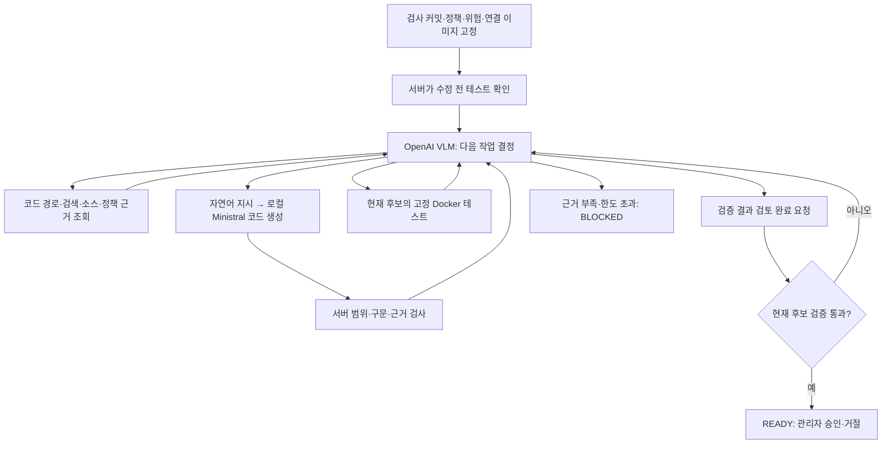

# VLM 총괄 · 프로젝트별 코딩 Agent

새 작업은 공통 엔진 버전 5와 프로젝트별 검증 프로필을 사용합니다. 설정·등록·실행 방법은 [프로젝트별 검증 설정](PROJECT_VERIFICATION_DESIGN.md)의 구현과 운영 방법을 따르세요. 현재 범위는 Python/pytest, 개인정보 로그 유출, 단일 파일 수정입니다. 다른 디렉터리·함수 구조를 가진 Python 프로젝트에 같은 엔진과 검증 팩을 적용합니다.

프로젝트마다 수정 경로·동작 계약·테스트·드라이버·격리 이미지가 고정됩니다. 새 Lichu 프로필은 현재 전화번호 필수 입력과 약한 기존 해시 거부 정책을 보존합니다. 원본 취약점 재현 후 최대 두 후보를 검증하고, 필수 테스트를 모두 통과한 현재 후보만 READY로 제공합니다. 활성 프로필·이미지·모델이 준비되지 않은 작업은 예전 전용 프로필로 되돌아가지 않습니다.

아래 `lichu-signup-v1`, 고정된 13개 보안 테스트와 40개 통과 기준은 엔진 버전 3/4의 **기존 결과·실습 재현용 기록**입니다. 새 프로젝트 프로필 작업에는 적용하지 않습니다.

`ai/coding-agent` 브랜치는 보안 리뷰에 **수정 코드 생성 → 격리 검증 → 관리자 승인 → 새 로컬 브랜치에 반영 준비**를 추가합니다. 모델은 이 Mac(Apple M5, 16GB)에서 비교한 후보 중 전체 코드와 설명을 함께 생성하는 과제에 가장 적합했던 `ministral-3:8b-instruct-2512-q4_K_M`입니다. 전체 오픈소스 모델의 최고 성능을 의미하지 않습니다. 파인튜닝은 사용하지 않습니다.

## 이전 전용 프로필의 지원 범위

- 저장소: 기본 `ymj9608/Lichu`. 코드 프로필: `lichu-signup-v1`.
- 수정 파일: `backend/app/core/csi_signup.py` 하나. `SEC-02`, `SEC-03`, `SEC-05` 탐지와 연결합니다.
- 목표: 신규 비밀번호 bcrypt cost 12·개별 salt, 비밀번호/이메일 원문 로그 제거, 기존 실습 계정 로그인 호환성, 합성 데이터 제한과 기존 함수 유지.
- `rag/policy.json`과 해당 검사에서 이미 검색한 `analysis.references`를 사용합니다. 모델이 임의로 문서를 검색하거나 조문을 추가하지 않습니다. 존재하는 탐지·문서 ID를 인용해야 합니다.
- cost 12는 현재 **가상 실습 정책** 값입니다. 이 기능으로 개인정보보호법 준수나 전체 애플리케이션 보안을 인증하지 않습니다.
- 검증된 취약 실습 baseline에서 시작하는 프로필입니다. 다른 파일, 이미 보완한 코드, 다른 정책 비용, 예상과 다른 기존 테스트 상태는 차단합니다. 범용 저장소 자동 수정 기능은 아닙니다.

## VLM 총괄 경로 (vlm-orchestrator-v1)

기본 총괄 모델은 OpenAI Responses API의 `gpt-5.4-mini-2026-03-17`입니다. `CSI_VLM_PROVIDER=ollama`와 `CSI_VLM_MODEL=qwen3-vl:8b`로 로컬 VLM도 선택할 수 있습니다. VLM이 원본 이미지·위험 분석·정책을 읽고 **조회 → 수정 위임 → 검증 요청 → 재판단**의 다음 행동을 선택합니다. 로컬 `Ministral 3 8B`는 VLM이 요청할 때 코드를 생성하는 하위 실행자입니다. 기존 보안 분석 LangGraph와는 별도의 도구 호출 루프입니다.



| VLM 도구 | 서버가 허용하는 동작 |
|---|---|
| `list_code_paths` | 고정 Git 커밋의 허용된 애플리케이션 경로 목록. 200개 초과 시 prefix로 좁혀 조회 |
| `search_code` | 해당 코드에서 문자열 검색. 최대 30개 일치, 2 MB/8초 검색 한도를 만나면 `truncated` 명시 |
| `read_code` | 선택한 실제 파일의 최대 160줄/12 KB 조회. 미커밋 파일·심볼릭 링크·`.env` 제외 |
| `get_policy_evidence` | 해당 검사에서 확보한 RAG 스냅샷 중 선택한 ID의 근거 조회. 새로운 법률 검색은 하지 않음 |
| `delegate_coding` | 근거를 인용한 자연어 지시문을 Ministral에 전달. 코드 후보와 diff/정적 검증 오류 반환 |
| `run_verification` | 현재 후보에 고정된 격리 테스트 실행. 테스트 명령을 모델이 바꿀 수 없음 |
| `finish_review` | 현재 후보가 검증을 통과한 경우에만 관리자 검토용 READY 제출 |
| `block` | 판단 보류 사유를 남기고 적용 가능한 패치 없이 종료 |

VLM에 초기 전체 소스는 보내지 않습니다. 이미지와 검사 맥락·근거 목록을 먼저 보내고 VLM이 선택한 코드 범위와 정책 발췌를 추가로 전달합니다. 코딩 모델에는 원본 대상·인증 코드·기존 검증 계약도 독립적으로 제공하여 VLM의 잘못된 설명이 계약을 덮어쓰지 못하게 합니다. 중간 아키텍처 그래프 JSON을 생성하지 않습니다. 수정 지시 본문은 자연어이고, 도구 이름·인수·실행 결과는 검증 가능한 JSON 프로토콜입니다.

VLM은 생성 실패·정적 검사 오류·실행 테스트 결과를 받아 추가 조회, 재수정 또는 보류를 선택합니다. 첫 후보가 통과하지 않았다고 코드가 자동으로 다음 생성을 실행하지 않습니다. VLM이 두 번째 위임을 명시적으로 선택해야 합니다. 후보를 바꾸면 이전 테스트 통과 기록은 무효화되며 새 검증이 필요합니다.

서버 한도는 최대 14 VLM 턴, 코딩 위임 2회, 총괄 루프 2,100초, 누적 토큰 사전 추정 및 실제 usage 120,000입니다. OpenAI 호출 timeout은 60초, 로컬 Ollama는 기본 600초이며 로컬 호출은 남은 총괄 시간 이내로 제한합니다. 자동 HTTP 재시도는 없습니다. API 입력에는 이미지 토큰도 포함되므로 이 토큰 한도는 정확한 금액 상한을 보장하지 않습니다. 한도를 넘거나 API가 실패하면 BLOCKED로 끝내며 다른 모델로 조용히 대체하지 않습니다. 코드 경로가 5,000개를 넘는 저장소도 명시적으로 차단합니다.

수정 범위는 여전히 Lichu 실습 파일 하나입니다. VLM의 관련 코드 검색은 추가됐지만 범용 다중 파일 수정이나 임의 shell 실행은 제공하지 않습니다. 이미지·문서 속 명령은 신뢰하지 않으며, VLM도 관리자 승인·원본 반영 조건을 해제할 수 없습니다.

## 이미지 연결·기록·데이터 경계

아키텍처는 선택 사항입니다. 사용할 경우 프로젝트 아키텍처에서 이미지를 열고 **코딩 Agent에 연결**합니다. 원본 PNG/JPEG(5 MiB, 16 MP, 각 변 8192 px 이하)를 서버에 등록하고 선택합니다. 새 수정안의 `architecture_id`에 해당 이미지 버전을 고정하므로 이후 이미지 교체가 이미 등록된 작업을 바꾸지 않습니다. 명시된 이미지 기준 커밋이 검사와 다르면 차단합니다. UI 업로드의 기준 커밋은 UNKNOWN으로 표시하며 일치를 가정하지 않습니다.

OpenAI 제공자를 선택하면 원본 이미지, 정책·위험 분석, VLM이 조회한 소스 범위, 코딩 모델의 후보 diff와 테스트 요약이 전송됩니다. 전체 저장소를 한 번에 업로드하지 않습니다. `store:false`로 요청하고 stateless 대화에 필요한 암호화된 reasoning 항목만 메모리에서 다음 호출로 전달합니다. 추론 내용·암호화 항목·API 키는 화면과 결과 로그에 저장하지 않습니다. `store:false`가 모든 제공자 보관 정책을 해제한다는 뜻은 아닙니다.

`result.handoff`에는 공급자/모델, 이미지 SHA, 커밋, 실제 도구 순서, 위임별 자연어 지시문, 읽은 경로, 근거 ID, 총괄 결론과 API 토큰·시간이 기록됩니다. **VLM 총괄 작업 기록**에서 볼 수 있습니다. `wallDurationMs`는 코딩·검증을 포함한 총괄 구간이며 `apiDurationMs`는 선택한 VLM 제공자의 호출 시간만입니다. 출력 토큰에는 reasoning 토큰이 포함됩니다. 실패가 코드 생성 전 발생했다면 지시문과 후보가 없어도 BLOCKED 결과를 저장합니다.

기존 `vlm-direct-v1` Qwen 결과와 비교 실험 로그는 과거 기록으로 보존합니다. `coding_agent/handoff.py`의 단발성 Qwen 함수는 과거 실험용이며 새 이미지 연결 작업에서 호출하지 않습니다. 별도 `architecture_agent` 구조 JSON API도 새 코딩 경로의 선행 조건이 아닙니다. 이미지가 없는 신규·과거 작업은 engine v3의 코드·정책 기반 흐름을 사용하며 VLM/API 키가 필요하지 않습니다. 이미지가 연결되면 선택한 제공자의 총괄 경로를 사용합니다.

진행 중인 구버전 작업은 완료 후 백엔드와 Worker를 함께 갱신하세요. engine v4 이미지 작업 결과는 새 백엔드 검증 계약이 필요합니다. 기존 READY/APPROVED는 재요청해도 재사용되므로 새 흐름은 새 검사에서 시험하세요. 작업 중 프로세스가 종료되면 VLM 중간 턴에서 자동 재개하지 않습니다. 기존 lease 만료·새 요청 및 완료 결과 전송 복구 방식을 사용합니다.

## 실행

명령은 CSI 저장소 루트 기준입니다. Docker Desktop과 native Ollama가 실행 중이어야 합니다. Apple GPU는 Mac에서 실행하는 Ollama가 사용하며, Docker는 Python 테스트만 수행합니다.

```sh
.venv/bin/python -m pip install -r coding_agent/requirements.txt
ollama pull ministral-3:8b-instruct-2512-q4_K_M
docker build -f coding_agent/verification/Dockerfile -t csi-coding-verifier:local .
```

`.env`에 아래 설정을 반영합니다. 기존 allowlist 항목과 비밀값은 유지하세요. 기본값은 비활성화이므로 기존 스택을 시작하는 것만으로 코딩 작업이 실행되지는 않습니다.

```dotenv
CSI_CODING_ENABLED=true
CSI_CODING_REPOSITORIES=ymj9608/Lichu
CSI_VLM_PROVIDER=openai
CSI_VLM_MODEL=gpt-5.4-mini-2026-03-17
OPENAI_API_KEY=YOUR_OPENAI_API_KEY
# 기존 값에 ymj9608/Lichu 추가 (예)
CSI_REPOSITORY_ALLOWLIST=local/csi-demo,ymj9608/Lichu
```

기존 CSI 분석 스택을 실행한 상태에서 백엔드·프론트엔드를 다시 빌드합니다. Flyway V5~V8이 수정안·아키텍처·이미지 연결 정보를 관리합니다.

```sh
docker compose --project-directory . --env-file .env -f compose.yml up -d --build backend frontend
```

Mac Worker는 별도 터미널에서 실행합니다. `.env`에서 `CSI_INTERNAL_TOKEN`, `OPENAI_API_KEY`, `CSI_VLM_PROVIDER`, `CSI_VLM_MODEL`을 읽고, 기존 환경변수가 있으면 우선합니다. OpenAI 키는 native Worker만 읽으며 프론트엔드·백엔드 컨테이너에는 전달하지 않습니다. 별도 검증 후 `gpt-6-astra`도 설정할 수 있습니다.

```sh
.venv/bin/python -m coding_agent.worker \
  --repo ../Lichu --repository ymj9608/Lichu \
  --backend http://127.0.0.1:8080
```

`--once`를 추가하면 한 번 조회하여 최대 한 작업만 처리하고 종료합니다. 실패·검증 미통과 시 종료 코드 1입니다. 결과 사본은 `.runtime/coding/<수정안 UUID>.json`에 저장됩니다. 일반 로그에는 소스·모델 응답·토큰을 출력하지 않습니다. 차수별 모델 응답과 검사 진단은 `.runtime/coding/<수정안 UUID>/attempt-N.json`에 로컬 파일로 저장합니다(디렉터리 0700, 파일 0600). 이 파일에는 생성 코드가 포함되며 서버에 업로드하지 않습니다.

### 실제 Git 커밋으로 검사

로컬 테스트에서도 `--head-sha`를 지정해야 합니다. 기존 CLI의 기본 `sourceDigest`는 Git 커밋이 아니므로 코딩 Worker에서 처리할 수 없습니다. 모델은 지정 커밋의 Git blob을 읽으며 현재 작업 폴더의 수정 내용을 읽지 않습니다.

```sh
lichu_head=$(git -C ../Lichu rev-parse HEAD)
.venv/bin/python scripts/scan_repository.py ../Lichu \
  --repository ymj9608/Lichu --branch develop --head-sha "$lichu_head"
```

변경 리뷰도 필요하면 `--base-sha BASE_FULL_SHA`를 추가하세요. 실제 Actions 검사도 Worker의 로컬 clone에 해당 커밋이 있어야 합니다. 필요할 때 운영자가 clone을 fetch합니다. Worker가 원격 저장소를 자동 동기화하거나 push하지 않습니다.

완료된 검사의 **프로젝트 → 위험 항목 → 해당 코드 위치 → AI 분석 → 수정안 생성·검토**에서 생성 버튼으로 시작합니다. 보안 리뷰 완료만으로 자동 생성하지 않습니다. 검사 상세의 기존 생성 버튼도 사용할 수 있습니다. 같은 검사·회원가입 파일의 비밀번호 및 로그 위험 항목은 하나의 수정안을 공유합니다. 보안 리뷰 Agent의 `LLM_MODE=disabled` 설정과 로컬 코딩 모델 실행은 독립적입니다.

### 관리자 승인 후 반영 준비

위험 항목의 수정안 생성·검토 탭에서 수정 이유, 연결된 탐지와 문서 원문, 전후 테스트, diff를 확인한 뒤 **검토 후 승인**을 누릅니다. 검증 미통과·대기·실행 중 수정안은 승인할 수 없습니다. 승인 후 patch를 다운로드하거나 아래 CLI로 새 worktree를 만듭니다.

```sh
.venv/bin/python -m coding_agent.worker \
  --repo ../Lichu --repository ymj9608/Lichu \
  --backend http://127.0.0.1:8080 \
  --apply-approved PROPOSAL_UUID --destination ../Lichu-coding-review
```

이 명령은 서버의 승인 상태, 저장소, 원본 커밋, clean working tree, 내용 해시를 다시 확인합니다. 기존 HEAD가 검사 커밋에서 바뀌었으면 거부합니다. `csi/coding-<UUID>` 브랜치와 새 worktree에 수정 파일을 **미커밋 상태로** 준비하며 기존 Lichu 체크아웃은 유지됩니다. 검토·추가 테스트 후 운영자가 commit/push/PR을 수행합니다. 승인과 실제 병합·배포는 별도 단계입니다.

## 검증과 장애 처리

- 모델: native Ollama loopback HTTP만 허용, 8K context, temperature 0, seed 42, 최대 3,000 출력 토큰, JSON Schema로 출력 제한. 요청당 90초, 최대 2회.
- 범위: 단일 파일·모든 기존 함수 및 시그니처·합성 입력 guard 보존. 누락된 전역 이름(import 등), 기존 계정 검증에서 신규 랜덤 해시 함수 재호출을 실행 전에 차단합니다. 허용 import 외 추가, 동적 실행, 알려지지 않은 인용 ID 차단.
- 테스트: commit 스냅샷에 CSI가 관리하는 보안 테스트를 추가하고 고정 pytest 명령 실행. 모델이 추천한 명령이나 테스트 변경을 실행하지 않습니다.
- Docker: 네트워크 없음, 소스·루트 파일시스템 읽기 전용, 비 root, capability 제거, CPU 1·메모리 1GB·PID 128·임시 저장소 128MB·실행 제한. 현재 설치된 verifier 이미지 ID를 결과에 남깁니다.
- 검증 v2에서는 SQLite 기준 총 40개 이상 통과, 실패 0개와 지정된 보안 테스트 13개 각각의 통과 기록이 있어야 READY입니다. 누락·중복된 테스트 ID나 합계만 있는 결과는 거부합니다. PostgreSQL 동시성 테스트 1개는 건너뜁니다. 격리 테스트 통과는 악성 코드 부재나 전체 보안의 증명이 아니며 관리자 코드 검토가 필요합니다.
- Mac이 꺼져 있으면 QUEUED 상태로 남습니다. claim 이후 종료되면 최대 10분 뒤 FAILED로 바뀌고 UI에서 새 작업을 요청할 수 있습니다. 부분 생성부터 자동 재개하지 않습니다.
- `SKIP LOCKED` claim 및 lease token/만료 검증으로 중복 Worker와 늦게 도착한 결과를 통제합니다. 같은 검사에는 활성 수정안을 하나만 둡니다.
- Worker가 수정 전 테스트 / N차 생성 / 코드 검사 / 수정 후 테스트 / 보완 요청 단계를 서버에 기록합니다. UI는 경과 시간과 단계를 표시하고 SSE 외에 5초 조회로 종료 상태를 확인합니다. 이 진행 표시는 lease를 연장하는 heartbeat가 아닙니다.
- 모델이 잘못된 JSON·코드·호환성을 반환하면 오류 위치·누락 이름과 신뢰된 수정 지침을 전달해 한 번 보완 요청 후 BLOCKED가 됩니다. Docker 미실행, 모델 미설치, 원본 커밋 부재, 예상과 다른 baseline 등 실행 전제 문제는 FAILED로 기록됩니다.
- 서버 연결 장애 시 같은 결과를 최대 3회 재전송하고, 실패하면 로컬 pending 파일을 다음 루프·Worker 재시작에서 복구합니다. 모델을 다시 실행하지 않습니다. 결과 파일과 전송 정보는 0600 권한으로 원자 저장합니다. 서버는 같은 토큰·동일 결과만 중복 응답하며 기존 승인·거절 결정을 유지합니다. 15분 lease가 만료되기 전에 저장되지 않은 결과는 뒤늦게 강제 반영하지 않으며 새 작업 요청이 필요합니다.

AWS에는 이 백엔드와 DB를 두고 Mac Worker에서 `--backend https://...`로 접속할 수 있습니다. 외부 HTTP 서버 URL은 거부하며 Ollama 포트를 인터넷에 공개할 필요가 없습니다. 클라우드 배포·TLS·접근 통제는 이번 구현에서 수행하지 않았습니다.

## 초기 구현의 실제 검증 (검증 v1 기록)

2026-10-22, Apple M5 16GB / Ollama 0.32.1 / Lichu `95345dbd8ba45fe77ea8cd926c84e40e4d16f83a` 기준입니다. 격리 검증 Python 3.11, 의존성은 `verification/requirements.lock.txt`로 고정했습니다.

| 항목 | 수정 전 | 실제 모델 수정 후 |
|---|---:|---:|
| 전체 테스트 통과 | 30 | 34 |
| 전체 테스트 실패 | 4 | 0 |
| 추가 보안 테스트 통과 | 3 / 7 | 7 / 7 |
| 건너뜀 | 1 | 1 |

스키마와 호환성 지침 보완 후 실제 생성·전후 검증 61.2초, 백엔드 claim부터 실행한 CLI Worker 65.1초였습니다. 소수의 실측이며 장기 성공률·응답시간 보장이 아닙니다. 초기 시도에서는 출력 형식 오류와 레거시 해시 prefix 처리 오류가 검증에서 차단됐습니다.

검증 범위: 테스트가 삽입된 실제 Lichu 스냅샷에서 모델 추론, 임시 PostgreSQL의 중복 요청·동시 claim·잘못된/만료된 lease 차단, 실제 HTTP Worker 결과 저장, Chrome 데스크톱·390px 모바일 diff 및 승인·patch 다운로드 E2E 통과, 임시 clone에서 승인된 수정안을 새 브랜치/worktree로 준비하는 CLI 통과. 통합 검사는 합성 검사 context와 저장된 카탈로그 근거를 사용했으며 GitHub push→Kafka→RAG 검색 전체 구간을 새로 재실행한 결과는 아닙니다.

단위·회귀 테스트와 빌드:

이번 변경 후 Python 64개, Java 14개 테스트가 통과했고 Vue/TypeScript 빌드와 코딩 승인 브라우저 E2E가 통과했습니다.

```sh
.venv/bin/python -m pytest -q
(cd backend && mvn test)
(cd frontend && npm run build)
```

브라우저 통합 테스트는 READY 수정안과 로그인 가능한 격리 CSI 환경에서 실행합니다. 테스트가 실제 승인 결정을 내리므로 업무용 검사를 지정하지 마세요. 환경변수 `CSI_CODING_TEST_SCAN`, `CSI_CODING_TEST_USER`, `CSI_CODING_TEST_PASSWORD`를 제공한 뒤 frontend에서 `npx playwright test e2e/coding.spec.ts`를 실행합니다. 기존 Playwright 설정의 서버 주소는 `http://127.0.0.1:5174`입니다.

## 반복 생성 실패 보완 (2026-10-22)

실제 검사 `9586063b-5e33-4403-862a-85d304775bdb` 입력으로 이전 실패를 재현했습니다. 1차 모델은 `app.core.security`를 다시 import했고, 2차는 금지 import 제거 과정에서 필요한 `import bcrypt`까지 삭제하여 5개 테스트가 실패했습니다. 기존 오류 코드만 전달하는 피드백은 어떤 import가 금지인지 구분하기 어려웠습니다.

보완 내용:

- 허용 import 계약을 생성·재시도에 동일하게 전달하고, 누락된 전역 정의와 레거시 검증의 잘못된 함수 호출을 실행 전에 확인합니다. 검사 기준은 완화하지 않았습니다.
- 비밀번호·로그 정책 및 외부 참조가 고르게 포함되도록 근거를 선택합니다. 조회 순서에 따라 첫 규칙의 근거만 입력되는 문제를 줄였습니다.
- 레거시 로그인 호환성 계약과 오류별 보완 지침, 로컬 진단 기록을 추가했습니다. 실패 후보와 성공 후보의 테스트 결과를 구분해 표시합니다.
- 사용자 분석 후 명시적으로 생성하는 흐름으로 바꾸고, 위험 항목 상세에서 근거 원문·diff·승인/거절을 제공합니다. 승인으로 위험 항목을 자동 해결 처리하거나 코드를 병합하지 않습니다.

최종 지침으로 같은 실제 검사 입력을 재검증한 결과, 1차 생성에서 34개 통과·0개 실패·1개 건너뜀(추가 보안 검사 7/7), 약 66.7초였습니다. 소수 사례의 결과로 전체 입력의 성공을 보장하지 않습니다. Python 회귀 테스트 67개, Java 15개 통과.

변경 후에는 backend/frontend 이미지를 다시 빌드하고 실행 중인 Mac Worker도 재시작해야 합니다. Flyway V6가 진행 상태 필드를 추가합니다.

실행 중인 CSI의 위험 항목 화면에서 직접 재요청한 수정안 `bd5e68ff-6a3f-4c14-bd5d-7216c9d49b5e`도 1차 생성에서 READY가 되었고, 73.2초에 34개 통과·0개 실패·1개 건너뜀을 기록했습니다. 연결된 근거 원문·diff·모바일 화면을 확인했으며 실제 승인 상태는 READY로 유지했습니다. 별도 가짜 API 브라우저 테스트 3개에서 생성→근거 확인→승인, 실패 차단→재시도→거절, 지원하지 않는 위험 항목의 생성 차단을 검증했습니다.

현재 Mac의 갱신된 Worker는 백그라운드로 실행 중이며 로그는 `.runtime/coding/worker.log`, PID 기록은 `.runtime/coding/worker.pid`입니다. 기존 터미널 Worker는 갱신 과정에서 종료했습니다. 다음에 다시 실행할 때는 이 문서의 일반 Worker 명령을 사용하세요.

## MVP 고도화: 확인된 개선과 남은 작업 (2026-10-22)

이번 고도화는 기존 단일 파일 실습 범위를 유지하면서 결과의 신뢰성과 설명을 개선합니다. 원본 Lichu 코드, 운영 DB, 과거 로그를 자동 변경하는 기능은 추가하지 않았습니다.

| 영역 | 수정 전 | 수정 후 |
|---|---|---|
| 결과 설명 | 모델의 이유·한계를 검증 수치와 나란히 노출하여 호환성·준수 여부를 오해할 수 있음 | 신뢰된 테스트별 상태로 5개 항목의 전후 비교 생성. 모델 설명은 별도 접힌 영역에 표시 |
| 해시·로그 검증 | 보안 테스트 7개, 대표 실습 입력 중심 | 13개로 확대. 다른 비밀번호·한글·72바이트 경계, 실습 모드 밖 신규 해시 인증, 기존 계정 DB 해시 유지 여부를 확인 |
| 잘못된 로그 수정 | 로그 시스템을 통째로 꺼도 누출 검사만 통과할 수 있음 | 로그 설정 변경을 정적 차단하고 비민감 이벤트·다른 로그가 유지되는지 실행 검증 |
| 근거 연결 | 모델이 비밀번호 근거만 인용해 로그 수정 근거가 빠질 수 있음 | 전후 비교 항목마다 해당 탐지와 실제 검색된 정책 근거 ID 연결 |
| 데이터 후속 조치 | 기존 해시·과거 로그가 해결된 것처럼 읽힐 수 있음 | 기존 해시 전환, 과거 로그 정리, 원본 반영·운영 검증을 남은 작업으로 표시 |
| 결과 전달 | 서버 응답을 잃으면 생성 성공도 실패로 처리 | 결과를 저장하고 동일 결과 재전송. 응답 유실·재시작 복구 및 관리자 결정 보존 |
| RAG 누락 | 빈 검색을 반복하다 턴 한도 초과로 전체 검사 실패 | 대체 검색·다른 규칙으로 진행. 확보한 결과를 보존하며 누락 근거는 PARTIAL과 판단 보류로 표시 |

RAG의 제한적 완료는 정책 스냅샷을 확보했을 때만 허용합니다. 정책 자체를 가져오지 못하면 제한된 재시도 후 실패하며 기본 정책을 임의로 만들어 사용하지 않습니다. 기존 정책 판단과 관리자 검토 요구는 유지합니다.

같은 Lichu 커밋 `95345dbd8ba45fe77ea8cd926c84e40e4d16f83a`에 실제 로컬 모델을 실행하고 **동일한 검증 v2**로 전후를 비교한 결과입니다.

| 항목 | 수정 전 | 모델 수정안 적용 후 격리 테스트 |
|---|---:|---:|
| 전체 테스트 통과 | 33 | 40 |
| 실패 | 7 | 0 |
| 보안 테스트 통과 | 6 / 13 | 13 / 13 |
| 건너뜀 | 1 | 1 |

1차 생성에서 통과했으며 총 80.1초(생성 약 61.7초, 수정 후 테스트 약 11.6초)였습니다. 이는 한 차례 실측이며 성능 보장 수치가 아닙니다. 기존 34개/7개 결과와 숫자만 비교해 성능 향상률로 계산하면 안 됩니다. 테스트 범위가 달라졌으므로 UI에서도 과거 결과를 과거 기록으로 구분합니다.

원본 반영 여부는 별도로 확인해야 합니다. 검증은 승인·병합·배포를 대신하지 않습니다. 기존 SHA-256 해시는 로그인 호환성을 유지하지만 자동으로 bcrypt로 전환하지 않으며, 민감정보를 기록하던 과거 로그도 삭제하지 않습니다.

새 결과 확인: Lichu 프로젝트에서 새 검사를 실행하고 위험 항목의 **AI 분석 → 수정안 생성·검토**로 이동합니다. **수정 전후 개선 사항 → 아직 남아 있는 작업 → 검증 범위 → 테스트 결과 → 근거·diff** 순서로 확인한 뒤 승인/거절합니다. 이미 저장된 과거 결과를 새 테스트 결과로 바꾸지는 않습니다.

회귀 검증: Python 95개 통과, 프런트 빌드 통과, 브라우저 모의 API 시나리오 9개 통과. 백엔드 결과 전송·검증 관련 Java 14개와 기존 테스트를 포함한 이미지 패키징이 통과했습니다. 실제 로컬 CSI에서도 새 Semgrep 검사 → Kafka·RAG·분석 완료 → 위험 항목에서 수정안 요청 → 검증 결과 저장 → 전후 비교·근거·모바일 화면을 확인했습니다. 실제 관리자 승인/거절은 실행하지 않고 READY로 유지합니다. 모의 API 테스트의 관리자 결정과 실제 기록은 구분합니다.

재배포 시에는 검증 v2 이미지, Worker, 백엔드를 함께 갱신하세요. 구버전 Worker와 새 검증기 결과를 섞으면 baseline 검사가 차단될 수 있습니다. 진행 중인 생성 작업을 마친 뒤 Worker를 재시작하고 새 검사를 요청하면 됩니다. 현재 실패 원인은 결과 화면에서도 한국어로 구분해 표시합니다.

최종 근거 분류 보완 후 실제 결과: 검사 `a3e410c6-18c1-4222-8a57-a06b97963643`, 수정안 `1a6860ec-7011-4710-a581-2f485485c883`. 1차 생성·검증 80.7초, 40개 통과·0개 실패·보안 13/13·동시성 1개 건너뜀, 관리자 검토 대기 상태입니다. Salt 관련 REF-05는 비밀번호 항목에, 로그 관련 REF-06은 로그 항목에 연결합니다. 실제 백엔드/DB에서도 동일 결과 재전송은 확인 응답만 반환하고, 다른 내용·잘못된 토큰은 409로 거절하며 기존 결과를 유지함을 확인했습니다.

## 저장된 결과의 순차 표시

프로젝트를 열면 최근 완료된 검사 결과를 **위험 요약 → 추이·분포 → 진단 범위 → 검토할 항목** 순서로 약 2초 동안 펼칩니다. 위험 항목 상세도 **코드 사실 → 잠재 위험 → 근거·불확실성 → 다음 조치** 순서로 나타나며 설명 문장에 짧은 타이핑 효과를 적용합니다.

이는 저장된 결과의 표시 방식입니다. 프로젝트 클릭이나 다시 보기는 분석·모델 호출·수정안 생성·관리자 결정을 실행하지 않습니다. 완료된 검사 자체가 없는 프로젝트에는 완료 결과 연출을 적용하지 않습니다. 실제 서버의 상태와 SSE 갱신은 그대로 유지하며, 같은 화면의 백그라운드 갱신은 순차 표시를 다시 시작하지 않습니다.

`전체 바로 보기`로 즉시 펼치거나 `다시 보기`로 재생할 수 있습니다. 프로젝트 이동 시 이전 타이머를 정리하고, 운영체제의 동작 줄이기 설정에서는 즉시 전체 결과를 보여줍니다. 스크린리더에는 문장 전체를 제공하며 글자마다 실시간 알림을 발생시키지 않습니다.

검증: 순차 표시 신규 브라우저 8개와 기존 수정안 흐름 9개, 총 17개 통과. 프런트 빌드 후 현재 로컬 서버에 배포했습니다. 실제 Lichu 프로젝트에서도 순차 표시·다시 보기·전체 보기·모바일 및 최신 READY 수정안 연결을 확인했고, 해당 읽기 흐름에서 분석·생성·승인 API를 새로 호출하지 않았습니다.

### OpenAI 실모델 총괄 경로 점검

```sh
.venv/bin/python scripts/smoke_vlm_coding.py --repo ../Lichu
```

기본값은 `95345dbd8ba45fe77ea8cd926c84e40e4d16f83a` 커밋, 코드에서 작성한 `docs/benchmarks/lichu-architecture.png`, 실습 정책 카탈로그입니다. `smoke-*` 탐지 ID는 테스트용이며 실제 서버 검사 결과가 아닙니다. 실제 OpenAI API 사용과 외부 전송이 발생합니다. OpenAI 도구 루프 → 로컬 Ministral → Docker 검증을 수행하며 서버 등록·승인·원본 수정은 하지 않습니다. `.runtime/vlm-orchestrator-smoke/summary.json`에 요약, 같은 비공개 디렉터리에 결과·후보 코드가 저장됩니다. 실패 시 종료 코드 1입니다. 기존 Qwen 실측 로그를 이번 모델의 결과로 사용하면 안 됩니다. [현재 검증 범위](testing/vlm-orchestrator-validation.md)를 참고하세요.

## 메모리와 빠른 비교

로컬 총괄 VLM은 응답 후 기본 300초 동안 메모리에 유지하도록 요청합니다. 반복 조회 때 모델을 다시 불러오는 비용을 줄이기 위한 설정이며, 실제 상주는 Ollama의 메모리 관리에 따릅니다. 메모리가 부족하면 `CSI_LOCAL_VLM_KEEP_ALIVE_SECONDS=0`으로 변경할 수 있습니다. 코딩 모델과 독립 아키텍처 추출은 응답 후 해제합니다. [모델 선택·데이터 수집·팀원용 설명](PERCEPTION_REASONING.md), [OpenAI 빠른 비교](benchmarks/flink/openai-quick/RESULTS.md)를 참고하세요.

## Windows·Mac 공통 로컬 실행 설정 (2026-10-24)

공통 엔진의 시간 설정은 `coding_agent/runtime_settings.py`와 `.env`에서 관리합니다. 장비 이름이나 특정 프로젝트 경로로 분기하지 않습니다. 백엔드 lease는 45분, 공통 프로젝트 엔진 실행은 최대 44분, 총괄 루프는 35분입니다. 이는 종료 상한이며 고정 대기 시간이 아닙니다. 코딩 위임 최대 2회, 고정 보안·기능 테스트와 승인 조건은 그대로입니다. 실행 한도 변경 시 백엔드와 Worker를 함께 갱신해야 합니다. 이미 BLOCKED인 요청은 자동 재개하지 않습니다.

| `.env` 설정 | 기본값 | 허용 범위 |
|---|---:|---:|
| `CSI_LOCAL_VLM_TIMEOUT_SECONDS` | 600초 | 30–900초 |
| `CSI_LOCAL_VLM_NUM_CTX` | 16384 | 8192–32768 |
| `CSI_LOCAL_VLM_NUM_PREDICT` | 1024 | 256–2048 |
| `CSI_LOCAL_VLM_KEEP_ALIVE_SECONDS` | 300초 | 0–600초 |
| `CSI_ARCHITECTURE_TIMEOUT_SECONDS` | 900초 | 60–1800초 |
| `CSI_ARCHITECTURE_NUM_PREDICT` | 1536 | 512–4096 |

로컬 응답은 도구별 JSON 객체 형식으로 제한하며 근거 ID·수정 범위·검증 결과는 호스트에서 다시 확인합니다. 응답 시간 초과도 API 대기 시간으로 기록하고, 미수신 토큰 수를 0으로 해석하지 않도록 표시합니다. 제한을 늘리는 것만으로 실제 생성 성공이나 속도가 보장되지는 않습니다.

### Mac에서 기존 환경 갱신

기존 Mac의 CSI 백엔드·프런트엔드를 이 소스로 재빌드하고, Python 가상환경은 Mac에서 별도로 생성합니다. Windows의 `.venv`·`.runtime/tools`는 복사하지 않습니다. Docker Desktop의 Linux 엔진, Git, 네이티브 Ollama가 실행되어 있어야 합니다. 동일 모델을 설치하고 `.env`에 `CSI_VLM_PROVIDER=ollama`, `CSI_VLM_MODEL=qwen3-vl:8b` 및 위 공통 설정을 사용합니다. 인증 값은 Mac의 기존 값을 유지합니다.

```sh
ollama pull qwen3-vl:8b
ollama pull ministral-3:8b-instruct-2512-q4_K_M
docker info
docker build -f coding_agent/verification/Dockerfile -t csi-coding-verifier:local .
docker build -f coding_agent/verification/Project.Dockerfile -t csi-project-verifier:v1 .
```

프로젝트 검증 설정의 Docker 이미지 ID는 장비에서 빌드한 실제 이미지에 고정합니다. 특히 Apple Silicon에서는 Windows의 prepared JSON을 그대로 활성화하지 않고 Mac에서 다시 준비합니다. 다음 명령의 `BASELINE_SHA`는 검증하려는 원본 취약점이 재현되는 전체 커밋 SHA로 지정합니다. 일반화된 엔진은 유지하며 예시만 Lichu 설정을 사용합니다.

```sh
export PYTHONUTF8=1
.venv/bin/python -m coding_agent.project_setup --repo ../Lichu --commit "$BASELINE_SHA" \
  --config coding_agent/project_profiles/lichu/draft.json --output .runtime/lichu-profile-prepared.json
```

`.runtime/local-automation.json`에 `{"preparedProfiles":["lichu-profile-prepared.json"]}`을 저장하고 `.env`에 `CSI_LOCAL_AUTOMATION_CONFIG=.runtime/local-automation.json`을 설정합니다. CSI 로그인 API와 서버에 접근 가능한 상태에서 아래를 실행합니다. 프로젝트 등록 후 프로필 연결과 QUEUED 이미지의 아키텍처 Worker 실행은 자동화 서비스가 처리합니다. 코딩 Worker는 별도 터미널에서 대기하며 사용자가 생성 버튼을 누를 때 작업을 받습니다.

```sh
.venv/bin/python -m scripts.start_local_automation
.venv/bin/python -m coding_agent.worker --repo ../Lichu --repository ymj9608/Lichu --env-file .env
```

기존 프로젝트에 다른 장비의 프로필이 이미 활성화되어 있다면 자동화는 덮어쓰지 않습니다. Mac에서 준비한 설정을 `scripts/register_verification_profile.py --help`의 명시적 등록 절차로 활성화해야 합니다. 같은 백엔드에 같은 저장소의 Windows·Mac 코딩 Worker를 동시에 연결하면 먼저 claim한 장비가 실행하므로 비교 실험에서는 하나만 실행합니다. `.runtime/start_local_backend.py`는 Windows 전용 개발 편의 스크립트이며 Mac에서는 기존 서버 실행 방법을 사용합니다. 이번 변경의 Mac 실장비 실행은 아직 검증하지 않았습니다.
