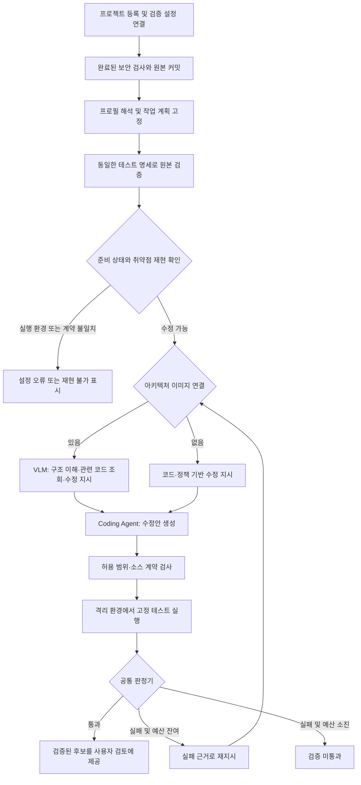

# 프로젝트별 검증 설정과 공통 코딩 엔진 설계

작성일: 2026-10-24

상태: Python/pytest 단일 파일 MVP 구현. `feat/project-verification-profiles`의 새 작업은 프로젝트 프로필을 사용하는 엔진 버전 5로 실행한다. 다중 파일·다른 언어·프로필 편집 UI는 후속 범위다.

## 구현과 운영 방법

- 공통 생성: `coding_agent/project_engine.py`; 프로필·판정: `project_verification.py`; Python/Docker 어댑터: `project_adapter.py`.
- 개인정보 검증 팩: `verification/privacy_pack.py`. 프로젝트 진입점·샘플·기능 계약은 `project_profiles/<project>/driver.py`와 `draft.json`에 둔다. 공통 엔진에는 저장소 이름에 따른 분기가 없다.
- 서버: `ProjectVerification.java`, DB 마이그레이션 V11. 불변 프로필 버전, 활성 버전, 작업별 계획 digest, 테스트 실행 기록과 Worker 준비 상태를 저장한다. 같은 scan이라도 계획이 달라지면 별도 작업을 만든다.
- VLM의 읽기·수정 위임·검증 도구는 프로필의 허용 경로를 사용한다. 이미지가 없는 검사는 코드·정책 경로로 동작한다.
- 과거 엔진 버전 3/4의 결과와 검증기는 이력 호환 목적으로 유지한다. 새 요청에는 활성 프로필이 필요하다.
- 프로필 등록은 운영자 CLI/API로 수행한다. 화면은 활성 프로필·테스트 수·Worker 준비 여부·테스트별 결과를 표시한다. 자동 프로젝트 탐지와 편집 UI는 구현하지 않았다.

운영자가 프로젝트 설정과 드라이버를 검토한 뒤 다음 순서로 연결한다. 대상 저장소의 설정을 push하는 것만으로 실행 설정을 바꿀 수 없다.

```powershell
docker build -f coding_agent/verification/Dockerfile -t csi-coding-verifier:local .
docker build -f coding_agent/verification/Project.Dockerfile -t csi-project-verifier:v1 .
python -m coding_agent.project_setup --repo ../Lichu --commit <40자리-SHA> --config coding_agent/project_profiles/lichu/draft.json --output .runtime/profile-prepared.json
python -m scripts.register_verification_profile --project <프로젝트-UUID> --prepared .runtime/profile-prepared.json
python -m coding_agent.worker --repo ../Lichu --repository ymj9608/Lichu
```

등록 명령의 `--project`는 생략할 수 있습니다. 생략하면 준비된 프로필의 `repository`와 일치하는 등록 프로젝트의 UUID를 실행 시 조회합니다. 명시한 UUID도 해당 저장소와 일치하는지 확인하며, 프로젝트 미등록·중복·불일치 시 등록을 중단합니다.

### 로컬 프로젝트 등록 자동화

`scripts.local_automation`은 5초 간격으로 등록 프로젝트를 조회합니다. 운영자가 지정한 준비 파일의 `repository`와 일치할 때만 기존 등록·검증 기록 제출·활성화 API를 사용합니다. 활성 프로필이 있으면 유지하며, 새 원본 검증 결과를 만들어내지 않습니다. 수정안 요청 시 해당 커밋에 대한 원본·후보 검증은 기존 엔진이 다시 수행합니다.

예를 들어 `.runtime/local-automation.json`을 다음처럼 만들고 `.env`에 `CSI_LOCAL_AUTOMATION_CONFIG=.runtime/local-automation.json`을 설정합니다. 파일 경로는 JSON 설정 파일 기준입니다. 다른 프로젝트도 준비한 프로필 경로를 목록에 추가하면 됩니다.

```json
{"preparedProfiles": ["lichu-profile-prepared.json"]}
```

```powershell
.venv/Scripts/python.exe -m scripts.start_local_automation
```

설정은 서비스 시작 시 읽습니다. 변경 후 재시작해야 합니다. 중복 실행은 프로세스 잠금으로 막고, 로그와 PID는 `.runtime/local-automation/`에 저장합니다. 이 PC의 `.runtime/start_local_backend.py`에도 시작 호출을 연결했습니다. 다른 서버 실행 방식이나 OS 로그인 시 자동 실행은 별도 설정해야 합니다.

이미지가 `QUEUED`이면 프로젝트용 아키텍처 Worker를 자동 실행합니다. 서비스가 시작한 이미지 분석은 한 번에 하나이며, 이미 분석 중이거나 완료된 이미지를 다시 claim하지 않습니다. DB 초기화·재등록 후에는 새 UUID를 조회합니다. 추론 실패 시 기존 Worker의 진행 상태가 남는 한계가 있어 로그 확인과 명시적인 이미지 재업로드가 필요하며, 자동 무한 재시도는 하지 않습니다. 이 서비스는 검사·수정안 생성·승인·Slack 전송을 요청하지 않습니다. 코딩 VLM의 이미지 선택은 기존 UI의 **코딩 Agent에 연결** 동작을 유지합니다.

`project_setup`은 Docker 원본 검증을 실행하고 전체 pytest node ID, 이미지·팩·드라이버 digest를 고정한다. 관련 없는 원본 테스트 실패는 차단한다. 등록 CLI는 리뷰어 세션으로 초안을 등록하고 별도의 내부 Worker 인증으로 검증 기록을 제출한 다음 활성화한다. 인증 값은 `.env`에서 읽으며 출력하지 않는다.

실제 JSON 필드는 `draft.json`을 기준으로 한다. 아래 YAML은 개념 설명이며 실행기가 읽는 포맷이 아니다. `snapshotPaths`는 정확한 파일/디렉터리 목록이며 glob이나 임의 명령 문자열은 허용하지 않는다. `relatedFailures`는 해당 취약점 때문에 실패하는 기존 테스트의 전체 ID이다.

다른 Python 프로젝트에는 설정과 검토된 드라이버를 추가한다. 다른 의존성은 별도로 준비한 검증 이미지가 필요하고, Java/Gradle 등은 어댑터 구현이 필요하다. 필요한 이미지·모델이 없는 Worker는 새 작업을 claim하지 않는다. 모델 호출은 회당 최대 300초, 최대 두 번이며 검증 시간을 포함해 15분 lease 안에서 종료한다.

로컬 모델에는 수정 대상 전체와 직접 연결된 호출부·타입 선언을 제공한다. 모델은 파일 전체 재출력 대신 최대 네 개의 정확한 텍스트 교체(`path`, `old`, `new`)를 반환한다. Worker가 원본에서 각 `old`의 유일성·겹침 여부를 확인해 전체 후보 파일을 재구성한다. 사용자에게 제공되는 내용과 검증 대상은 같은 전체 후보 파일이다. 테스트에는 축약 전의 전체 승인 스냅샷을 사용한다.

최종 승인은 필수 테스트가 모두 PASS이고 사전에 승인된 기존 SKIP만 남은 경우에 가능하다. 원본/후보의 전체 테스트 ID, 파일 manifest, 현재 후보 SHA, 계획 digest를 검사한다. 두 번 모두 미통과하면 BLOCKED이며 승인 가능한 코드를 제공하지 않는다. 현재 Lichu의 PostgreSQL 동시성 검사 한 항목은 SQLite 환경에서 SKIP하며 성공으로 계산하지 않는다.

API는 `POST /api/projects/{id}/verification-profiles`, `POST /internal/projects/{id}/verification-profiles/{version}/validate`, `POST /api/projects/{id}/verification-profiles/{version}/activate`, `GET /api/projects/{id}/coding-capabilities`, `GET /api/coding-proposals/{id}/verification`이다. 검증 증명 제출은 내부 Worker 인증만 받으며, 공개 사용자 API에서 검증 성공을 직접 제출할 수 없다.

### 2026-10-24 구현 검증

| 검증 | 결과 |
|---|---|
| 실제 Lichu 원본 `956c8331f87b1b42f7f4a5996519572fa86e0d9f` | 35 PASS, 3 FAIL, 1 사전 허용 SKIP; 개인정보 팩 3/4 |
| 실제 로컬 Ministral 생성 및 Docker 검증 | 첫 후보 READY, 38 PASS, 0 FAIL, 1 사전 허용 SKIP; 개인정보 팩 4/4; 전체 181.407초 |
| 로컬 모델 작업 ID | `55f0aad6-60c7-4f96-b45a-64a30bfbff7f`; 프로필 `lichu-privacy-v1` 버전 1 |
| 다른 Python 구조 `service/contacts/service.py` | 공통 엔진·팩으로 5/5 PASS; 내부 개인정보 저장을 삭제한 후보는 BLOCKED |
| 서버·화면 검증 | 백엔드 63개, Playwright 21개 통과; 실제 READY 화면과 승인 버튼 활성화 확인, 승인 자체는 실행하지 않음 |

두 번째 프로젝트는 자동화 테스트의 결정적 모델 대역을 사용했다. Lichu도 별도의 정상 수정 대조군을 실행했지만 위 로컬 모델 행은 실제 Ollama 응답으로 생성한 결과다. 두 결과를 구분한다. 새 Lichu 작업에는 아키텍처 이미지가 연결되어 있지 않아 코드·정책 경로를 사용했다. 따라서 이번 확인은 공통 엔진과 검증 설정 분리의 기능 검증이며 Vision 성능 입증 실험이 아니다. VLM 위임 경로는 다른 프로젝트 경로를 사용하는 자동화 도구 시퀀스 테스트로 확인했다.

초기 전체 파일 재출력 방식은 이 PC에서 300초 제한을 넘겼다. 해당 작업은 설정 갱신으로 종료하고 이력을 보존했다. 이후 직접 연결된 호출부 중심으로 소스 입력을 18,840바이트에서 4,868바이트로 줄이고 정확한 텍스트 교체 방식으로 바꿨다. 테스트와 판정 기준은 변경하지 않았다. 한 번의 실제 성공으로 일반적인 성공률을 주장하지 않는다.

## 1. 결정

CSI는 **공통 실행 엔진 + 실행 환경 어댑터 + 프로젝트 프로필 + 취약점 검증 팩**으로 구성한다. 프로젝트 이름에 따른 분기를 엔진에 추가하지 않는다.

같은 Python/pytest 환경과 개인정보 로그 노출 유형을 사용하는 두 번째 프로젝트는 프로젝트 프로필과 테스트 연결 설정만 추가해 지원한다. Java/Gradle처럼 다른 실행 환경은 어댑터가, 새로운 취약점 유형은 검증 팩이 필요하다. 설정 파일 하나만으로 모든 프로젝트를 자동 지원한다고 주장하지 않는다.

초기 범위는 Python/pytest, 개인정보 로그 노출, 승인된 범위 내 단일 파일 수정이다. API와 데이터 모델은 복수 파일을 표현하되, 실제 다중 파일 수정은 별도 검증 후 활성화한다. VLM의 아키텍처 이해와 Coding Agent 위임 구조는 유지한다.

## 2. 현재 결합과 실제 장애

| 위치 | 현재 프로젝트 종속성 | 이동할 곳 |
|---|---|---|
| `coding_agent/profile.py` | Lichu 경로, 다섯 함수, 비밀번호 계약, 프롬프트, 정책 조항 선택 | 프로젝트 프로필·검증 팩·정책 매핑 |
| `engine.py`, `executor.py`, `orchestrator.py` | 단일 `TARGET`, Lichu 소스 패킷, 원본 실패 집합, 모델·예산 상수 | 작업 계획과 공통 실행 정책 |
| `validation.py` | 특정 함수 집합, `validate_lab_signup` 전체 AST 불변, legacy 해시 처리 | 언어 어댑터와 프로젝트의 동작 계약 |
| `repository.py` | `backend/app`, `backend/tests`, Lichu API 명세만 내보냄 | 승인된 스냅샷 경로 설정 |
| `verification/*`, `verifier.py` | 고정 테스트 13개, 고정 실패 7개, 통과 40개 이상 | 고정된 작업별 테스트 명세와 판정기 |
| `reporting.py` | Lichu 회원가입·legacy 로그인 설명 | 검증 팩의 설명과 실제 테스트 결과 |
| `CodingProposals.java` | 저장소 기본값, 대상 파일·규칙·모델·프로필·13개 테스트 고정 | 프로필 해석기, 작업별 검증 명세 검증 |
| `worker.py` | 한 저장소·대상 파일을 전제로 하는 claim 및 적용 | 프로젝트 연결 정보와 Worker 기능 목록 |
| `CodingProposal.vue` | Lichu 전용 지원 범위와 안내 | 서버가 제공한 지원 범위·설정 상태 |

최근 Lichu 커밋 `956c8331f87b1b42f7f4a5996519572fa86e0d9f`의 원본 검사는 39개 통과, 8개 실패, 1개 건너뜀이다. 현재 엔진은 과거의 정확한 실패 집합을 요구해 `BASELINE_NOT_SUPPORTED`로 종료한다.

이 결과를 단순히 “실패 8개면 시작 가능”으로 바꾸지 않는다. 최신 Lichu는 전화번호 입력 계약과 legacy 계정 정책이 달라졌고, 기존 검증은 `record_signup` 등 과거 인터페이스를 전제로 한다. 의도적으로 추가한 로그도 `validate_lab_signup` 안에 있으므로 함수 전체 AST 불변 조건과 충돌한다. **수정 가능한 구현과 보존해야 할 동작을 구분하는 계약**이 필요하다.

## 3. 구성과 책임



| 구성 | 담당 | 담당하지 않는 것 |
|---|---|---|
| 공통 엔진 | 커밋·설정 고정, 범위 검증, 후보 관리, 실행 예산, 검증 호출, 상태·승인 | 프로젝트 함수명, 특정 테스트 개수 |
| 실행 환경 어댑터 | 스냅샷 구성, 언어 검사, 고정 runner 실행, 테스트 결과 정규화 | 보안 요구사항을 임의로 결정 |
| 프로젝트 프로필 | 경로, 진입점, 기존 테스트, 실행 이미지, 호출 계약, 검증 팩 연결 | 실제 모델 호출, 직접 승인 |
| 취약점 검증 팩 | 취약점 재현·보안 요구사항·기능 유지 검증, 실패 설명 | 저장소 이름에 따른 엔진 분기 |
| 실행 정책 | 모델·공급자, 호출 시간·토큰·시도 예산, Worker 자원 선택 | 보안 테스트 완화 |
| VLM | 구조와 코드 근거를 읽고 조회·수정 위임·재시도를 선택 | 테스트·수정 범위·승인 규칙 변경 |

VLM은 프로젝트 프로필과 원본에서 확인된 호출 계약을 입력으로 받는다. 이미지에서 추론한 데이터 흐름은 근거와 불확실성을 함께 기록한다. 이미지에 외부 로그 전달 경로가 있다고 해서 실제 외부 전송을 검증했다고 표시하지 않는다. 외부 유출을 주장하려면 그 전달 경로를 검증 팩의 테스트용 수신기로 재현해야 한다.

## 4. 설정의 출처와 고정 시점

1. 프로젝트 등록 시 런타임·테스트 설정을 감지해 **초안**을 만든다. 감지는 읽기 전용으로 수행한다.
2. 프로젝트 관리자가 경로·기능 계약·검증 팩 연결을 검토하고 프로필 버전을 활성화한다. 매번 수정안을 만들 때 재승인하는 절차는 아니다.
3. 활성 프로필은 CSI가 관리하는 불변 버전으로 저장한다. 대상 저장소의 `.csi/verification.yaml`은 초안 입력으로 허용할 수 있으나, push만으로 실행 설정이 교체되지는 않는다.
4. 작업 생성 시 프로필 버전, 정책 스냅샷, 검증 팩·어댑터 버전, 실행 이미지 digest, 원본 커밋, 이미지 버전, 선택한 finding을 고정한다.
5. 모델 입력이나 후보 코드에서 다른 프로필·테스트·명령을 제안해도 실행 계획은 바뀌지 않는다. 설정 변경은 새 작업부터 적용한다.

의존성 설치와 이미지 준비는 승인된 빌드 단계에서 수행한다. 후보 검증은 준비된 이미지에서 네트워크 없이 수행하며, 대상 프로젝트의 Dockerfile·설치 스크립트를 자동 실행하지 않는다. 프로젝트 테스트 자체도 실행 코드이므로 격리 환경 안에서만 수집·실행한다.

## 5. 프로젝트 프로필 예시

아래는 제안 스키마의 예시이며 아직 등록 가능한 실제 설정이 아니다. `python-pytest`와 `pii-log-leak` 구현은 CSI에 등록하고, `bindings`로 프로젝트의 진입점과 계약을 연결한다.

```yaml
schemaVersion: 1
profileId: employee-service-privacy
version: 1
projectId: "<CSI project UUID>"
repository: "<owner/repository>"

runtime:
  adapter: python-pytest
  adapterVersion: 1
  imageRef: python-api-tests-v1  # 승인된 이미지 레지스트리 항목
  workingDirectory: backend
  dependencyLockPaths: [backend/requirements.lock.txt]

snapshot:
  include: [backend/app/**, backend/tests/**, backend/pytest.ini]

editScope:
  allow: [backend/app/core/**, backend/app/services/**]
  deny: [backend/tests/**, .csi/**, .github/**]
  maxChangedFiles: 1
  maxChangedBytes: 24000

context:
  roots: [backend/app]
  entrypoints: [backend/app/services/hub.py]

verification:
  regressionSuite:
    runnerId: pytest-project-tests-v1
    paths: [tests]
  securityPacks:
    - id: pii-log-leak
      version: 1
      bindings:
        driverId: python-http-signup-v1
        applicationModule: app.main
        requestPath: /api/auth/signup
        inputFixtureRef: employee-signup-synthetic-v1
        sensitiveFields: [email, password]
        requiredBehaviors: [request-success, persistence, authentication, input-validation]
  gatePolicy: strict-remediation-v1
```

- `imageRef`에서 실제 `sha256` digest를 해석하고, 테스트 명령은 `runnerId`에 등록된 argv로 구성한다. YAML의 임의 셸 문자열을 실행하지 않는다.
- `.env`, `.git`, 키 파일, 심볼릭 링크·경로 탈출 금지는 서버의 공통 규칙이다. 프로필의 `include`/`allow`로 해제할 수 없다.
- 후보가 수정할 수 있는 경로는 `editScope ∩ 해당 작업에 선택된 경로`이다. VLM은 승인 범위 안에서 탐색할 수 있지만 변경 파일 제한을 넓힐 수 없다.
- 프로젝트 함수명이 필요하면 `bindings` 또는 프로젝트 드라이버에 둔다. 공통 엔진에서 `if repository == 'Lichu'`로 처리하지 않는다.
- 드라이버는 검토된 테스트 코드다. 기존 드라이버로 진입점·저장소·로그 관측을 표현할 수 없는 프로젝트에는 새 드라이버 작성이 필요하다.
- 입력 샘플은 합성 데이터 참조로 관리한다. 환경변수는 승인된 테스트용 값만 전달하고 실제 `.env`는 모델·컨테이너에 제공하지 않는다.

Lichu 적용 시 위 경로와 진입점, 전화번호를 포함한 합성 입력, 현재 로그인 정책을 Lichu 프로필/드라이버에 명시한다. 기존 약한 해시 거부가 현재 계약이면 이를 보존한다. 예전 실습 계정 로그인을 다시 허용하도록 공통 프롬프트에서 지시하지 않는다.

## 6. 작업 계획과 공통 인터페이스

프로필을 직접 전역 상수처럼 import하지 않고, 해석된 불변 `ExecutionPlan`을 각 계층에 전달한다.

```python
plan = resolver.resolve(project, scan, active_profile_version)
snapshot = repository.export(plan.source_manifest)
inventory = adapter.collect_tests(snapshot, plan)
baseline = verifier.run(snapshot, plan, inventory)
decision = gate.assess_baseline(plan, inventory, baseline)

# 단일 파일 MVP에서도 patchSet 형태로 전달한다.
candidate = executor.generate(snapshot, plan, baseline, instruction)
adapter.validate_changes(snapshot, candidate, plan.contracts)
verification = verifier.run(candidate.snapshot, plan, inventory)
decision = gate.assess_candidate(plan, inventory, baseline, verification)
```

`ExecutionPlan`에는 최소한 다음 항목을 포함한다.

| 항목 | 내용 |
|---|---|
| 작업 식별 | project/scan/repository/commit/finding IDs |
| 버전·무결성 | profile version/digest, policy digest, adapter version, security pack digests, image digest |
| 소스·범위 | source manifest, 파일별 SHA, 허용 변경 경로, 필수 컨텍스트 |
| 동작 계약 | 시그니처·입력·출력·기존 정책 계약 및 출처 |
| 검증 명세 | runner, 필수 보안 check ID, 기존 테스트 선택, 승인된 skip 목록 |
| 실행 한도 | 모델 참조, 최대 시도·시간·토큰·메모리, 실제 Worker 기능 |
| 이미지 근거 | architecture ID/hash, 기준 커밋 또는 일치 여부 미확인 표시 |

기존 함수 전체 AST 불변 조건은 제거하되, 지켜야 할 입력 제한·함수 시그니처·로그인 정책은 테스트와 언어 어댑터 규칙으로 확인한다. 특정 함수에 생긴 결함을 고칠 수 없게 함수 전체를 동결하지 않는다.

호출 단위 timeout과 전체 작업 deadline을 분리한다. 전체 deadline은 Worker lease 안에 들어가도록 서버가 제한한다. GPU 사용 여부는 런타임의 관측 값으로 표시하며, 프로젝트 프로필이나 화면 문구로 GPU 실행을 보장하지 않는다.

## 7. 원본과 후보의 판정

### 테스트 명세

원본 커밋에서 동일한 격리 이미지와 고정 옵션으로 테스트를 수집한다. 테스트 ID는 함수명만 쓰지 않고 `suite + relative path + class + name + parameter ID`로 구성한다. 수집 결과와 승인된 보안 팩의 필수 check 목록을 고정한다. 후보에서도 동일한 테스트가 실행됐는지 비교한다.

결과는 `PASS`, `FAIL`, `SKIP`, `ERROR`, `TIMEOUT`을 구별한다. 수집 실패, 실행기 오류, 누락·중복 ID, 예상하지 않은 skip은 보안 취약점 재현 성공으로 계산하지 않는다. 결과 개수만 맞추거나 후보가 출력한 “통과” 문자열을 믿지 않는다. Worker가 통제하는 runner·구조화 결과를 이용하고 원본·후보 코드 및 테스트 digest를 묶어 기록한다.

### 원본 판정

| 원본 상태 | 처리 |
|---|---|
| 설정·드라이버·이미지·필수 진입점 불일치 | `PROFILE_INCOMPATIBLE` / `VERIFIER_UNAVAILABLE`; 모델 호출 전 종료 |
| 테스트 수집·실행 오류 | `BASELINE_ERROR`; 취약점 실패와 구분 |
| 선택한 취약점이 연결된 보안 검사에서 재현되고, 다른 필수 동작은 정상 | 수정안 생성 허용 |
| 선택한 취약점이 재현되지 않음 | `NOT_REPRODUCED`; 검증된 보안 수정안으로 취급하지 않음 |
| 해당 취약점과 무관한 필수 기존 테스트 실패 | MVP에서는 `BASELINE_REGRESSION_BLOCKED`; 별도 진단 필요 |

기존 회귀 테스트도 이메일 노출 때문에 실패할 수 있다. 검증 팩/프로필에 사전 연결된 테스트 ID와 실패 유형·관측 근거로 이를 취약점 재현에 포함한다. 모든 `AssertionError`를 임의로 취약점 실패라고 분류하거나, 이번 실패 목록을 그대로 허용 목록으로 복사하지 않는다. `AttributeError`처럼 오래된 테스트가 없는 함수를 호출하는 경우는 계약 오류다.

### 후보 승인 가능 조건

`READY`는 다음 조건을 모두 만족한 후보에만 허용한다.

1. 선택한 모든 finding에 대응하는 필수 보안 검사가 `PASS`이고, 원본에서 재현한 취약점이 수정본에서 해소됐다.
2. 승인된 회귀 테스트와 동작 계약 검사를 모두 통과했다. 원본에서 통과했던 검사가 새로 실패하지 않았다.
3. 원본과 후보의 테스트 ID 집합·팩 버전·옵션이 일치하고, 필수 검사가 누락·skip되지 않았다. 사전 승인된 비필수 skip은 별도 표시한다.
4. 변경 파일이 허용 범위 안에 있고, 테스트·설정·검증기·의존성 선언을 후보가 바꾸지 않았다.
5. 검증된 코드 hash와 제출할 패치 hash가 일치하며, 격리 환경과 실행 제한이 계획에 부합한다.

따라서 통과 40개 이상, 실패 7개/8개 일치 같은 프로젝트 공통 숫자 조건은 없어진다. 대신 **그 작업의 필수 테스트 전체**를 확인한다. 테스트가 0개이거나 선택한 finding을 검증할 검사가 없으면 승인할 수 없다.

최대 2회 생성은 초기 기본 실행 정책으로 유지한다. 여러 후보 중 선택이 필요하면 위 조건을 모두 통과한 후보만 선택 대상으로 삼는다. 부분 통과 후보의 점수가 높다는 이유로 `READY`로 올리지 않는다. 검증되지 않은 후보·진단 기록과 승인 가능한 패치를 구분한다.

후보가 테스트를 통과해도 해당 테스트가 다루는 범위의 증거일 뿐 전체 보안의 증명은 아니다. 프로젝트 코드와 같은 프로세스에서 실행되는 테스트의 간섭 가능성도 남으므로, 개인정보 검증은 가능한 경우 외부 테스트 드라이버가 API 응답·저장 결과·로그 수신 결과를 관측하도록 한다.

## 8. API·저장소·화면 변경

### 서버와 Worker

- `project_verification_profiles`: `project_id`, `profile_id`, `version`, `schema_version`, `config_json`, `config_digest`, 활성화 기록. 활성 버전의 본문은 수정하지 않는다.
- `projects.active_verification_profile_id`: 프로젝트가 사용할 프로필 버전을 참조한다.
- `coding_proposals`: `profile_version_id`, `plan_json`, `plan_digest`, `source_manifest_digest`, `test_inventory_digest`, `result_schema_version`을 추가한다. 테스트 수집 전에는 inventory digest가 없으며, baseline 시작 시 한 번 고정한다.
- `coding_verification_runs`: proposal/attempt/stage, candidate digest, test inventory digest, 환경·결과 요약, 개별 check 결과를 저장한다.
- 서버는 이미지·팩·어댑터·runner 등록 목록을 소유한다. 프로필에서 승인되지 않은 참조를 사용하면 활성화하지 않는다.
- Worker는 지원 어댑터·이미지·모델과 가용 자원을 heartbeat로 알리고, 프로젝트 연결 정보로 원본 커밋을 읽는다. 환경 불일치 시 claim하지 않는다. heartbeat/lease와 실제 처리 로그를 구분한다.
- backend의 결과 검증은 Lichu 상수 대신 작업에 고정된 계획을 대조한다. 모델의 판정문이 아니라 필수 check 집합, hash, 상태, isolation, 버전을 검증한다.
- 같은 scan이라도 profile/plan/finding 묶음이 달라지면 새 작업이다. 기존의 `scan_id`만으로 READY 작업을 재사용하는 동작을 바꾼다. 같은 계획의 활성 작업 중복은 트랜잭션과 고유 키로 막는다. 실패 재시도는 명시적인 새 실행 번호를 둔다.

제안 API:

```text
POST /api/projects/{id}/verification-profiles             설정 초안 등록
POST /api/projects/{id}/verification-profiles/{version}/validate
POST /api/projects/{id}/verification-profiles/{version}/activate
GET  /api/projects/{id}/coding-capabilities              지원 범위·Worker 준비 상태
POST /api/scans/{id}/coding-proposals                    고정 계획으로 생성 요청
GET  /api/coding-proposals/{id}/verification             원본·후보별 검증 근거
```

API 이름은 제안이며 기존 엔드포인트와의 호환 계층을 구현 시 정의한다. 프로필 등록·활성화는 프로젝트 설정 관리 권한으로 제한하고, 수정안 사용자 승인은 별도로 유지한다.

### 상태와 화면

상위 상태는 기존 `QUEUED → RUNNING → READY/BLOCKED/FAILED`를 유지할 수 있다. 상세 reason과 phase를 추가한다.

- 환경 대기: “검증 이미지 준비 필요”, “코딩 Worker 연결 대기”. 무한 대기만 표시하지 않고 heartbeat 기준을 제공한다.
- 지원 확인: “검증 설정 없음”, “현재 커밋과 검증 계약 불일치”, “선택한 취약점 유형 미지원”.
- 실행 단계: `PREFLIGHT → BASELINE → PLANNING → GENERATING → VERIFYING → RETRYING/REVIEW`.
- 결과: 취약점 재현 여부, 보안 검사 통과/실패, 기존 기능 검사, 실행 오류를 나누어 표시한다.
- 화면의 프로젝트·모델·대상 경로·테스트 수는 계획과 실제 실행 결과에서 가져온다. “Lichu 회원가입”, “Mac에서”, “항상 GPU 실행” 같은 고정 설명을 사용하지 않는다.

## 9. 마이그레이션과 검증

| 단계 | 변경 | 완료 기준 |
|---|---|---|
| 1 | 프로필 스키마·해석기·작업 계획 도입 | 알 수 없는 필드·버전·팩·경로를 거부하고, 설정 변경이 기존 작업을 바꾸지 않음 |
| 2 | Python/pytest 어댑터, 테스트 명세·원본/후보 판정 분리 | 특정 실패 개수와 함수명이 공통 엔진에서 사라짐 |
| 3 | 현재 Lichu의 개인정보 로그 검증 드라이버 작성 | 원문 이메일 유출을 원본에서 재현하고, 전화번호 제한·저장·로그인·현재 legacy 거부 정책을 보존 |
| 4 | backend 결과 검증·프로젝트 설정·Worker 준비 상태 연결 | UI에서 프로필·검증 근거를 확인하며, 검증되지 않은 후보 승인 차단 |
| 5 | 다른 Python 서비스로 재사용 확인 | 경로·함수명·테스트 개수가 다른 서비스도 엔진 변경 없이 처리 |
| 6 | 실행 환경·취약점 범위 확대 | 새로운 어댑터/팩별 독립된 검증 근거 확보 |

기존 `lichu-signup-v1` 결과는 과거 버전으로 보존한다. 새 판정기를 이전 READY/APPROVED 결과에 소급 적용하거나 실패 작업을 자동으로 성공으로 바꾸지 않는다. 새 계약으로 새 작업을 생성한다. 전환 시 처리 중 작업을 기존 버전으로 완료하거나 명시적으로 만료 처리하고, backend·Worker·verifier의 버전 호환을 확인한다.

핵심 수용 테스트:

- 서로 다른 디렉터리·함수명을 가진 두 Python 프로젝트에 동일한 엔진과 `pii-log-leak` 팩을 사용한다.
- 보안 검사 성공을 위해 로그 전체를 끄거나 내부 저장 데이터까지 삭제한 후보는 기능 계약에서 실패한다.
- 원본에 무관한 테스트 실패가 있거나 드라이버가 존재하지 않는 함수를 호출하면 모델 생성 전에 이유를 구분한다.
- 검사를 삭제·skip·중복 보고하거나 기존 정상 테스트를 깨뜨린 후보는 통과 개수가 많아도 승인하지 않는다.
- 프로필 교체·이미지 변경·후보 변경 후 과거 검증 결과를 재사용할 수 없다.
- 2회 모두 실패하면 `BLOCKED`이며 최고 부분 점수 후보도 승인용 패치로 제공하지 않는다.
- Lichu 이름을 공통 엔진·validator·backend 승인 조건에서 검색했을 때 프로젝트별 실행 분기가 남지 않는다. 이름과 고유 경로는 프로젝트 설정·드라이버·과거 기록에만 남는다.

## 10. Vision 실험과의 관계

동일한 프로젝트 프로필, 원본 커밋, 코드 접근 범위, 모델·예산, 테스트 명세를 고정하고 아키텍처 입력 유무만 비교한다. 필요하면 동일 사실을 담은 텍스트 구조 설명 조건도 추가한다. 이미지에만 정답 단서가 들어가는 경우는 정보량 차이를 별도로 기록한다.

성공률은 `READY` 작업 비율로 집계하고, 환경 오류·프로필 불일치는 모델의 수정 실패와 분리하되 전체 실행 분모에서도 누락하지 않는다. 수정 시간·탐색량·VLM 시간·검증 시간을 각각 측정한다. Vision이 항상 우수한 결과가 나오도록 검증 조건을 조정하지 않는다.

이 설계의 재사용성은 두 번째 프로젝트로 검증하고, Vision의 성능 효과는 별도 대조 실험으로 검증한다.
