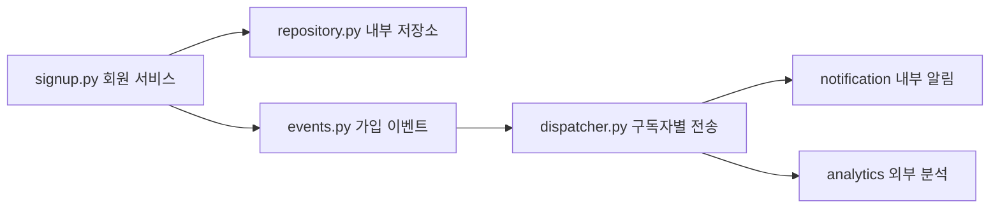

# 가입 이벤트 개인정보 전파: 구조 맥락 유무 비교

2026-10-23. 2단계만 실행했다. 비전 조건은 **완벽한 구조 인식을 가정한 텍스트→작업 지시문→코딩 모델**이며 실제 이미지 인식이나 Qwen 성능 측정이 아니다. 두 조건 모두 OpenAI `gpt-5.4-mini-2026-03-17`로 한 번 생성했다. 기존 서비스는 수정하지 않고 합성 fixture와 별도 후보만 생성했다.

## 데이터와 동일 조건

Python 5파일 및 topology.json을 양쪽에 모두 제공했다. 회원 DB는 메모리 사전, 외부 수신처는 메모리 목록으로 모사했다. 실제 HTTP·큐·DB 서버는 없다. 외부 전송 금지 정책과 수신처 신뢰 영역/phoneAllowed 정보는 코드만 조건에도 동일하게 제공했다. 구조 조건만 추가로 같은 사실을 정리한 맥락을 받아 자연어 지시문을 생성했다. 원래 그림의 실제 이미지 인식이나 Flink/Lichu의 실서비스 통합 검증으로 해석하지 않는다.

공통 변경 요구는 선택적 전화번호 추가, ASCII 010+8자리 검증, 내부 저장·알림 사용, 외부 분석 유출 금지, 가입 이벤트·기존 가입 유지다. 수정 가능 파일은 signup.py/events.py/dispatcher.py뿐이다. 테스트·저장소·수신처·배포 설정은 모델 수정 대상이 아니며 평가 테스트는 프롬프트에 전달하지 않았다.

검증 전 안전장치로 단순히 전화번호만 추가한 취약 대조군을 실행했다. 기능 4개는 유지되지만 외부 전화번호 유출과 수신처별 분리, 잘못된 입력 거절에 실패하여 4/10이다. 모델 후보는 이 대조군을 직접 받지 않고 동일한 원래 소스에서 요구사항을 구현했다.

## 실측 비교

| 지표 | 구조 설명 없음 | 정확한 구조 맥락→지시문 추가 |
|---|---:|---:|
| 입력 파일(설정 포함) | 6 | 6 |
| 기능·경로 분리 테스트 | 5/5 | 5/5 |
| 보안 테스트 | 5/5 | 5/5 |
| 전체 통과 | **10/10** | **10/10** |
| 외부 전파 위험 설명 | 있음 | 있음 |
| 코드 생성 API 시간 | 5.21초 | 3.81초 |
| 지시문 포함 모델 시간 | **5.21초** | 7.16초 |
| 코드 입력 토큰 | 552 | 995 |
| 코드 출력 토큰 | 1,227 | 823 |
| 지시문 포함 입력 토큰 | 552 | 1,296 |
| 지시문 포함 출력 토큰 | 1,227 | 1,322 |
| 제공자 입력 캐시 | 0 | 0 |
| 코드 생성 추정 비용 | $0.00594 | $0.00445 |
| 지시문 포함 추정 비용 | **$0.00594** | $0.00692 |
| 격리 테스트 시간 | 0.185초 | 0.186초 |

지시문 생성 3.34363초, 입력301/출력499토큰, 추정 $0.00247125. 총 API 3회 비용 약 $0.01286. 기존 가격 기준 입력$0.75/캐시$0.075/출력$4.5(백만 토큰당)을 actual usage에 적용했다. 실제 이미지 인식은 미측정이며 비용 0의 이미지 인식으로 간주하지 않는다. 환경 준비·개발 시간은 표에서 제외했다.

## 테스트 판정과 해석

고정한 10개 테스트: 저장, 내부 알림 전달, 외부 분석 이벤트 유지, 기존 가입, 저장/내부/외부 객체 분리, 외부 원문 노출 금지, 개행·전각 숫자·과대 입력·잘못된 타입 거절. 양쪽 모두 통과했다. 실제 인터넷 공격, 임의의 모든 중첩 데이터·별칭, 암호화, 법적 준수, 전체 서비스 보안은 검증하지 않는다.

위험 설명은 평가자가 별도로 확인했다. 코드만 후보도 signup.py에서 저장된 전화번호가 dispatcher.py의 공통 전송을 거쳐 topology.json의 외부 analytics로 도달한다고 설명했다. 구조 후보는 events.py와 adapters.py까지 연결해서 설명했다. 근거 문장이 더 길거나 파일을 더 많이 언급한 것을 별도 품질 우위 점수로 바꾸지 않았다. 테스트 성공과 모델 설명은 독립 지표다.

구조 후보는 코드 생성만 약 26.8% 짧았으나, 지시문을 포함하면 약 37.4% 길었다. 최초 모델 총 비용도 약 16.6% 증가했다. 한 번씩, 고정 순서이므로 통계적 속도 효과로 확정할 수 없다. 두 모델 출력 길이가 달라 입력 증가가 그대로 지연 증가로 이어진 것도 아니다.

이번 작은 예제는 코드/설정이 명확하고 입력이 충분히 작아 구조 없이도 전파 경로를 알 수 있었다. 따라서 **비전/구조를 추가해야만 탐지 가능한 위험이나 추가적인 방어 성공은 관측하지 못했다.** 정확한 구조 맥락이 쓸모없다는 일반 결론도 낼 수 없다. 작업 간 경계·서비스별 코드가 분산된 경우에 동일 검색 예산을 부여한 후 필요한 경로 발견률과 성공까지 비용을 측정하는 것이 다음 과제다. 비전 없는 조건만 정보를 숨기거나 실패할 때까지 재생성해서는 안 된다.

## 실행 제한과 근거

- 모델 호출 3회, 재시도0, 로컬 모델 실행0.
- 테스트는 네트워크 없는 읽기 전용 Docker, 256MiB/1CPU, 비특권 사용자, 순차 실행.
- `protocol.json`: 호출 전 고정 요구사항·구조 가정·소스/테스트 해시.
- `calls/*-input.json`: 실제 입력·시스템 프롬프트, `calls/*.json`: 응답·시간·토큰.
- `comparison.json`: 실측 비교, 각 조건 `candidate.patch`/`risk.txt`/`validation.json`/`test.log`.
- `unsafe_control`: 취약 대조군과 실패 로그.
- 재현: 저장소 루트에서 `PYTHONPATH=. .venv/bin/python scripts/benchmark_signup_events.py`. 결과가 있으면 덮어쓰지 않고 종료한다.
